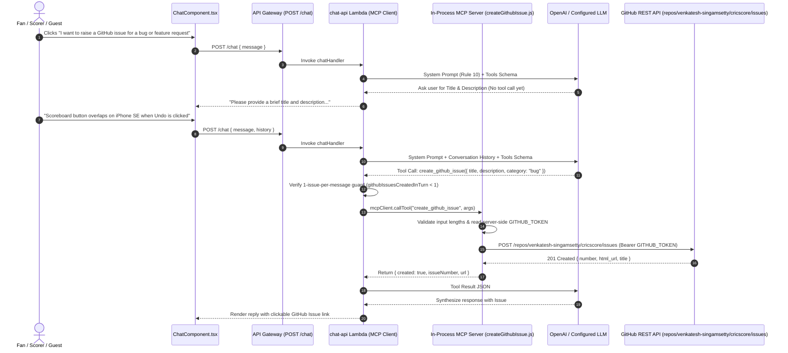

# 🐙 GitHub Issue Specialist Agent & MCP Setup Guide

CricScore includes a dedicated **GitHub Issue Specialist Agent** integrated into the AI Chat Assistant via the **Model Context Protocol (MCP)**. Fans, scorers, and guests can report bugs, UI issues, or feature requests directly from the Chat Bot, creating a labeled issue in `venkatesh-singamsetty/cricscore` without exposing credentials to the browser or LLM.

---

## 🎯 1. Overview & 2-Step Conversational Flow

In the **AI Chat Assistant** (`ChatComponent.tsx`), users can click the suggested prompt chip **`7. "I want to report a bug or request a new feature"`** or type a report directly. To prevent accidental or blank issues, `chatHandler.js` (`Rule 10`) and `apps/ai-service/cricscore_ai/graph.py` (`github_issue_node`) enforce a strict **2-step confirmation protocol**:

| Step  | User Input Scenario                                                                                  | Agent Action                                                        | Tool Invoked? | Response / Outcome                                                                                                                       |
| :---: | :--------------------------------------------------------------------------------------------------- | :------------------------------------------------------------------ | :-----------: | :--------------------------------------------------------------------------------------------------------------------------------------- |
| **1** | • Generic intent<br/>• e.g., clicks chip _"I want to report a bug or request a new feature"_         | • Prompts user for a concrete **Title** & **Description**           |   ❌ **No**   | • _"Please provide a brief title and description of the bug or feature request you'd like to raise on GitHub..."_                        |
| **2** | • User provides details<br/>• e.g., _"Scoreboard button overlaps on iPhone SE when Undo is clicked"_ | • Validates inputs<br/>• Calls `create_github_issue` via MCP server |  ✅ **Yes**   | • Creates GitHub issue with `["via-cricscore-ai", category]` labels<br/>• Returns the **Issue `#`** and **clickable GitHub URL** in chat |

### Tool Input Schema (`create_github_issue`)

| Parameter     | Type                | Validation Rule                                                                  | Description                                                                 |
| :------------ | :------------------ | :------------------------------------------------------------------------------- | :-------------------------------------------------------------------------- |
| `title`       | `string` (required) | • `5 – 120` characters (trimmed)<br/>• Automatically prefixed with `[AI Report]` | • Concise summary of the bug, UI issue, or feature request                  |
| `description` | `string` (required) | • `10 – 2,000` characters (trimmed)                                              | • Steps to reproduce, device/browser context, or requested feature behavior |
| `category`    | `string` (optional) | • Enum: `"bug"` \| `"feature-request"` \| `"feedback"`<br/>• Defaults to `"bug"` | • Attached as a GitHub issue label alongside `"via-cricscore-ai"`           |
| `matchId`     | `string` (optional) | • Optional UUID / identifier                                                     | • Included in the issue metadata block when reported from an active match   |

---

## 🏗️ 2. Architecture & Sequence Flow



---

## 🔒 3. Security & Abuse Guardrails

Because `POST /chat` is open to both authenticated scorers and guests, the GitHub Issue Agent enforces 5 server-side security guardrails:

| Guardrail                      | Implementation                                                                                                               | Purpose                                                                                                                                         |
| :----------------------------- | :--------------------------------------------------------------------------------------------------------------------------- | :---------------------------------------------------------------------------------------------------------------------------------------------- |
| **Zero Secret Exposure**       | • `GITHUB_TOKEN` is read strictly inside `createGithubIssue.js` / `tools.py` on the server                                   | • The LLM and browser client never see or receive the GitHub token                                                                              |
| **Fixed Repository Allowlist** | • `DEFAULT_GITHUB_REPO = "venkatesh-singamsetty/cricscore"`<br/>• Validated against `/^[A-Za-z0-9_.-]+\/[A-Za-z0-9_.-]+$/`   | • Callers cannot supply an arbitrary repository URL<br/>• Prevents SSRF and cross-repository spam                                               |
| **1-Issue-Per-Message Cap**    | • `githubIssuesCreatedInTurn` counter in `chatHandler.js` tool execution loop                                                | • Even if a prompt-injected message tricks the LLM into emitting multiple `create_github_issue` calls in one turn, only the first call executes |
| **Input Length Validation**    | • `validateGithubIssueInput()` requires `title >= 5 chars` (max `120`)<br/>• Requires `description >= 10 chars` (max `2000`) | • Rejects blank or noisy issues<br/>• Strictly bounds GitHub API payload size                                                                   |
| **Audit Labels & Metadata**    | • Automatically applies `["via-cricscore-ai", category]` labels<br/>• Prefixes title with `[AI Report]`                      | • Clearly tags every AI-created issue with environment (`dev`/`prod`), category, and UTC timestamp                                              |

---

## ⚙️ 4. Setup & Configuration Matrix

| Layer                       | File / Secret Location                                             | Configuration Variable / Secret                                   | Required Permission / Value                                                              |
| :-------------------------- | :----------------------------------------------------------------- | :---------------------------------------------------------------- | :--------------------------------------------------------------------------------------- |
| **1. GitHub PAT**           | GitHub → Settings → Developer settings → Fine-grained PAT          | • `GITHUB_TOKEN`<br/>• `secrets.GH_PAT`                           | • Scoped to `venkatesh-singamsetty/cricscore`<br/>• Permission: **Issues: Read & Write** |
| **2. Local Dev Env**        | `.env.local` (repo root)                                           | • `GITHUB_TOKEN`<br/>• `GITHUB_REPO` (optional)                   | • Automatically exported as `TF_VAR_github_token` by `deploy.sh`                         |
| **3. Terraform IaC**        | • `infra/terraform/variables.tf`<br/>• `infra/terraform/lambda.tf` | • `var.github_token` (`sensitive = true`)<br/>• `var.github_repo` | • Injected into `module "chat_api"` Lambda environment variables                         |
| **4. GitHub Actions CI/CD** | • `.github/workflows/ci.yml`<br/>• `.github/workflows/cd.yml`      | • `TF_VAR_github_token: ${{ secrets.GH_PAT }}`                    | • Hydrates `chat-api` Lambda across both `dev` and `prod` deployments                    |

```bash
# Add GitHub Issue Agent token to local .env.local and deploy to dev
cat << 'EOF' >> .env.local
GITHUB_TOKEN='ghp_your_personal_access_token_here'
GITHUB_REPO='venkatesh-singamsetty/cricscore'
EOF

./infra/scripts/deploy.sh --env dev --use-local-env
```

---

## 🧪 5. Key Files & Verification Commands

| Subsystem                       | File Path                                                                                                                                          | Responsibility                                                                                     |
| :------------------------------ | :------------------------------------------------------------------------------------------------------------------------------------------------- | :------------------------------------------------------------------------------------------------- |
| **Node.js MCP Tool**            | [`apps/backend/lambdas/chat-api/mcp/tools/createGithubIssue.js`](../apps/backend/lambdas/chat-api/mcp/tools/createGithubIssue.js)                  | • Input validation and length checks<br/>• GitHub REST API `POST` and audit metadata block         |
| **MCP Server Registry**         | [`apps/backend/lambdas/chat-api/mcp/server.js`](../apps/backend/lambdas/chat-api/mcp/server.js)                                                    | • Registers `create_github_issue` schema on the in-memory MCP server                               |
| **Supervisor & Rate Guard**     | [`apps/backend/lambdas/chat-api/handlers/chatHandler.js`](../apps/backend/lambdas/chat-api/handlers/chatHandler.js)                                | • Enforces `Rule 10` 2-step prompt<br/>• Enforces `githubIssuesCreatedInTurn` 1-issue-per-turn cap |
| **Python LangGraph Specialist** | • [`apps/ai-service/cricscore_ai/tools.py`](../apps/ai-service/cricscore_ai/tools.py)<br/>• [`graph.py`](../apps/ai-service/cricscore_ai/graph.py) | • Implements `create_github_issue` tool<br/>• Runs `github_issue_node` specialist agent            |
| **Frontend Chat UI**            | [`apps/frontend/src/components/ChatComponent.tsx`](../apps/frontend/src/components/ChatComponent.tsx)                                              | • Renders prompt chip `#7`<br/>• Formats clickable GitHub issue links (`target="_blank"`)          |

```bash
# 1. Run Backend MCP tool & handler unit tests
npm --prefix apps/backend test -- --run

# 2. Run Python LangGraph multi-agent tests
./apps/ai-service/.venv/bin/pytest apps/ai-service -q

# 3. Run Frontend ChatComponent tests
npm --prefix apps/frontend test -- --run src/test/ChatComponent.test.tsx
```

---

## 🔗 Related Documentation

- [**AI Architecture (Agentic RAG & MCP)**](./ai_architecture.md)
- [**Weather Report Specialist Agent Guide**](./weather_report_agent.md)
- [**Architecture & AI/MLOps FAQ**](./architecture_faq.md)
- [**Full Deployment Guide**](./deployment.md)
