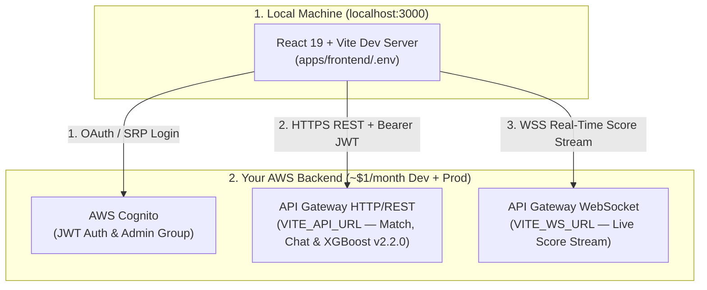

# ⚡ CricScore Frontend Quickstart (Local Dev Against Your Backend)

Run the React 19 + Vite frontend locally at `http://localhost:3000` connected to your own deployed AWS backend (`~$1/month` combined Dev + Prod footprint):

- **REST API**: `API Gateway HTTP/REST` (`VITE_API_URL`)
- **Live Score Stream**: `API Gateway WebSocket` (`VITE_WS_URL`)
- **Authentication**: `AWS Cognito` (`Admin` & `Scorer` groups)

> [!IMPORTANT]
> Connect only to a backend deployment you own or are authorized to test against. Never commit `apps/frontend/.env` to version control.

---

## 🏗️ Local Frontend-to-Cloud Architecture



---

## 🛠️ 3-Step Quickstart

### Step 1: Clone & Install Dependencies (Node.js 24+)

```bash
# Install Node 24 via nvm if needed: nvm install 24 && nvm use 24
git clone https://github.com/venkatesh-singamsetty/cricscore.git
cd cricscore
npm install
```

### Step 2: Configure `apps/frontend/.env`

Copy the template and populate the values from your deployment outputs:

```bash
cp apps/frontend/.env.example apps/frontend/.env
```

| Environment Variable        |  Required  | Example / Format                                        |
| :-------------------------- | :--------: | :------------------------------------------------------ |
| `VITE_API_URL`              |   `Yes`    | `https://<api-id>.execute-api.us-east-1.amazonaws.com`  |
| `VITE_WS_URL`               |   `Yes`    | `wss://<ws-id>.execute-api.us-east-1.amazonaws.com/dev` |
| `VITE_COGNITO_REGION`       |   `Yes`    | `us-east-1`                                             |
| `VITE_COGNITO_USER_POOL_ID` |   `Yes`    | `us-east-1_XXXXXXXXX`                                   |
| `VITE_COGNITO_CLIENT_ID`    |   `Yes`    | `1234567890abcdefghijklmnop`                            |
| `VITE_COGNITO_DOMAIN`       |   `Yes`    | `cricscore-dev-auth.auth.us-east-1.amazoncognito.com`   |
| `VITE_SENTRY_DSN`           | `Optional` | `https://...@o0.ingest.sentry.io/...`                   |

#### Environment Variable Reference

- **1. `VITE_API_URL` (`Required`):**
  - REST API Gateway endpoint handling matches, ball-by-ball scoring, **XGBoost `v2.2.0`** win predictions (`xgboost-cpu ~309 MB`, ECR `countNumber = 1`), and ChatBot queries.
- **2. `VITE_WS_URL` (`Required`):**
  - WebSocket API Gateway endpoint streaming real-time scoreboard and `HUB_UPDATE` broadcasts.
- **3. `VITE_COGNITO_REGION` & `VITE_COGNITO_USER_POOL_ID` (`Required`):**
  - AWS region (`us-east-1`) and Cognito User Pool ID for Scorer and Admin authentication.
- **4. `VITE_COGNITO_CLIENT_ID` & `VITE_COGNITO_DOMAIN` (`Required`):**
  - Cognito App Client ID and Hosted UI domain for browser SRP/OAuth login.
- **5. `VITE_SENTRY_DSN` (`Optional`):**
  - Optional frontend crash reporting DSN.

> [!TIP]
> If you deployed the backend from this machine using `./infra/scripts/deploy.sh --env dev --use-local-env`, these variables are automatically populated for you.

### Step 3: Start the Dev Server & Run Frontend Tests

```bash
# Start Vite with Hot Module Replacement at http://localhost:3000
npm run dev --prefix apps/frontend

# Run the 151 Frontend Vitest unit & component tests (part of the 376 unit + 15 E2E suite)
npm test --prefix apps/frontend
```

---

## 🔐 Authentication & Admin Access Model

| Role       | Authentication Method                   | Primary Scope                          |
| :--------- | :-------------------------------------- | :------------------------------------- |
| **Viewer** | No login required (`Guest` spectator)   | Live scoreboards, win prob & AI Chat   |
| **Scorer** | Sign in via AWS Cognito (or Guest mode) | Create matches & score ball-by-ball    |
| **Admin**  | Cognito user in exact `Admin` group     | Match Ops, Rulebooks & DB bulk cleanup |

- **1. Viewer (Public Spectator):**
  - Watch live ball-by-ball WebSocket updates and worm charts without logging in.
  - View hybrid win probabilities (**XGBoost `v2.2.0`** + Markov DP + DLS) and query the AI ChatBot.
- **2. Scorer (Authenticated or Guest Scorer):**
  - Create new matches, configure squads and toss details, and record live ball-by-ball events.
  - Trigger post-match AI summaries and deterministic Player of the Match awards.
- **3. Admin (`Admin` Cognito Group):**
  - Access the **Match Ops** drawer and System Access view.
  - Upload or delete tournament rulebook RAG documents and purge guest, incomplete, or `TEST 🧪` matches.
