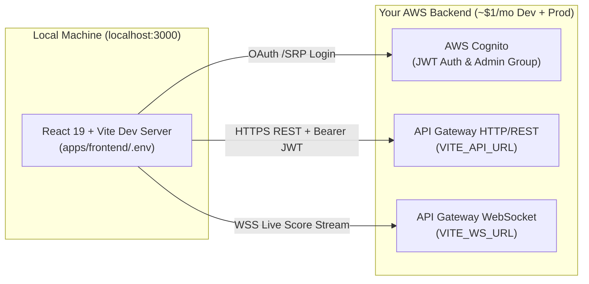

# ⚡ CricScore Frontend Quickstart (Local Dev Against Your Backend)

Run the React 19 + Vite frontend locally at `http://localhost:3000` connected to your own deployed AWS backend (`API Gateway REST`, `API Gateway WebSocket`, and `AWS Cognito`).

> [!IMPORTANT]
> Connect only to a backend deployment you own or are authorized to test against. Never commit `apps/frontend/.env` to version control.

---

## 🏗️ Local Frontend-to-Cloud Architecture



---

## 🛠️ 3-Step Quickstart

### Step 1: Clone & Install Dependencies (Node.js 24+)

```bash
# Install Node 24 via nvm if needed: nvm install 24 && nvm use 24
git clone https://github.com/venkatesh-singamsetty/cricscore.git
cd cricscore
npm install
```

### Step 2: Configure `apps/frontend/.env`

Copy the template and populate the values from your deployment outputs:

```bash
cp apps/frontend/.env.example apps/frontend/.env
```

| Environment Variable        | Required | Example / Source                                        | Purpose                                              |
| --------------------------- | -------- | ------------------------------------------------------- | ---------------------------------------------------- |
| `VITE_API_URL`              | Yes      | `https://<api-id>.execute-api.us-east-1.amazonaws.com`  | REST API Gateway endpoint for matches, scoring, chat |
| `VITE_WS_URL`               | Yes      | `wss://<ws-id>.execute-api.us-east-1.amazonaws.com/dev` | WebSocket API Gateway endpoint for live scoreboard   |
| `VITE_COGNITO_REGION`       | Yes      | `us-east-1`                                             | AWS region hosting your Cognito User Pool            |
| `VITE_COGNITO_USER_POOL_ID` | Yes      | `us-east-1_XXXXXXXXX`                                   | Cognito User Pool ID for scorer/admin authentication |
| `VITE_COGNITO_CLIENT_ID`    | Yes      | `1234567890abcdefghijklmnop`                            | Cognito App Client ID                                |
| `VITE_COGNITO_DOMAIN`       | Yes      | `cricscore-dev-auth.auth.us-east-1.amazoncognito.com`   | Hosted UI / OAuth domain                             |
| `VITE_SENTRY_DSN`           | Optional | `https://...@o0.ingest.sentry.io/...`                   | Optional crash reporting DSN                         |

> [!TIP]
> If you deployed the backend from this machine using `./infra/scripts/deploy.sh --env dev --use-local-env`, these variables are automatically populated for you.

### Step 3: Start the Dev Server & Run Frontend Tests

```bash
# Start Vite with Hot Module Replacement at http://localhost:3000
npm run dev --prefix apps/frontend

# Run the 151 Frontend Vitest unit & component tests (part of the 376 total test suite)
npm test --prefix apps/frontend
```

---

## 🔐 Authentication & Admin Access Model

| Role       | How to Authenticate                                    | Authorized Capabilities                                                    |
| ---------- | ------------------------------------------------------ | -------------------------------------------------------------------------- |
| **Viewer** | No login required (Guest)                              | Watch live ball-by-ball updates, win probabilities, and query the ChatBot  |
| **Scorer** | Sign in via AWS Cognito                                | Create matches, record ball-by-ball events, and trigger AI match summaries |
| **Admin**  | Sign in with a Cognito user in the exact `Admin` group | Access Match Ops, upload/delete tournament rulebooks, and manage data      |
