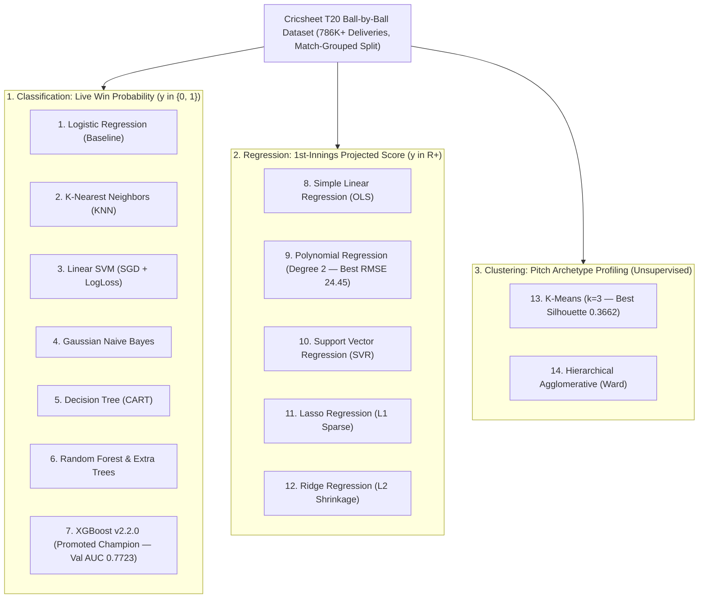

# CricScore Machine Learning Models Revision Handbook

This handbook provides an engineering and theoretical reference for **14 fundamental machine learning algorithms** across **Classification**, **Regression**, and **Clustering**, grounded in empirical benchmarks on the CricScore Cricsheet T20 dataset (`786K+` deliveries).

---

## 📑 Table of Contents

1. [Architectural Overview & Problem Formulations](#architectural-overview) — How Classification, Regression, and Clustering map to live T20 match analytics.
2. [🎯 Classification Models (Win Probability Prediction)](#classification-models) — Predicting 2nd-innings chase victory probability $P(y=1\mid X)$:
   - [1. Logistic Regression](#1-logistic-regression) — Linear log-odds baseline (`Val LogLoss = 0.8069`).
   - [2. K-Nearest Neighbors (KNN)](#2-k-nearest-neighbors-knn) — Distance-based historical scoreboard lookup (`66.15 ms` lazy scan).
   - [3. Support Vector Machine (SVM)](#3-support-vector-machine-svm) — Maximum-margin linear classifier with Platt scaling (`Val ROC-AUC = 0.7704`).
   - [4. Naive Bayes (Gaussian)](#4-naive-bayes-gaussian) — Conditional independence baseline showing why correlated cricket features fail (`LogLoss = 9.5548`).
   - [5. Decision Tree](#5-decision-tree) — Depth-regularized axis-aligned threshold rules (`1.19 ms` latency).
   - [6. Random Forest (Ensemble Bagging)](#6-random-forest-ensemble-bagging) — Variance-reducing bootstrap tree ensemble (`Val LogLoss = 0.6136`).
   - [7. XGBoost (Extreme Gradient Boosting)](#7-xgboost-extreme-gradient-boosting) — 🏆 Production Champion (`v2.2.0`, `Val LogLoss = 0.5786`, `Val ROC-AUC = 0.7723`).
3. [📈 Regression Models (1st-Innings Projected Score)](#regression-models) — Forecasting final 1st-innings totals from live delivery states:
   - [8. Simple Linear Regression (SLR)](#8-simple-linear-regression-slr) — Unregularized Ordinary Least Squares baseline (`RMSE = 25.10`).
   - [9. Polynomial Regression](#9-polynomial-regression) — 🏆 Degree-2 interaction model capturing death-over acceleration (`RMSE = 24.45`).
   - [10. Support Vector Regression (SVR)](#10-support-vector-regression-svr) — $\epsilon$-insensitive tube regression robust to outlier overs.
   - [11. Lasso Regression (L1 Regularization)](#11-lasso-regression-l1-regularization) — Sparse feature selection eliminating collinear ball counters.
   - [12. Ridge Regression (L2 Regularization)](#12-ridge-regression-l2-regularization) — $L_2$ weight shrinkage stabilizing correlated predictors.
4. [🎡 Clustering Models (Pitch & Match Condition Profiling)](#clustering-models) — Unsupervised discovery of venue and pitch archetypes:
   - [13. K-Means Clustering](#13-k-means-clustering) — 🏆 Centroid partitioning into Batting Paradise, Balanced, and Bowling Minefield (`Silhouette = 0.3662`).
   - [14. Hierarchical (Agglomerative) Clustering](#14-hierarchical-agglomerative-clustering) — Bottom-up Ward linkage venue similarity tree.
5. [📊 Empirical CricScore Benchmark Summary](#empirical-benchmark-summary) — Complete side-by-side validation and held-out test metrics table.
6. [💡 System Design & Interview Trap Cheat Sheet](#system-design--interview-cheat-sheet) — Key engineering answers on leakage-free splits, LogLoss vs. Accuracy, and hybrid DP+ML.

---

## <a name="architectural-overview"></a>1. Architectural Overview & Problem Formulations



- **1. Classification (Live Ball-by-Ball Match Win Probability):**
  - **Target Variable ($y$):** Binary Winner $\in \{0, 1\}$.
  - **Feature Vector ($X$):** Categorical (`batting_team`, `bowling_team`, `inning`) + Numeric (`balls_left`, `current_score`, `wickets_lost`, `target_score`).
  - **Primary Metrics:** **Log Loss** (probability calibration), **Brier Score**, and **ROC-AUC**.
- **2. Regression (1st-Innings Projected Final Score):**
  - **Target Variable ($y$):** Continuous Final Runs $\in \mathbb{R}^+$.
  - **Feature Vector ($X$):** `current_score`, `balls_bowled`, `balls_left`, `wickets_lost`, and `current_run_rate`.
  - **Primary Metrics:** **RMSE** (Runs), **MAE** (Runs), and **$R^2$ Score**.
- **3. Clustering (Pitch Condition & Scoring Environment Profiling):**
  - **Target Variable ($y$):** Unsupervised Archetypes $k \in \{1, 2, 3\}$.
  - **Feature Vector ($X$):** Final innings score, average runs per over (`RPO`), and total wickets fallen.
  - **Primary Metrics:** **Silhouette Score** and **WCSS Inertia**.

---

## <a name="classification-models"></a>2. 🎯 Classification Models (Win Probability Prediction)

### 1. Logistic Regression

- **Mathematical Formulation:** $P(y=1\mid X) = \sigma(w^T X + b) = \frac{1}{1 + e^{-(w^T X + b)}}$, minimizing Binary Cross-Entropy (Log Loss).
- **Cricket Context:** Foundational baseline modeling log-odds of victory as a linear combination of remaining balls, runs, and wickets.
- **CricScore Benchmark:**
  - Validation LogLoss: `0.8069` (Brier `0.2379`, ROC-AUC `0.7550`, Accuracy `65.59%`).
  - Model Size & Latency: `0.01 MB`, `1.52 ms` per 100 rows.
- **Trade-Offs:** ✅ Ultra-fast inference and direct log-odds interpretability; ❌ cannot capture non-linear interactions between wickets and death overs.

### 2. K-Nearest Neighbors (KNN)

- **Mathematical Formulation:** $\hat{P}(y=1\mid x_q) = \frac{1}{k} \sum_{i \in \mathcal{N}_k(x_q)} \mathbb{I}(y_i = 1)$ using Euclidean distance $d(x,z)$ over scaled features.
- **Cricket Context:** Predicts outcome from the $k=7$ historical deliveries with the closest scoreboard state ($R$ runs, $W$ wickets, $B$ balls left).
- **CricScore Benchmark:**
  - Validation LogLoss: `8.7168` (Brier `0.2784`, ROC-AUC `0.7185`, Accuracy `69.65%`).
  - Latency (100 rows): **`66.15 ms`** ⚠️ (`33x` slower than XGBoost).
- **Trade-Offs:** ✅ Non-parametric local lookup; ❌ **$O(N \cdot D)$ lazy inference** scans 84K+ training rows per ball and yields uncalibrated step probabilities.

### 3. Support Vector Machine (SVM)

- **Mathematical Formulation:** $\min_{w,b,\xi} \frac{1}{2}\|w\|^2 + C\sum \xi_i$, calibrated via log-loss / Platt scaling $\hat{P}(y=1\mid x) = \frac{1}{1+\exp(Af(x)+B)}$.
- **Cricket Context:** Finds the maximum-margin hyperplane separating winning and losing chase trajectories in standardized feature space.
- **CricScore Benchmark:**
  - Validation LogLoss: `0.6526` (Brier `0.2148`, ROC-AUC `0.7704`, Accuracy `67.55%`).
  - Model Size & Latency: `0.01 MB`, `1.32 ms` per 100 rows.
- **Trade-Offs:** ✅ Strong ROC-AUC (`0.7704`) and tiny memory footprint; ❌ kernel SVM ($O(N^3)$) cannot scale to 100K+ rows without linear SGD approximation.

### 4. Naive Bayes (Gaussian)

- **Mathematical Formulation:** $P(y=c \mid X) \propto P(y=c) \prod_{j=1}^D \mathcal{N}(x_j; \mu_{cj}, \sigma_{cj}^2)$, assuming strict conditional feature independence given $y$.
- **Cricket Context:** Treats `balls_left`, `current_score`, and `wickets_lost` as independent Gaussian distributions per class.
- **CricScore Benchmark:**
  - Validation LogLoss: **`9.5548`** ❌ (Brier `0.3515`, ROC-AUC `0.6487`, Accuracy `64.36%`).
  - Model Size & Latency: `0.01 MB`, `1.81 ms` per 100 rows.
- **Trade-Offs:** ✅ Sub-second training speed; ❌ **violates cricket physics** because `balls_left` and `current_score` are strongly correlated, causing extreme overconfidence.

### 5. Decision Tree

- **Mathematical Formulation:** Recursive binary partitioning minimizing Gini Impurity $\text{Gini}(S) = 1 - \sum_{k} p_k^2$, regularized with `max_depth = 6`.
- **Cricket Context:** Learns explicit coaching thresholds (e.g., `IF balls_left <= 18 AND runs_needed > 36 AND wickets >= 6 THEN win_prob = 0.08`).
- **CricScore Benchmark:**
  - Validation LogLoss: `0.8488` (Brier `0.2014`, ROC-AUC `0.7558`, Accuracy `69.98%`).
  - Model Size & Latency: `0.01 MB`, `1.19 ms` per 100 rows.
- **Trade-Offs:** ✅ Fast (`1.19 ms`) and human-interpretable rules; ❌ high variance and coarse piecewise-constant probability steps.

### 6. Random Forest (Ensemble Bagging)

- **Mathematical Formulation:** $\hat{P}(y=1\mid x) = \frac{1}{B}\sum_{b=1}^B T_b(x)$, averaging predictions across $B=50$ de-correlated bootstrap trees (`max_depth = 10`).
- **Cricket Context:** Reduces single-tree variance by averaging probability estimates across diverse match sub-samples and feature subsets.
- **CricScore Benchmark:**
  - Validation LogLoss: `0.6136` (Brier `0.2119`, ROC-AUC `0.7561`, Accuracy `68.19%`).
  - Model Size & Latency: `0.70 MB`, `15.38 ms` per 100 rows.
- **Trade-Offs:** ✅ Smooth non-linear boundaries (`0.6136` LogLoss); ❌ `8x` slower inference (`15.38 ms`) and `3x` larger artifact than XGBoost.

### 7. XGBoost (Extreme Gradient Boosting) 🏆

- **Mathematical Formulation:** $\mathcal{L}^{(t)} \approx \sum_{i=1}^N [g_i f_t(x_i) + \frac{1}{2}h_i f_t^2(x_i)] + \gamma T + \frac{1}{2}\lambda \sum w_j^2$, configured with `n_estimators=100, max_depth=6, lr=0.1`.
- **Cricket Context:** Sequentially fits 2nd-order gradient/Hessian residuals to capture non-linear phase transitions, wicket pressure, and RRR cliffs.
- **CricScore Benchmark:**
  - Validation Metrics: **LogLoss `0.5786`** 🏆, **Brier `0.1992`** 🏆, **ROC-AUC `0.7723`** 🏆 (`68.35%` Acc).
  - Held-Out Test Metrics: **Test ROC-AUC `0.7529`**, **Test Accuracy `69.01%`** (`0.22 MB` size, `1.98 ms` latency).
- **Trade-Offs:** ✅ Best probability calibration, highest ROC-AUC, compact `227 KB` pipeline, and `<2 ms` CPU inference (`xgboost-cpu ~309 MB`, `countNumber = 1`); ❌ requires $\eta$/depth tuning.

---

## <a name="regression-models"></a>3. 📈 Regression Models (1st-Innings Projected Score)

- **<a name="8-simple-linear-regression-slr"></a>8. Simple Linear Regression (SLR):**
  - **Objective:** $\min_w \|y - Xw\|_2^2$.
  - **Cricket Role:** Linear run-rate extrapolation ($\text{Final} = \text{Score} + \text{RPO} \times \text{OversLeft}$).
- **<a name="9-polynomial-regression"></a>9. Polynomial Regression (Degree 2) 🏆:**
  - **Objective:** $\hat{y} = w_0 + \sum_j w_j x_j + \sum_{j \le k} w_{jk} x_j x_k$.
  - **Cricket Role:** Captures quadratic death-overs acceleration and interaction between remaining balls and wickets in hand.
- **<a name="10-support-vector-regression-svr"></a>10. Support Vector Regression (SVR $\epsilon$-Tube):**
  - **Objective:** $\min \frac{1}{2}\|w\|^2 + C\sum(\xi_i + \xi_i^*)$ subject to $|y_i - \hat{y}_i| \le \epsilon$.
  - **Cricket Role:** Ignores normal $\pm\epsilon$ run variance and penalizes only extreme outlier overs.
- **<a name="11-lasso-regression-l1-regularization"></a>11. Lasso Regression ($L_1$ Regularization):**
  - **Objective:** $\min_w \|y - Xw\|_2^2 + \lambda \|w\|_1$.
  - **Cricket Role:** Enforces $L_1$ sparsity, zeroing out collinear features (`balls_bowled` when `balls_left` is present).
- **<a name="12-ridge-regression-l2-regularization"></a>12. Ridge Regression ($L_2$ Regularization):**
  - **Objective:** $\min_w \|y - Xw\|_2^2 + \lambda \|w\|_2^2$.
  - **Cricket Role:** Applies $L_2$ shrinkage to stabilize correlated weights (`current_score` vs. `balls_bowled`).

|   #    | Regression Model             |  RMSE (Runs)   |   MAE (Runs)   |   $R^2$ Score   | Train Time |
| :----: | :--------------------------- | :------------: | :------------: | :-------------: | :--------: |
| **8**  | **Simple Linear (SLR)**      |    `25.10`     |    `18.24`     |    `0.6186`     |  `0.008s`  |
| **9**  | **Polynomial (Degree 2)** 🏆 | **`24.45`** 🏆 | **`17.50`** 🏆 | **`0.6380`** 🏆 |  `0.046s`  |
| **10** | **SVR ($\epsilon$-Tube)**    |    `25.31`     |    `18.11`     |    `0.6120`     |  `0.026s`  |
| **11** | **Lasso ($L_1$)**            |    `25.29`     |    `18.38`     |    `0.6128`     |  `0.013s`  |
| **12** | **Ridge ($L_2$)**            |    `25.10`     |    `18.24`     |    `0.6186`     |  `0.006s`  |

---

## <a name="clustering-models"></a>4. 🎡 Clustering Models (Pitch & Match Condition Profiling)

- **<a name="13-k-means-clustering"></a>13. K-Means Clustering ($k=3$) 🏆:**
  - **Objective:** $\arg\min_S \sum_{i=1}^k \sum_{x \in S_i} \|x - \mu_i\|^2$ (Voronoi WCSS minimization).
  - **Discovered Pitch Archetypes (`3,310` T20 Innings):**
    - **1. Batting Paradise:** `~201` runs, `10.1` RPO, `4.7` wickets.
    - **2. Balanced Pitch:** `~155` runs, `7.8` RPO, `7.0` wickets.
    - **3. Bowling Minefield:** `~106` runs, `5.5` RPO, `9.0` wickets.
  - **Benchmark:** **Silhouette Score `0.3662`** 🏆 · Runtime `0.31s`.
- **<a name="14-hierarchical-agglomerative-clustering"></a>14. Hierarchical (Agglomerative) Clustering (Ward):**
  - **Objective:** Bottom-up merges minimizing Ward variance $\Delta \text{ESS} = \frac{n_A n_B}{n_A+n_B}\|\mu_A - \mu_B\|^2$.
  - **Discovered Structure:** Builds a nested venue dendrogram grouping grounds by historical scoring pace and wicket fall clusters.
  - **Benchmark:** Silhouette Score `0.3141` · Runtime `0.50s`.

---

## <a name="empirical-benchmark-summary"></a>5. 📊 Empirical CricScore Benchmark Summary

### Classification Benchmark (`apps/ml-engine/compare_models.py` + `KNN` Study)

| Model                  |   Val Acc    | Val LogLoss  | Val ROC-AUC  | Test ROC-AUC |    Latency    |     Size      |     Status      |
| :--------------------- | :----------: | :----------: | :----------: | :----------: | :-----------: | :-----------: | :-------------: |
| **XGBoost (`v2.2.0`)** | **`0.6835`** | **`0.5786`** | **`0.7723`** | **`0.7529`** | **`1.98 ms`** | **`0.22 MB`** | 🏆 **Champion** |
| `HistGradientBoosting` |   `0.6789`   |   `0.5998`   |   `0.7642`   |      —       |   `3.84 ms`   |   `0.37 MB`   | Former Champion |
| `RandomForest`         |   `0.6819`   |   `0.6136`   |   `0.7561`   |      —       |  `15.38 ms`   |   `0.70 MB`   |    Evaluated    |
| `LinearSVM_SGD`        |   `0.6755`   |   `0.6526`   |   `0.7704`   |      —       |   `1.32 ms`   |   `0.01 MB`   |    Evaluated    |
| `ExtraTrees`           |   `0.6667`   |   `0.6532`   |   `0.7118`   |      —       |  `14.96 ms`   |   `0.71 MB`   |    Evaluated    |
| `LogisticRegression`   |   `0.6559`   |   `0.8069`   |   `0.7550`   |      —       |   `1.52 ms`   |   `0.01 MB`   |    Baseline     |
| `DecisionTree`         |   `0.6998`   |   `0.8488`   |   `0.7558`   |      —       |   `1.19 ms`   |   `0.01 MB`   |    Evaluated    |
| `KNN (k=7)`            |   `0.6965`   |   `8.7168`   |   `0.7185`   |      —       |  `66.15 ms`   |  `>15.0 MB`   |   ❌ Latency    |
| `GaussianNB`           |   `0.6436`   |   `9.5548`   |   `0.6487`   |      —       |   `1.81 ms`   |   `0.01 MB`   |   ❌ LogLoss    |

```bash
# Reproduce the multi-algorithm benchmark and inspect comparison_report.md
python3 apps/ml-engine/compare_models.py --version v2.2.0
cat apps/ml-engine/comparison_report.md
```

---

## <a name="system-design--interview-cheat-sheet"></a>6. 💡 System Design & Interview Trap Cheat Sheet

- **1. Why is Accuracy misleading for live win probability?**
  - **Answer:** Live broadcasting requires **calibrated probabilities**, not binary `0.5` thresholding (`DecisionTree` gets `69.98%` accuracy but poor `0.8488` Log Loss). **Log Loss** and **Brier Score** penalize overconfident errors.
- **2. Why does Gaussian Naive Bayes fail (`LogLoss = 9.55`)?**
  - **Answer:** Naive Bayes assumes $P(X_1, X_2 \mid Y) = P(X_1 \mid Y)P(X_2 \mid Y)$. In cricket, `balls_left` and `current_score` are strongly anti-correlated, so multiplying dependent likelihoods drives probabilities to `0.0001` or `0.9999`.
- **3. Why is KNN unsuitable for AWS Lambda inference?**
  - **Answer:** KNN is a lazy learner with $O(N \cdot D)$ inference complexity (`66.15 ms` per 100 rows and `>15 MB` memory footprint). **XGBoost `v2.2.0`** compiles static depth-6 trees evaluated in **`1.98 ms`** inside a `227 KB` artifact (`xgboost-cpu ~309 MB`, `countNumber = 1`).
- **4. How do you prevent target leakage in cricket datasets?**
  - **Answer:** Partition Train (`70%`), Validation (`15%`), and Test (`15%`) strictly by **`match_id`** (`load_and_split_data()`), never by random row shuffling, and exclude any post-match aggregates or future ball outcomes.
- **5. Lasso ($L_1$) vs. Ridge ($L_2$) for collinear features?**
  - **Answer:** `balls_bowled` and `balls_left = 120 - balls_bowled` are perfectly collinear. **Ridge ($L_2$)** shrinks both weights proportionally, whereas **Lasso ($L_1$)** drives one redundant weight to exact `0`.
- **6. How does XGBoost prevent overfitting on rare collapses?**
  - **Answer:** Combines tree-complexity penalty $\gamma T$ and leaf-weight $L_2$ regularization $\frac{1}{2}\lambda \sum w_j^2$, bounds tree depth (`max_depth = 6`), and applies step-size shrinkage (`learning_rate = 0.1`).
