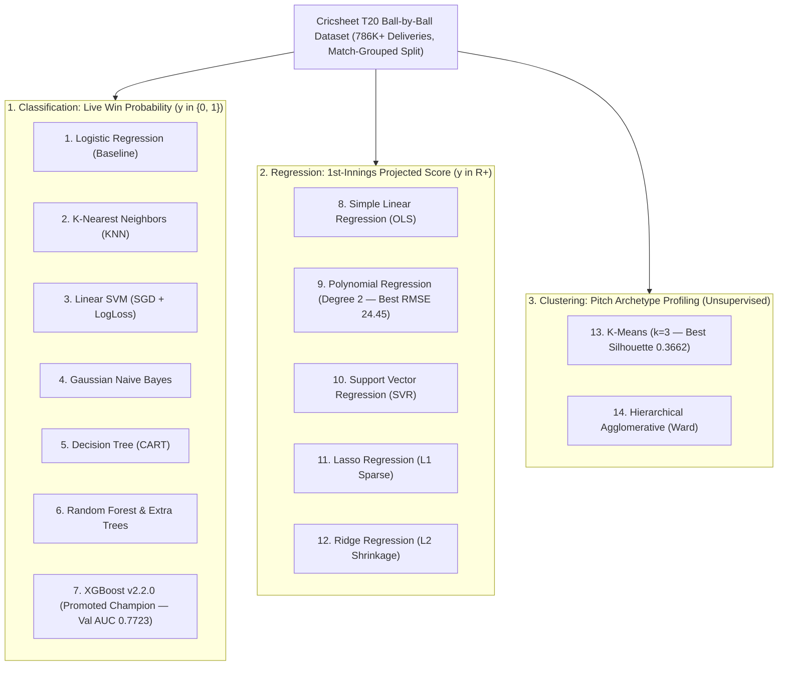

# CricScore Machine Learning Models Revision Handbook

This handbook provides an engineering and theoretical reference for **14 fundamental machine learning algorithms** across **Classification**, **Regression**, and **Clustering**, grounded in empirical benchmarks on the CricScore Cricsheet T20 dataset (`786K+` deliveries).

---

## 📑 Table of Contents

1. [Architectural Overview & Problem Formulations](#architectural-overview)
2. [🎯 Classification Models (Win Probability Prediction)](#classification-models)
   - [1. Logistic Regression](#1-logistic-regression)
   - [2. K-Nearest Neighbors (KNN)](#2-k-nearest-neighbors-knn)
   - [3. Support Vector Machine (SVM)](#3-support-vector-machine-svm)
   - [4. Naive Bayes (Gaussian)](#4-naive-bayes-gaussian)
   - [5. Decision Tree](#5-decision-tree)
   - [6. Random Forest (Ensemble Bagging)](#6-random-forest-ensemble-bagging)
   - [7. XGBoost (Extreme Gradient Boosting)](#7-xgboost-extreme-gradient-boosting)
3. [📈 Regression Models (1st-Innings Projected Score)](#regression-models)
   - [8. Simple Linear Regression (SLR)](#8-simple-linear-regression-slr)
   - [9. Polynomial Regression](#9-polynomial-regression)
   - [10. Support Vector Regression (SVR)](#10-support-vector-regression-svr)
   - [11. Lasso Regression (L1 Regularization)](#11-lasso-regression-l1-regularization)
   - [12. Ridge Regression (L2 Regularization)](#12-ridge-regression-l2-regularization)
4. [🎡 Clustering Models (Pitch & Match Condition Profiling)](#clustering-models)
   - [13. K-Means Clustering](#13-k-means-clustering)
   - [14. Hierarchical (Agglomerative) Clustering](#14-hierarchical-agglomerative-clustering)
5. [📊 Empirical CricScore Benchmark Summary](#empirical-benchmark-summary)
6. [💡 System Design & Interview Trap Cheat Sheet](#system-design--interview-cheat-sheet)

---

## <a name="architectural-overview"></a>1. Architectural Overview & Problem Formulations



| Paradigm           | Target Task                                     | Target Variable ($y$)                     | Feature Vector ($X$)                                                                                                                 | Primary Evaluation Metric                                            |
| :----------------- | :---------------------------------------------- | :---------------------------------------- | :----------------------------------------------------------------------------------------------------------------------------------- | :------------------------------------------------------------------- |
| **Classification** | Live Ball-by-Ball Match Win Probability         | Binary Winner $\in \{0, 1\}$              | • Categorical: `batting_team`, `bowling_team`, `inning`<br/>• Numeric: `balls_left`, `current_score`, `wickets_lost`, `target_score` | • **Log Loss** (Calibration)<br/>• **Brier Score**<br/>• **ROC-AUC** |
| **Regression**     | 1st-Innings Projected Final Score               | Continuous Final Runs $\in \mathbb{R}^+$  | • `current_score`, `balls_bowled`, `balls_left`<br/>• `wickets_lost`, `current_run_rate`                                             | • **RMSE** (Runs)<br/>• **MAE** (Runs)<br/>• **$R^2$ Score**         |
| **Clustering**     | Pitch Condition / Scoring Environment Profiling | Unsupervised Archetypes $k \in \{1,2,3\}$ | • Final innings score<br/>• Average runs per over (`RPO`)<br/>• Total wickets fallen                                                 | • **Silhouette Score**<br/>• **WCSS Inertia**                        |

---

## <a name="classification-models"></a>2. 🎯 Classification Models (Win Probability Prediction)

### 1. Logistic Regression

| Dimension             | Specification                                                                                                                                     |
| :-------------------- | :------------------------------------------------------------------------------------------------------------------------------------------------ |
| **Formulation**       | • $P(y=1\mid X) = \sigma(w^T X + b) = \frac{1}{1 + e^{-(w^T X + b)}}$<br/>• Minimizes Binary Cross-Entropy (Log Loss)                             |
| **Cricket Context**   | • Foundational baseline modeling log-odds of victory as a linear combination of remaining balls, runs, and wickets                                |
| **CricScore Metrics** | • Val LogLoss: `0.8069` & Val Brier: `0.2379`<br/>• Val ROC-AUC: `0.7550` & Val Acc: `65.59%`<br/>• Artifact Size: `0.01 MB` & Latency: `1.52 ms` |
| **Pros & Cons**       | • ✅ Ultra-fast inference and direct log-odds interpretability<br/>• ❌ Cannot capture non-linear interactions between wickets and death overs    |

### 2. K-Nearest Neighbors (KNN)

| Dimension             | Specification                                                                                                                                          |
| :-------------------- | :----------------------------------------------------------------------------------------------------------------------------------------------------- |
| **Formulation**       | • $\hat{P}(y=1\mid x_q) = \frac{1}{k} \sum_{i \in \mathcal{N}_k(x_q)} \mathbb{I}(y_i = 1)$<br/>• Uses Euclidean distance $d(x,z)$ over scaled features |
| **Cricket Context**   | • Predicts outcome from the $k=7$ historical deliveries with the closest scoreboard state ($R$ runs, $W$ wickets, $B$ balls left)                      |
| **CricScore Metrics** | • Val LogLoss: `8.7168` & Val Brier: `0.2784`<br/>• Val ROC-AUC: `0.7185` & Val Acc: `69.65%`<br/>• Latency (100 rows): **`66.15 ms`** ⚠️              |
| **Pros & Cons**       | • ✅ Non-parametric local lookup<br/>• ❌ **$O(N \cdot D)$ lazy inference** scans 84K+ training rows per ball and yields uncalibrated step probs       |

### 3. Support Vector Machine (SVM)

| Dimension             | Specification                                                                                                                                       |
| :-------------------- | :-------------------------------------------------------------------------------------------------------------------------------------------------- |
| **Formulation**       | • $\min_{w,b,\xi} \frac{1}{2}\|w\|^2 + C\sum \xi_i$<br/>• Calibrated via log-loss / Platt scaling $\hat{P}(y=1\mid x) = \frac{1}{1+\exp(Af(x)+B)}$  |
| **Cricket Context**   | • Finds the maximum-margin hyperplane separating winning and losing chase trajectories in standardized feature space                                |
| **CricScore Metrics** | • Val LogLoss: `0.6526` & Val Brier: `0.2148`<br/>• Val ROC-AUC: `0.7704` & Val Acc: `67.55%`<br/>• Artifact Size: `0.01 MB` & Latency: `1.32 ms`   |
| **Pros & Cons**       | • ✅ Strong ROC-AUC (`0.7704`) and tiny memory footprint<br/>• ❌ Kernel SVM ($O(N^3)$) cannot scale to 100K+ rows without linear SGD approximation |

### 4. Naive Bayes (Gaussian)

| Dimension             | Specification                                                                                                                                                  |
| :-------------------- | :------------------------------------------------------------------------------------------------------------------------------------------------------------- |
| **Formulation**       | • $P(y=c \mid X) \propto P(y=c) \prod_{j=1}^D \mathcal{N}(x_j; \mu_{cj}, \sigma_{cj}^2)$<br/>• Assumes strict conditional feature independence given $y$       |
| **Cricket Context**   | • Treats `balls_left`, `current_score`, and `wickets_lost` as independent Gaussian distributions per class                                                     |
| **CricScore Metrics** | • Val LogLoss: **`9.5548`** ❌ & Val Brier: `0.3515`<br/>• Val ROC-AUC: `0.6487` & Val Acc: `64.36%`<br/>• Artifact Size: `0.01 MB` & Latency: `1.81 ms`       |
| **Pros & Cons**       | • ✅ Sub-second training speed<br/>• ❌ **Violates cricket physics**: `balls_left` and `current_score` are strongly correlated, causing extreme overconfidence |

### 5. Decision Tree

| Dimension             | Specification                                                                                                                                     |
| :-------------------- | :------------------------------------------------------------------------------------------------------------------------------------------------ |
| **Formulation**       | • Recursive binary partitioning minimizing Gini Impurity $\text{Gini}(S) = 1 - \sum_{k} p_k^2$<br/>• Regularized with `max_depth = 6`             |
| **Cricket Context**   | • Learns explicit coaching thresholds (e.g., `IF balls_left <= 18 AND runs_needed > 36 AND wickets >= 6 THEN win_prob = 0.08`)                    |
| **CricScore Metrics** | • Val LogLoss: `0.8488` & Val Brier: `0.2014`<br/>• Val ROC-AUC: `0.7558` & Val Acc: `69.98%`<br/>• Artifact Size: `0.01 MB` & Latency: `1.19 ms` |
| **Pros & Cons**       | • ✅ Fast (`1.19 ms`) and human-interpretable rules<br/>• ❌ High variance and coarse piecewise-constant probability steps                        |

### 6. Random Forest (Ensemble Bagging)

| Dimension             | Specification                                                                                                                                      |
| :-------------------- | :------------------------------------------------------------------------------------------------------------------------------------------------- |
| **Formulation**       | • $\hat{P}(y=1\mid x) = \frac{1}{B}\sum_{b=1}^B T_b(x)$<br/>• Averages predictions across $B=50$ de-correlated bootstrap trees (`max_depth = 10`)  |
| **Cricket Context**   | • Reduces single-tree variance by averaging probability estimates across diverse match sub-samples and feature subsets                             |
| **CricScore Metrics** | • Val LogLoss: `0.6136` & Val Brier: `0.2119`<br/>• Val ROC-AUC: `0.7561` & Val Acc: `68.19%`<br/>• Artifact Size: `0.70 MB` & Latency: `15.38 ms` |
| **Pros & Cons**       | • ✅ Smooth non-linear boundaries (`0.6136` LogLoss)<br/>• ❌ `8x` slower inference (`15.38 ms`) and `3x` larger artifact than XGBoost             |

### 7. XGBoost (Extreme Gradient Boosting) 🏆

| Dimension             | Specification                                                                                                                                                                                  |
| :-------------------- | :--------------------------------------------------------------------------------------------------------------------------------------------------------------------------------------------- |
| **Formulation**       | • $\mathcal{L}^{(t)} \approx \sum_{i=1}^N [g_i f_t(x_i) + \frac{1}{2}h_i f_t^2(x_i)] + \gamma T + \frac{1}{2}\lambda \sum w_j^2$<br/>• Configured with `n_estimators=100, max_depth=6, lr=0.1` |
| **Cricket Context**   | • Sequentially fits 2nd-order gradient/Hessian residuals to capture non-linear phase transitions, wicket pressure, and RRR cliffs                                                              |
| **CricScore Metrics** | • **Val LogLoss: `0.5786`** 🏆 & **Val Brier: `0.1992`** 🏆<br/>• **Val ROC-AUC: `0.7723`** 🏆 & **Test ROC-AUC: `0.7529`**<br/>• **Test Acc: `69.01%`**, Size: `0.22 MB`, Latency: `1.98 ms`  |
| **Pros & Cons**       | • ✅ Best probability calibration, highest ROC-AUC, compact `227 KB` pipeline, and `<2 ms` CPU inference (`xgboost-cpu ~309 MB`, `countNumber = 1`)<br/>• ❌ Requires $\eta$/depth tuning      |

---

## <a name="regression-models"></a>3. 📈 Regression Models (1st-Innings Projected Score)

|   #    | Regression Algorithm                                                     | Mathematical Objective                                                                     | Cricket Domain Interpretation                                                                                      |  RMSE (Runs)   |   MAE (Runs)   |   $R^2$ Score   | Train Time |
| :----: | :----------------------------------------------------------------------- | :----------------------------------------------------------------------------------------- | :----------------------------------------------------------------------------------------------------------------- | :------------: | :------------: | :-------------: | :--------: |
| **8**  | <a name="8-simple-linear-regression-slr"></a>**Simple Linear (SLR)**     | $\min_w \|y - Xw\|_2^2$                                                                    | • Linear run-rate extrapolation<br/>• $\text{Final} = \text{Score} + \text{RPO} \times \text{OversLeft}$           |    `25.10`     |    `18.24`     |    `0.6186`     |  `0.008s`  |
| **9**  | <a name="9-polynomial-regression"></a>**Polynomial (Degree 2)** 🏆       | $\hat{y} = w_0 + \sum_j w_j x_j + \sum_{j \le k} w_{jk} x_j x_k$                           | • Captures quadratic death-overs acceleration<br/>• Models interaction between remaining balls and wickets in hand | **`24.45`** 🏆 | **`17.50`** 🏆 | **`0.6380`** 🏆 |  `0.046s`  |
| **10** | <a name="10-support-vector-regression-svr"></a>**SVR ($\epsilon$-Tube)** | $\min \frac{1}{2}\|w\|^2 + C\sum(\xi_i + \xi_i^*)$ s.t. $\|y_i - \hat{y}_i\| \le \epsilon$ | • Ignores normal $\pm\epsilon$ run variance<br/>• Penalizes only extreme outlier overs                             |    `25.31`     |    `18.11`     |    `0.6120`     |  `0.026s`  |
| **11** | <a name="11-lasso-regression-l1-regularization"></a>**Lasso ($L_1$)**    | $\min_w \|y - Xw\|_2^2 + \lambda \|w\|_1$                                                  | • Enforces $L_1$ sparsity<br/>• Zeroes out collinear features (drops `balls_bowled` when `balls_left` is present)  |    `25.29`     |    `18.38`     |    `0.6128`     |  `0.013s`  |
| **12** | <a name="12-ridge-regression-l2-regularization"></a>**Ridge ($L_2$)**    | $\min_w \|y - Xw\|_2^2 + \lambda \|w\|_2^2$                                                | • Applies $L_2$ shrinkage<br/>• Shrinks correlated weights (`current_score` vs `balls_bowled`) smoothly            |    `25.10`     |    `18.24`     |    `0.6186`     |  `0.006s`  |

---

## <a name="clustering-models"></a>4. 🎡 Clustering Models (Pitch & Match Condition Profiling)

|   #    | Clustering Algorithm                                                           | Mathematical Objective                                                                                     | Discovered Cricket Pitch Archetypes (`3,310` T20 Innings)                                                                                                                                         | Silhouette Score | Runtime |
| :----: | :----------------------------------------------------------------------------- | :--------------------------------------------------------------------------------------------------------- | :------------------------------------------------------------------------------------------------------------------------------------------------------------------------------------------------ | :--------------: | :-----: |
| **13** | <a name="13-k-means-clustering"></a>**K-Means ($k=3$)** 🏆                     | $\arg\min_S \sum_{i=1}^k \sum_{x \in S_i} \|x - \mu_i\|^2$ (Voronoi WCSS minimization)                     | • **1. Batting Paradise**: `~201` runs, `10.1` RPO, `4.7` wkts<br/>• **2. Balanced Pitch**: `~155` runs, `7.8` RPO, `7.0` wkts<br/>• **3. Bowling Minefield**: `~106` runs, `5.5` RPO, `9.0` wkts | **`0.3662`** 🏆  | `0.31s` |
| **14** | <a name="14-hierarchical-agglomerative-clustering"></a>**Hierarchical (Ward)** | Bottom-up merges minimizing Ward variance $\Delta \text{ESS} = \frac{n_A n_B}{n_A+n_B}\|\mu_A - \mu_B\|^2$ | • Builds a nested venue dendrogram<br/>• Groups grounds by historical scoring pace and wicket fall clusters                                                                                       |     `0.3141`     | `0.50s` |

---

## <a name="empirical-benchmark-summary"></a>5. 📊 Empirical CricScore Benchmark Summary

### Classification Benchmark (`apps/ml-engine/compare_models.py` + `KNN` Study)

| Model                  | Family              | Val Accuracy | Val Log Loss | Val Brier Score | Val ROC-AUC  | Test ROC-AUC | Latency (100 rows) | Artifact Size |   Production Status   |
| :--------------------- | :------------------ | :----------: | :----------: | :-------------: | :----------: | :----------: | :----------------: | :-----------: | :-------------------: |
| **XGBoost (`v2.2.0`)** | Gradient Boosting   | **`0.6835`** | **`0.5786`** |  **`0.1992`**   | **`0.7723`** | **`0.7529`** |   **`1.98 ms`**    | **`0.22 MB`** |    🏆 **Champion**    |
| `HistGradientBoosting` | Gradient Boosting   |   `0.6789`   |   `0.5998`   |    `0.2063`     |   `0.7642`   |      —       |     `3.84 ms`      |   `0.37 MB`   |    Former Champion    |
| `RandomForest`         | Ensemble Bagging    |   `0.6819`   |   `0.6136`   |    `0.2119`     |   `0.7561`   |      —       |     `15.38 ms`     |   `0.70 MB`   |       Evaluated       |
| `LinearSVM_SGD`        | Max-Margin Linear   |   `0.6755`   |   `0.6526`   |    `0.2148`     |   `0.7704`   |      —       |     `1.32 ms`      |   `0.01 MB`   |       Evaluated       |
| `ExtraTrees`           | Randomized Bagging  |   `0.6667`   |   `0.6532`   |    `0.2302`     |   `0.7118`   |      —       |     `14.96 ms`     |   `0.71 MB`   |       Evaluated       |
| `LogisticRegression`   | Generalized Linear  |   `0.6559`   |   `0.8069`   |    `0.2379`     |   `0.7550`   |      —       |     `1.52 ms`      |   `0.01 MB`   |       Baseline        |
| `DecisionTree`         | Single CART Tree    |   `0.6998`   |   `0.8488`   |    `0.2014`     |   `0.7558`   |      —       |     `1.19 ms`      |   `0.01 MB`   |       Evaluated       |
| `KNN (k=7)`            | Instance-Based      |   `0.6965`   |   `8.7168`   |    `0.2784`     |   `0.7185`   |      —       |     `66.15 ms`     |  `>15.0 MB`   | ❌ Rejected (Latency) |
| `GaussianNB`           | Probabilistic Bayes |   `0.6436`   |   `9.5548`   |    `0.3515`     |   `0.6487`   |      —       |     `1.81 ms`      |   `0.01 MB`   | ❌ Rejected (LogLoss) |

```bash
# Reproduce the multi-algorithm benchmark and inspect comparison_report.md
python3 apps/ml-engine/compare_models.py --version v2.2.0
cat apps/ml-engine/comparison_report.md
```

---

## <a name="system-design--interview-cheat-sheet"></a>6. 💡 System Design & Interview Trap Cheat Sheet

|   #   | System Design / ML Interview Question                       | Key Mathematical & Engineering Answer                                                                                                                                                                                                   |
| :---: | :---------------------------------------------------------- | :-------------------------------------------------------------------------------------------------------------------------------------------------------------------------------------------------------------------------------------- |
| **1** | **Why is Accuracy misleading for live win probability?**    | • Live broadcasting requires **calibrated probabilities**, not binary `0.5` thresholding (`DecisionTree` gets `69.98%` accuracy but poor `0.8488` Log Loss)<br/>• **Log Loss** and **Brier Score** penalize overconfident errors        |
| **2** | **Why does Gaussian Naive Bayes fail (`LogLoss = 9.55`)?**  | • Naive Bayes assumes $P(X_1, X_2 \mid Y) = P(X_1 \mid Y)P(X_2 \mid Y)$<br/>• In cricket, `balls_left` and `current_score` are strongly anti-correlated, so multiplying dependent likelihoods drives probabilities to `0.0001`/`0.9999` |
| **3** | **Why is KNN unsuitable for AWS Lambda inference?**         | • KNN is a lazy learner with $O(N \cdot D)$ inference complexity (`66.15 ms` per 100 rows and `>15 MB` memory footprint)<br/>• **XGBoost `v2.2.0`** compiles static depth-6 trees evaluated in **`1.98 ms`** inside a `227 KB` artifact |
| **4** | **How do you prevent target leakage in cricket datasets?**  | • Partition Train (`70%`), Validation (`15%`), and Test (`15%`) strictly by **`match_id`** (`load_and_split_data()`), never by random row shuffling<br/>• Exclude any post-match aggregates or future ball outcomes                     |
| **5** | **Lasso ($L_1$) vs. Ridge ($L_2$) for collinear features?** | • `balls_bowled` and `balls_left = 120 - balls_bowled` are perfectly collinear<br/>• **Ridge ($L_2$)** shrinks both weights proportionally, whereas **Lasso ($L_1$)** drives one redundant weight to exact `0`                          |
| **6** | **How does XGBoost prevent overfitting on rare collapses?** | • Combines tree-complexity penalty $\gamma T$ and leaf-weight $L_2$ regularization $\frac{1}{2}\lambda \sum w_j^2$<br/>• Bounds tree depth (`max_depth = 6`) and applies step-size shrinkage (`learning_rate = 0.1`)                    |
