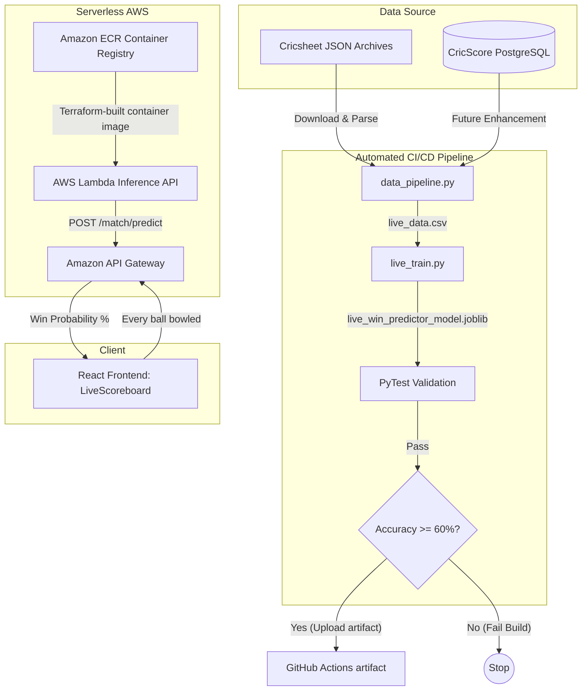

# 🤖 Serverless MLOps Tutorial

This guide walks through the end-to-end Machine Learning Operations (MLOps) pipeline integrated into the CricScore project. The goal of this pipeline is to predict the outcome of a T20 match based on historical data.

The pipeline avoids dedicated GPU instances and always-on inference servers by using GitHub Actions for training and AWS Lambda for inference. Actual costs depend on AWS usage, GitHub plan and usage, and external data or model services.

**Quick Navigation:** [Architecture](#️-1-architecture-overview) · [Data Pipeline](#-2-the-data-pipeline-live_datacsv) · [Training](#-3-model-training-live_trainpy) · [CI/CD Gate](#-4-automated-cicd-gate-mlops-pipelineyml) · [Docker Inference](#️-5-serverless-docker-inference-predictpy) · [Frontend](#️-6-frontend-integration) · [Troubleshooting](#-7-lessons-learned--troubleshooting) · [Win Prediction Spec](#-8-win-prediction-engine-specification) · [DLS Method](#️-9-duckworth-lewis-stern-dls-method)

---

## 🏗️ 1. Architecture Overview



The MLOps pipeline consists of four main stages:

1. **Data Ingestion & Preprocessing**: Automatically downloads raw ball-by-ball JSON data from [Cricsheet](https://cricsheet.org/) and compiles it into a structured tabular format (`live_data.csv`).
2. **Model Training & Multi-Algorithm Benchmarking**: Compares 8 candidate models (Logistic Regression, Gaussian Naive Bayes, Decision Trees, Linear SVM with Platt scaling, Random Forest, Extra Trees, HistGradientBoosting, and **XGBoost**). The training pipeline strictly enforces match-grouped data splitting (70% train, 15% validation, 15% test) to prevent **target leakage** (see detailed analysis in [ML Models Handbook](ml_models_handbook.md)). The winning model (**XGBoost**) is tracked in MLflow and written to `model_manifest.json` with SHA-256 integrity checksums.
3. **Continuous Integration (CI) Quality Gates**: The GitHub Actions workflow (`mlops-pipeline.yml`) runs only when dataset or training scripts change (`cricket-data/**`, `data_pipeline.py`, `compare_models.py`, `train_model.py`, `requirements-train.txt`), monthly on schedule, or by manual dispatch (avoiding redundant retraining on routine PRs). It executes validation quality gates (`accuracy >= 0.60`, `roc_auc >= 0.65`, `size <= 25MB`), tests via `pytest`, and uploads versioned artifacts.
4. **S3 Versioned Model Registry & Serverless Inference**: Terraform uploads versioned model artifacts (`live_win_predictor_model.joblib`, `model_manifest.json`, `live_metadata.json`) to S3 (`s3://<project>-match-backups-.../models/<ml_model_version>/`) and builds/pushes the `apps/ml-engine` Docker image to ECR tagged with both `:<ml_model_version>` (`:v2.2.0`) and `:latest` (with an automated ECR lifecycle policy that expires untagged layers after 1 day). At runtime (`POST /match/predict`), `predict.py` lazily imports heavy ML libraries during the invoke phase (keeping Lambda init `<70ms`), caches `/tmp/models/<MODEL_VERSION>/` from S3, verifies the SHA-256 hash, and blends the model with the Markov Dynamic Programming (DP) and Duckworth-Lewis-Stern (DLS) resource par engine.

---

## 📊 2. The Data Pipeline (`live_data.csv`)

**Location**: `apps/ml-engine/data/live_data.csv` (Ignored by Git)

The data pipeline extracts ball-by-ball match situations instead of just pre-match summaries.

**Key Features Extracted:**

- `current_score`: Total runs scored so far.
- `wickets_lost`: Number of wickets fallen.
- `balls_left`: Remaining balls in the innings.
- `target_score`: The target score to win (if in the 2nd innings, otherwise -1).
- `winner`: The team that ultimately won the match.

The script compiles a highly structured `live_data.csv` into a `.gitignore`'d directory (`apps/ml-engine/data/`) to prevent bloating the Git repository.

---

## 🧠 3. Model Training (`live_train.py`)

**Location**: `apps/ml-engine/live_train.py`

We use a robust `LogisticRegression` model trained on in-match dynamic variables.

**Key ML Concepts Applied:**

- **Dynamic State Evaluation**: The model assesses win probability based on the _current match situation_ rather than static pre-match attributes.
- **Categorical Encoding**: Handles string-based features (Team Names).
- **Artifact Generation**: The pipeline outputs two files:
  - `live_win_predictor_model.joblib`: The serialized model weights.
  - `live_metadata.json`: Contains model version, accuracy metrics, and timestamp.

---

## 🚦 4. Automated CI/CD Gate (`mlops-pipeline.yml`)

**Location**: `.github/workflows/mlops-pipeline.yml`

ML models degrade over time (Data Drift). To keep the model fresh, we need a way to safely retrain it.

This GitHub Action runs when changes under `apps/ml-engine/` are pushed to `main`, on its monthly schedule, or by manual dispatch.

1. It installs dependencies (`scikit-learn`, `pandas`).
2. Runs the data pipeline.
3. Runs the training script.
4. **The Gate**: The training script exits with an error code if the model accuracy falls below acceptable thresholds.
5. The resulting lightweight `.joblib` model artifact is then bundled for deployment.

---

## ☁️ 5. Serverless Docker Inference (`predict.py`)

**Location**: `apps/ml-engine/predict.py` & `apps/ml-engine/Dockerfile`

Instead of deploying a traditional zipped Lambda package, the live model is containerized using Docker and hosted on **AWS ECR (Elastic Container Registry)**.

**Serverless Container Execution (Firecracker MicroVM):**
A common misconception is that a Docker image in ECR requires a running server (like ECS or Fargate) to serve requests. However, AWS Lambda natively supports Docker Images under the hood using **Firecracker MicroVMs**.

- ECR stores the image; storage charges depend on image size, retained image versions, region, and current pricing.
- When an API Gateway request arrives, Lambda invokes the function in a managed execution environment, including a cold start when a warm environment is unavailable.
- Lambda may reuse an execution environment for later requests; it is not necessarily destroyed immediately after a response. Compute charges depend on invocations and execution duration.

**How it works:**

1. **Containerization**: A `Dockerfile` bundles the `live_win_predictor_model.joblib`, `predict.py`, and dependencies into an AWS Lambda Python base image.
2. **ECR Storage**: The image is pushed to a private ECR repository. Check current ECR pricing and account eligibility for storage charges. Updating the mutable `latest` tag does not necessarily remove older image versions; configure image lifecycle cleanup if required. Lambda container images support up to 10GB.
3. **Execution**: The handler accepts a JSON payload of the live match state, executes `model.predict_proba()`, and returns live ball-by-ball win probabilities.

---

## 🖥️ 6. Frontend Integration

**Location**: `apps/frontend/src/components/AiMatchPrediction.tsx`

The React frontend seamlessly integrates with the Lambda endpoint. Inside the Live Scoreboard view, an `AiMatchPrediction` component issues a `POST` request to the API Gateway after every single ball.

The UI visualizes the probabilities using a compact progress bar nestled right inside the scoreboard header, providing fans and scorers with real-time AI insights.

---

## 🛑 7. Lessons Learned & Troubleshooting

During the development of this MLOps pipeline, we faced and resolved several critical infrastructure issues:

- **AWS Lambda Zip Size Limits**: Initially, we deployed the model via standard `.zip` files. However, the combined size of `pandas`, `scikit-learn`, and the `.joblib` model exceeded Lambda's strict 250MB unzipped limit. **Fix**: We migrated the architecture to AWS ECR Docker Container Images, which increased the limit to 10GB.
- **Out-of-Distribution (OOD) Shortened Matches (e.g. 1-Over Matches)**: Logistic regression models trained on T20 data (`balls_left = 120`) misinterpret shortened match features. Raw linear scaling (`9 runs * 120 / 6 = 180 T20 runs`) falsely projects 9 runs in a 1-over match as an invincible 180 T20 score, inflating win probability to 99%. **Fix**: We introduced Par-Adjusted RPO Scaling (`par_rpo = 8.0 + (20.0 - total_overs) * 0.2`) in `predict.py`, which projects shortened match scores against realistic T20 par benchmarks (calibrating 9 runs in 5 balls to a realistic 87% win probability).
- **Batting vs. Bowling Team Mapping Alignment**: The frontend `AiMatchPrediction` component initially passed static `teamA` and `teamB` strings to the API, causing inverted win predictions during 2nd innings when `teamB` was batting. **Fix**: `AiMatchPrediction.tsx` now dynamically passes `battingTeam` as `team1` and `bowlingTeam` as `team2`, ensuring backend predictions match who is actively at the crease.
- **Start of Match Baseline (50% / 50%)**: At the beginning of 1st innings (`currentScore = 0`, `wicketsLost = 0`), the model initially output skewed weights for shortened match configurations. **Fix**: Explicitly enforced a 50% - 50% baseline rule at the start of every match before scoring begins.
- **Impossible Chase Heuristics**: In 2nd innings chases where the required runs exceed maximum physical possibility (`runsNeeded > ballsLeft * 6`), standard ML models can output nonsensical probabilities. **Fix**: Added explicit hard overrides ensuring 0% win probability for the chasing team and 100% for the defending team.

---

### 📊 8. Win Prediction Engine Specification

This section details the exact mathematical models, dynamic-programming ball simulation, DLS-aligned chase hybrid blend, and heuristic overrides powering the real-time AI Match Predictor in CricScore (`apps/ml-engine/predict.py` and `apps/ml-engine/win_probability.py`).

### 🏗️ Inference Pipeline

The live prediction engine calculates real-time win probabilities after every ball by combining:

1. **Format-Agnostic Ball-by-Ball Dynamic Programming (`win_probability.py`)**: Exact recursion over every remaining legal delivery (`1` to `120` balls) and wickets lost (`0` to `9`), adapting ball outcome profiles (`DEFENSIVE`, `NORMAL`, `AGGRESSIVE`) to required run rate, lower-order tail quality (`TAIL_FACTOR`), and match length.
2. **DLS Resource Parity Alignment (2nd Innings)**: When the required run rate is physically achievable (`<= 2.3` runs/ball full weight, tapering smoothly to `0` by `3.0` runs/ball), the engine blends the ball-by-ball DP probability with a logistic DLS Par differential so teams ahead of DLS Par (`currentScore > dlsPar`) with wickets in hand are properly favored (`> 50%`).
3. **T20 Logistic Regression Model Blend (`10–20` Overs)**: For matches longer than 10 overs, the T20-trained model (`live_win_predictor_model.joblib`) is blended in with weight rising linearly from `0.0` at `10` overs to `0.5` at `20` overs.


### 🛑 Hard Heuristic Overrides & Clamping

To guarantee mathematical sanity across all match lengths (`1` to `20` overs), the prediction engine applies strict boundary conditions:

| Scenario               | Rule Condition                                                            | Resulting Win Probability     |
| :--------------------- | :------------------------------------------------------------------------ | :---------------------------- |
| **Match Start**        | `inning == 1` AND `score == 0` AND `wickets == 0` AND `balls_bowled == 0` | **50% Batting / 50% Bowling** |
| **Completed Chase**    | `inning == 2` AND `current_score >= target_score`                         | **100% Batting / 0% Bowling** |
| **All Out / No Balls** | `inning == 2` AND (`wickets_lost >= 10` OR `balls_left <= 0`)             | **0% Batting / 100% Bowling** |
| **Impossible Target**  | `inning == 2` AND `(target_score - current_score) > balls_left * 6 + 1`   | **0% Batting / 100% Bowling** |
| **Undecided Live**     | Any live ball before a decided outcome                                    | **Clamped to `1% – 99%`**     |

---

## 🌧️ 9. Duckworth-Lewis-Stern (DLS) Method

This section details the exact mathematical formulas, Standard Edition resource decay parameters, par score calculations, and tiebreaker rules for the **Duckworth-Lewis-Stern (DLS)** method implemented in CricScore (`apps/frontend/src/utils/dlsUtils.ts` and `apps/ml-engine/win_probability.py`).

### 📐 The Core Concept: Format-Normalized Resources Remaining ($R$)

The DLS method models a batting team's scoring capacity as a function of two fundamental resources:

1. **Overs Remaining** ($u$)
2. **Wickets Lost** ($w$)

Using the Standard Edition exponential form $Z(u, w) = F(w) \cdot (1 - e^{-b \cdot u / F(w)})$ with $b = 0.027$ and $F(w)$ solved against the published 50-over resource row (`[100, 93.4, 85.1, 74.9, 62.7, 49.0, 34.9, 22.0, 11.9, 4.7]`), resources for a match of $N = \text{totalMatchOvers}$ overs are normalized relative to $Z(N, 0)$:

$$R(u, w, N) = \frac{Z(u, w)}{Z(N, 0)} \times 100\%$$

This guarantees that a 1-over, 5-over, 10-over, or 20-over match always begins with exactly `100%` of its resources available.

#### Standard T20 Resource Table ($R_0$ and $b$ parameters):

| Wickets Lost ($w$) | $R_0(w)$ (%) | Decay Constant $b(w)$ | Resource at 20 overs ($u=20$) |
| :----------------: | :----------: | :-------------------: | :---------------------------: |
|       **0**        |    100.0%    |        0.0544         |            100.0%             |
|       **1**        |    93.4%     |        0.0558         |             91.2%             |
|       **2**        |    85.1%     |        0.0575         |             82.5%             |
|       **3**        |    74.9%     |        0.0598         |             72.1%             |
|       **4**        |    62.7%     |        0.0631         |             59.8%             |
|       **5**        |    48.5%     |        0.0682         |             45.8%             |
|       **6**        |    33.1%     |        0.0765         |             30.9%             |
|       **7**        |    18.7%     |        0.0910         |             17.3%             |
|       **8**        |     8.2%     |        0.1200         |             7.5%              |
|       **9**        |     2.1%     |        0.1800         |             1.9%              |

### 🎯 DLS Par Score Calculation (Rain / Interruption)

When rain or weather interruptions stop play during the 2nd innings, DLS calculates the **Par Score** (the target score team 2 needed to reach at that exact ball to tie the match).

#### Formula for DLS Target Score:

1. **Calculate Team 1 Resource Used**: $R_1 = R(20, 0) = 100\%$
2. **Calculate Team 2 Resource Available**: $R_2 = R(\text{overs\_left}, \text{wickets\_lost})$
3. **Calculate DLS Par Score**:

$$\text{DLS Par Score} = \left\lfloor \text{Team 1 Score} \times \left( \frac{R_2}{R_1} \right) \right\rfloor$$

$$\text{DLS Target to Win} = \text{DLS Par Score} + 1$$

#### Winner Decision Rules:

- If $\text{Team 2 Score} > \text{DLS Par Score} \implies$ **Team 2 Wins** by DLS Method.
- If $\text{Team 2 Score} < \text{DLS Par Score} \implies$ **Team 1 Wins** by DLS Method.
- If $\text{Team 2 Score} == \text{DLS Par Score} \implies$ **Match Tied** by DLS Method.

### 💡 Step-by-Step Worked Example

**Scenario**: Team 1 scored **160/6** in 20 overs.
Team 2 is chasing in the 2nd innings. Rain stops play at **10.0 overs** (10 overs left, $u=10$), and Team 2 is at **75/2** (2 wickets down, $w=2$).

1. **Team 1 Resource ($R_1$)**: $100\%$
2. **Team 2 Resource Remaining ($R_2$)**:
   $$R(10, 2) = 85.1 \times \left( 1 - e^{-0.0575 \times 10} \right) \approx 37.2\%$$
   Since Team 2 already used $82.5\% - 37.2\% = 45.3\%$ of their resources.
3. **DLS Par Score**:
   $$\text{DLS Par Score} = \lfloor 160 \times 0.453 \rfloor = 72 \text{ runs}$$

4. **Result**:
   Team 2 is at **75/2**, which is higher than the DLS Par Score of **72**.
   **Team 2 is leading by 3 runs on DLS!** If the match is abandoned now, Team 2 wins.

---

## 🔮 Future Enhancements

As this is an experimental pipeline, there are several ways to scale it up:

- **Player-Level Data**: Aggregating individual player statistics (strike rate, bowling economy) to determine team strength dynamically based on who is currently at the crease.
- **Deep Learning**: Now that we use ECR Containers, we have the space to include heavier frameworks like PyTorch or TensorFlow if the model complexity increases.

---

## 🔬 10. Reproducible Multi-Algorithm MLOps Pipeline (DVC + MLflow + Manifests)

The CricScore ML engine includes a reproducible comparison and release pipeline (`apps/ml-engine/compare_models.py`):

### 10.1 Algorithm Comparison & Leakage-Free Validation

We systematically compare four candidate algorithms against the actual binary classification target ($\text{Target} = 1$ if batting team wins, $0$ if bowling team wins):

1. **`LogisticRegression` (Baseline)**: Fast, calibrated baseline for live probability curves.
2. **`HistGradientBoostingClassifier`**: Fast histogram-based gradient boosting capable of capturing non-linear interactions between balls remaining, required run rate, and wickets in hand.
3. **`RandomForestClassifier`**: Robust ensemble of decision trees with out-of-bag variance reduction.
4. **`ExtraTreesClassifier`**: Randomized ensemble providing high variance reduction and fast splits.

#### Data Leakage Prevention Guarantees:

- **Match-Grouped Split**: Splitting is partitioned strictly by unique `match_id` across Train (70%), Validation (15%), and Test (15%). Balls from the same match never leak across partitions.
- **In-Play Observables Only**: Features are strictly limited to match state available at prediction time (`batting_team`, `bowling_team`, `inning`, `balls_left`, `current_score`, `wickets_lost`, `target_score`).

### 10.2 MLflow Experiment Tracking

- **Local Tracking**: Tracks runs into `apps/ml-engine/mlruns` using `mlflow-skinny` without requiring paid hosted servers.
- **Logged Entities**: Hyperparameters, dataset hash, git commit SHA, training duration, model artifact sizes, inference latency per 100 rows, Log Loss, Brier Score, and ROC-AUC.

### 10.3 DVC Dataset Versioning

- **Metadata Tracking**: Raw ball-by-ball archive hashes are versioned in `cricket-data/t20s_json.zip.dvc`.
- **Reproducible Pipeline**: `dvc.yaml` defines the execution stages (`prepare` and `train_and_compare`).
- **Reproduce Locally**:
  ```bash
  dvc repro
  ```

### 10.4 Model Manifest & Release Verification

Each model build generates an immutable `model_manifest.json` containing:

- Semantic version (e.g., `v2.1.0`)
- Promoted algorithm and training hyperparameters
- Training Git commit SHA and DVC dataset content hash
- Test-set evaluation metrics (Accuracy, Log Loss, Brier Score, ROC-AUC)
- SHA-256 checksum of the generated `.joblib` model artifact

### 10.5 Safe Loading & Rollback

`predict.py` safely verifies the SHA-256 checksum against the manifest before loading:

```python
# Checksum validation before execution
if actual_sha256 != expected_sha256:
    raise ValueError("Model checksum verification failed! Rejecting untrusted artifact.")
```

To deploy or rollback to a specific version tag in S3 & ECR without retraining:

```bash
# Option A: Full Terraform + S3 + ECR tag deploy/rollback
./infra/scripts/deploy.sh --env dev --use-local-env --model-version v2.2.0

# Option B: Instant Lambda environment variable rollback (fetches models/<version>/ from S3)
aws lambda update-function-configuration \
  --function-name cricscoredev-ml-predict \
  --environment "Variables={MODEL_VERSION=v2.1.0,MODEL_S3_BUCKET=<match-backups-bucket>}"
```
