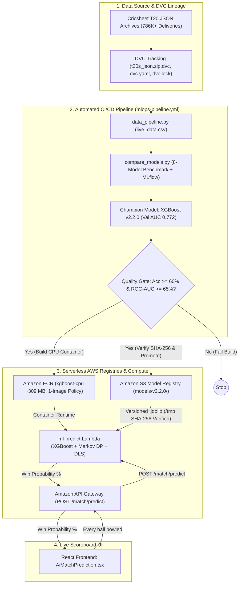
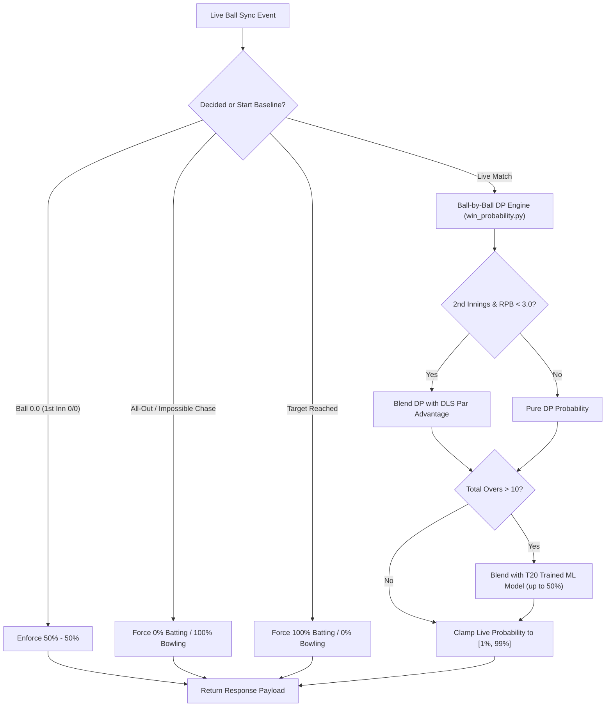

# 🤖 Serverless MLOps Tutorial

This guide walks through the end-to-end **Machine Learning Operations (MLOps)** and **Hybrid Win Prediction** pipeline integrated into CricScore. By combining GitHub Actions for training, **Amazon S3** for versioned model artifacts, **Amazon ECR** (`xgboost-cpu ~309 MB`, `countNumber = 1` single-image policy) for the container runtime, and **AWS Lambda** for serverless inference, the entire platform operates within a **~$1/month** AWS footprint across `dev` and `prod`.

## 🧭 Quick Navigation

- [🏗️ 1. Architecture Overview](#️-1-architecture-overview) — End-to-end DVC, MLflow, S3/ECR, and Lambda hybrid inference diagram.
- [📊 2. The Data Pipeline (`live_data.csv`)](#-2-the-data-pipeline-live_datacsv) — Extracting `786K+` deliveries from Cricsheet T20 JSON archives.
- [🧠 3. Model Training (`live_train.py`)](#-3-model-training-live_trainpy) — Leakage-free `GroupShuffleSplit` and 8-model benchmark evaluation.
- [🚦 4. Automated CI/CD Gate (`mlops-pipeline.yml`)](#-4-automated-cicd-gate-mlops-pipelineyml) — Automated accuracy/ROC-AUC quality gates and S3/ECR promotion.
- [☁️ 5. Serverless Docker Inference (`predict.py`)](#️-5-serverless-docker-inference-predictpy) — `~309 MB` `xgboost-cpu` container, `/tmp` S3 caching, and SHA-256 verification.
- [🖥️ 6. Frontend Integration](#️-6-frontend-integration) — Rendering the real-time win-probability bar on every ball.
- [🛑 7. Lessons Learned & Troubleshooting](#-7-lessons-learned--troubleshooting) — 5 production MLOps root-cause analyses and cost optimizations.
- [📊 8. Win Prediction Engine Specification](#-8-win-prediction-engine-specification) — Blending `XGBoost v2.2.0`, Markov Chain DP, and hard terminal overrides.
- [🌧️ 9. Duckworth-Lewis-Stern (DLS) Method](#️-9-duckworth-lewis-stern-dls-method) — Standard Edition resource table math and rain-interruption par targets.
- [🔬 10. Reproducible Multi-Algorithm MLOps Pipeline (DVC + MLflow + Manifests)](#-10-reproducible-multi-algorithm-mlops-pipeline-dvc--mlflow--manifests) — Reproducing the pipeline locally and executing 5-second model rollbacks.

---

## 🏗️ 1. Architecture Overview



### End-to-End MLOps Lifecycle Stages

- **Stage 1 — Data Ingestion & DVC Lineage (`apps/ml-engine/data_pipeline.py`):**
  - Extracts `786K+` Cricsheet T20 ball-by-ball deliveries into `live_data.csv`, tracked reproducibly via `cricket-data/t20s_json.zip.dvc` and `dvc.yaml`.
- **Stage 2 — 8-Model Benchmark & Promotion (`apps/ml-engine/compare_models.py`):**
  - Uses a match-grouped `70/15/15` split (zero data leakage), evaluates 8 classifiers in MLflow, and promotes **XGBoost (`v2.2.0`)**.
- **Stage 3 — CI Quality Gate & Manifest (`.github/workflows/mlops-pipeline.yml`):**
  - Enforces `Test Accuracy >= 0.60`, `Test ROC-AUC >= 0.65`, and `Size <= 25 MB`, then writes the SHA-256 checksum to `model_manifest.json`.
- **Stage 4 — Decoupled S3 + ECR Registries (`infra/terraform/s3.tf`, `infra/terraform/ecr.tf`):**
  - Uploads `.joblib` (`~227 KB`) to `s3://.../models/v2.2.0/` and pushes the `xgboost-cpu ~309 MB` container image to ECR with `countNumber = 1`.
- **Stage 5 — Hybrid Serverless Inference (`apps/ml-engine/predict.py`, `win_probability.py`):**
  - Lazy-loads ML libraries on invoke (`<70ms` init), verifies SHA-256 in `/tmp`, and blends **XGBoost `v2.2.0` + Markov DP + DLS Par**.

---

## 📊 2. The Data Pipeline (`live_data.csv`)

**Location**: `apps/ml-engine/data_pipeline.py` → `apps/ml-engine/data/live_data.csv` (Git-ignored; tracked via DVC)

- **`batting_team` (`str` — `OneHotEncoder`):** Team currently batting at the crease.
- **`bowling_team` (`str` — `OneHotEncoder`):** Team currently bowling / defending.
- **`inning` (`int` — `OneHotEncoder`):** Innings number (`1` for setting target, `2` for chasing).
- **`balls_left` (`int` — `StandardScaler`):** Legal deliveries remaining in the current innings (`0–120`).
- **`current_score` (`int` — `StandardScaler`):** Cumulative runs scored in the current innings so far.
- **`wickets_lost` (`int` — `StandardScaler`):** Wickets fallen in the current innings (`0–10`).
- **`target_score` (`int` — `StandardScaler`):** Target runs required to win in 2nd innings (`-1` during 1st innings).
- **`target` (`0` or `1` — Supervision Label):** `1` if `winner == batting_team`, `0` if `winner == bowling_team`.

```bash
# Run the data extraction pipeline locally from raw Cricsheet archives
python3 apps/ml-engine/data_pipeline.py
```

---

## 🧠 3. Model Training (`live_train.py`)

**Locations**: `apps/ml-engine/compare_models.py`, `apps/ml-engine/train_model.py`, and `apps/ml-engine/live_train.py`

CricScore uses `compare_models.py` (invoked by `train_model.py` and `dvc.yaml`) to benchmark **8 candidate classification algorithms** against the `LogisticRegression` baseline using a **match-grouped 70% Train / 15% Validation / 15% Test split** (ensuring balls from the same `match_id` never leak across splits).

### 8-Model Validation Benchmark & Promoted Champion (`v2.2.0`)

| Algorithm                |   Val Acc    | Val LogLoss  |  Val Brier   | Val ROC-AUC  | Latency (100) |     Size      |     Status      |
| :----------------------- | :----------: | :----------: | :----------: | :----------: | :-----------: | :-----------: | :-------------: |
| `LogisticRegression`     |   `0.6559`   |   `0.8069`   |   `0.2379`   |   `0.7550`   |   `1.52 ms`   |   `0.01 MB`   |    Baseline     |
| `GaussianNB`             |   `0.6436`   |   `9.5548`   |   `0.3515`   |   `0.6487`   |   `1.81 ms`   |   `0.01 MB`   |    Evaluated    |
| `DecisionTree`           |   `0.6998`   |   `0.8488`   |   `0.2014`   |   `0.7558`   |   `1.19 ms`   |   `0.01 MB`   |    Evaluated    |
| `LinearSVM_SGD`          |   `0.6755`   |   `0.6526`   |   `0.2148`   |   `0.7704`   |   `1.32 ms`   |   `0.01 MB`   |    Evaluated    |
| `RandomForest`           |   `0.6819`   |   `0.6136`   |   `0.2119`   |   `0.7561`   |  `15.38 ms`   |   `0.70 MB`   |    Evaluated    |
| `ExtraTrees`             |   `0.6667`   |   `0.6532`   |   `0.2302`   |   `0.7118`   |  `14.96 ms`   |   `0.71 MB`   |    Evaluated    |
| `HistGradientBoosting`   |   `0.6789`   |   `0.5998`   |   `0.2063`   |   `0.7642`   |   `3.84 ms`   |   `0.37 MB`   | Former Champion |
| **`XGBoost` (`v2.2.0`)** | **`0.6835`** | **`0.5786`** | **`0.1992`** | **`0.7723`** | **`1.98 ms`** | **`0.22 MB`** | 🏆 **Promoted** |

### Held-Out Test Set Performance (`XGBoost v2.2.0`)

| Metric                        | Held-Out Test Value | CI Gate Threshold  |   Status    |
| :---------------------------- | :-----------------: | :----------------: | :---------: |
| **Test Accuracy**             |    **`0.6901`**     |    `>= 0.6000`     | ✅ **PASS** |
| **Test ROC-AUC**              |    **`0.7529`**     |    `>= 0.6500`     | ✅ **PASS** |
| **Test Log Loss**             |    **`0.6018`**     | Calibration Metric | ✅ **PASS** |
| **Test Brier Score**          |    **`0.2060`**     |    Scoring Rule    | ✅ **PASS** |
| **Artifact Size (`.joblib`)** |   **`0.217 MB`**    |    `<= 25.0 MB`    | ✅ **PASS** |

```bash
# Run the 8-model benchmark, log to MLflow, and generate model_manifest.json
python3 apps/ml-engine/compare_models.py --version v2.2.0
```

---

## 🚦 4. Automated CI/CD Gate (`mlops-pipeline.yml`)

**Location**: `.github/workflows/mlops-pipeline.yml`

- **Path-Scoped Push Trigger:** Runs only when `cricket-data/**`, `data_pipeline.py`, `compare_models.py`, `train_model.py`, or `requirements-train.txt` change on `main` (routine code PRs never waste CI minutes retraining).
- **Scheduled Drift Retraining:** Runs automatically on the 1st of every month (`cron: '0 0 1 * *'`) or on demand via `workflow_dispatch`.
- **Quality Gate Enforcement:** Fails the pipeline immediately (`sys.exit(1)`) if held-out test `accuracy < 0.60`, `roc_auc < 0.65`, or `model_size > 25 MB`.
- **Immutable Artifact Output:** Publishes `live_win_predictor_model.joblib` (`~227 KB`), `model_manifest.json` (with SHA-256 hash), `live_metadata.json`, and `comparison_report.md`.

---

## ☁️ 5. Serverless Docker Inference (`predict.py`)

**Locations**: `apps/ml-engine/predict.py`, `apps/ml-engine/Dockerfile`, `infra/terraform/ecr.tf`, `infra/terraform/s3.tf`

- **1. CPU-Only `xgboost-cpu` Wheel (`apps/ml-engine/requirements.txt`):**
  - **Implementation:** Installs `xgboost-cpu==2.1.4` instead of the default `xgboost` wheel (which bundles `~450 MB` of NVIDIA CUDA/NCCL GPU libraries).
  - **Impact:** Shrinks the compressed ECR image by **62%** (`~810 MB` → **`xgboost-cpu ~309 MB`**), saving `~$0.05/mo` in ECR storage.
- **2. Single-Image ECR Retention (`infra/terraform/lambda.tf`, `infra/terraform/ecr.tf`):**
  - **Implementation:** Pushes only `:${var.ml_model_version}` (never `:latest`) and enforces `countNumber = 1` expiration across `dev` and `prod`.
  - **Impact:** Guarantees exactly **1 image** exists per repository (`~$0.03/mo` per environment).
- **3. Lazy Imports on Invoke (`apps/ml-engine/predict.py`):**
  - **Implementation:** Imports `joblib`, `pandas`, `numpy`, and `xgboost` inside `_load_model()` on invoke rather than at module initialization.
  - **Impact:** Reduces Lambda `Init Duration` to **`<70ms`**, preventing Firecracker cold-start timeouts.
- **4. S3 Model Registry + SHA-256 Check (`apps/ml-engine/predict.py`):**
  - **Implementation:** Downloads `models/${MODEL_VERSION}/live_win_predictor_model.joblib` to `/tmp`, verifies its SHA-256 checksum against `model_manifest.json`, and caches in memory.
  - **Impact:** Enables 5-second model rollbacks via the `MODEL_VERSION` env var with zero Docker image rebuilds.

---

## 🖥️ 6. Frontend Integration

**Location**: `apps/frontend/src/components/AiMatchPrediction.tsx`

- **Automatic Ball-by-Ball Trigger:** Fires `POST /match/predict` whenever `currentScore`, `wickets`, `balls`, `target`, or `inning` changes on the live scoreboard.
- **Dynamic Innings Team Binding:** Maps the active `battingTeam` to `team1` and `bowlingTeam` to `team2` so 1st- and 2nd-innings win probabilities always align with the team at the crease.
- **Live Dual-Team Probability Bar:** Renders a smooth real-time probability split (`team1Probability%` vs `team2Probability%`) inside both the Scorer console and Spectator scoreboard.

---

## 🛑 7. Lessons Learned & Troubleshooting

- **1. AWS Lambda 250 MB `.zip` Limit Exceeded:**
  - **Root Cause:** `scikit-learn` + `pandas` + `numpy` + `xgboost` exceeded Lambda's 250 MB unzipped `.zip` ceiling.
  - **Fix:** Migrated `ml-predict` to an **Amazon ECR Container Image** (supports up to 10 GB) using `xgboost-cpu ~309 MB`.
- **2. 810 MB ECR Image Bloat & Duplicate Tags:**
  - **Root Cause:** Standard `pip install xgboost` pulled NVIDIA CUDA libraries, and pushing both `:latest` + `:v2.2.0` doubled the tag count.
  - **Fix:** Switched to `xgboost-cpu==2.1.4`, removed `:latest` pushes, and enforced the `countNumber = 1` lifecycle policy in `ecr.tf`.
- **3. OOD Shortened Matches (1–5 Overs):**
  - **Root Cause:** Linear scaling projected `9 runs in 1 ball` of a 1-over game as `180 T20 runs` (`99%` win probability).
  - **Fix:** Built format-agnostic **Ball-by-Ball Markov DP** (`win_probability.py`) and added Par-Adjusted RPO scaling in `predict.py`.
- **4. 2nd-Innings Team Inversion Bug:**
  - **Root Cause:** Frontend originally sent static `teamA`/`teamB` strings even when `teamB` was batting in Innings 2.
  - **Fix:** `AiMatchPrediction.tsx` dynamically binds `batting_team = battingTeam` and `bowling_team = bowlingTeam`.
- **5. Start-of-Match (`0/0`) & Impossible Chase:**
  - **Root Cause:** Unconstrained ML models output non-50% probabilities at `0/0` or `>0%` when needing 40 off 2 balls.
  - **Fix:** Added hard mathematical boundary overrides (`50%/50%` at `0/0` Ball `0.0` and `0%/100%` when `runsNeeded > ballsLeft * 6 + 1`).

---

### 📊 8. Win Prediction Engine Specification

This section details the mathematical models, dynamic-programming ball simulation, DLS-aligned chase hybrid blend, and heuristic overrides powering `apps/ml-engine/predict.py` and `apps/ml-engine/win_probability.py`.

### 🏗️ Inference Pipeline

- **Layer 1 — Ball-by-Ball Markov DP (`win_probability.py` — All Match Lengths `1–20` Overs):**
  - Performs exact recursion over remaining balls (`1..120`) and wickets (`0..9`), evaluating transition distributions across `DEFENSIVE`, `NORMAL`, and `AGGRESSIVE` batting modes.
- **Layer 2 — DLS Resource Parity Blend (`2nd Innings` when `RPB < 3.0`):**
  - Blends Markov DP with a logistic DLS Par differential so teams ahead of `dlsPar` with wickets in hand are favored (`> 50%`).
- **Layer 3 — T20 Champion XGBoost Blend (`v2.2.0` — `10 < total_overs <= 20`):**
  - Blends `live_win_predictor_model.joblib` (**XGBoost `v2.2.0`**) with weight rising linearly from `0.0` (at 10 overs) to `0.5` (at 20 overs).



### 🛑 Hard Heuristic Overrides & Clamping

- **Match Start (`inning == 1` AND `score == 0` AND `wickets == 0` AND `balls_bowled == 0`):** Enforces **50% Batting / 50% Bowling**.
- **Completed Chase (`inning == 2` AND `current_score >= target_score`):** Enforces **100% Batting / 0% Bowling**.
- **All Out / No Balls (`inning == 2` AND (`wickets_lost >= 10` OR `balls_left <= 0`):** Enforces **0% Batting / 100% Bowling**.
- **Impossible Target (`inning == 2` AND `(target_score - current_score) > balls_left * 6 + 1`):** Enforces **0% Batting / 100% Bowling**.
- **Undecided Live Play:** Clamped strictly to **`1% – 99%`**.

---

## 🌧️ 9. Duckworth-Lewis-Stern (DLS) Method

Implemented identically in `apps/frontend/src/utils/dlsUtils.ts` and `apps/ml-engine/win_probability.py`.

### 📐 Format-Normalized Resources Remaining ($R$)

Using the Standard Edition exponential decay equation $Z(u, w) = F(w) \cdot (1 - e^{-b \cdot u / F(w)})$ with $b = 0.027$ and $F(w)$ calibrated against the 50-over resource row (`[100, 93.4, 85.1, 74.9, 62.7, 49.0, 34.9, 22.0, 11.9, 4.7]`), resources for an $N$-over match are normalized relative to $Z(N, 0)$:

$$R(u, w, N) = \frac{Z(u, w)}{Z(N, 0)} \times 100\%$$

#### Standard T20 Resource Table ($R_0$ and $b$ parameters)

| Wickets Lost ($w$) | $R_0(w)$ (%) | Decay Constant $b(w)$ | Resource at 20 overs ($u=20$) |
| :----------------: | :----------: | :-------------------: | :---------------------------: |
|       **0**        |    100.0%    |        0.0544         |            100.0%             |
|       **1**        |    93.4%     |        0.0558         |             91.2%             |
|       **2**        |    85.1%     |        0.0575         |             82.5%             |
|       **3**        |    74.9%     |        0.0598         |             72.1%             |
|       **4**        |    62.7%     |        0.0631         |             59.8%             |
|       **5**        |    48.5%     |        0.0682         |             45.8%             |
|       **6**        |    33.1%     |        0.0765         |             30.9%             |
|       **7**        |    18.7%     |        0.0910         |             17.3%             |
|       **8**        |     8.2%     |        0.1200         |             7.5%              |
|       **9**        |     2.1%     |        0.1800         |             1.9%              |

### 🎯 DLS Par Score & Target Formulas

$$\text{DLS Par Score} = \left\lfloor \text{Team 1 Score} \times \left( \frac{R_{\text{Team 2 Used}}}{R_{\text{Team 1 Total}}} \right) \right\rfloor, \qquad \text{DLS Target} = \text{DLS Par Score} + 1$$

- **If $\text{Team 2 Score} > \text{DLS Par Score}$:** Team 2 wins by $(\text{Score} - \text{Par})$ runs (DLS).
- **If $\text{Team 2 Score} < \text{DLS Par Score}$:** Team 1 wins by $(\text{Par} - \text{Score})$ runs (DLS).
- **If $\text{Team 2 Score} == \text{DLS Par Score}$:** Match Tied (DLS Method).

### 💡 Worked Example (Team 1 = `160/6` in 20 Overs; Rain at `10.0` Overs with Team 2 at `75/2`)

- **Step 1 — Team 1 Total Resource ($R_1$):** Full 20 overs completed = **`100.0%`**.
- **Step 2 — Team 2 Resource Remaining at `10.0` ov, `2` wkts:** $R(10, 2) = 85.1 \times (1 - e^{-0.0575 \times 10}) =$ **`37.2%`**.
- **Step 3 — Team 2 Resource Used:** $82.5\% - 37.2\% =$ **`45.3%`**.
- **Step 4 — DLS Par Score:** $\lfloor 160 \times 0.453 \rfloor =$ **`72` runs**.
- **Step 5 — Outcome at `75/2`:** $75 > 72$ ($\text{Lead} = +3\text{ runs}$) → **Team 2 leads by 3 runs on DLS**.

---

## 🔬 10. Reproducible Multi-Algorithm MLOps Pipeline (DVC + MLflow + Manifests)

### 10.1 8-Model Algorithm Comparison & Leakage-Free Validation (`compare_models.py`)

`apps/ml-engine/compare_models.py` evaluates **8 candidate classifiers** (`LogisticRegression`, `GaussianNB`, `DecisionTree`, `LinearSVM_SGD`, `RandomForest`, `ExtraTrees`, `HistGradientBoosting`, and **`XGBoost`**) and selects the model that minimizes validation **Log Loss** (`0.8 * log_loss + 0.2 * (1 - roc_auc)`):

- **Match-Grouped Partitioning:** Splits unique `match_id`s into **70% Train**, **15% Validation**, and **15% Held-Out Test** so deliveries from the same match never leak across splits.
- **In-Play Observables Only:** Restricts features strictly to pre-delivery state (`batting_team`, `bowling_team`, `inning`, `balls_left`, `current_score`, `wickets_lost`, `target_score`).
- **Calibration-First Promotion:** Promotes **XGBoost (`v2.2.0`)** with the lowest Validation Log Loss (`0.5786`), best Brier Score (`0.1992`), highest Validation ROC-AUC (`0.7723`), and Held-out Test ROC-AUC (`0.7529`).

### 10.2 MLflow, DVC & Manifest Specifications

- **1. MLflow Experiment Store (`apps/ml-engine/mlruns` — `mlflow-skinny`):**
  - Logs hyperparameters, Git SHA, DVC hash, training duration (`0.691s`), inference latency (`1.98ms`), Log Loss, Brier Score, and ROC-AUC.
- **2. DVC Dataset & Pipeline Lineage (`cricket-data/t20s_json.zip.dvc`, `dvc.yaml`, `dvc.lock`):**
  - Tracks raw Cricsheet archive MD5 (`dvc:31e19c47bdbc05d773938754d8589516`) and orchestrates reproducible `prepare` + `train_and_compare` stages.
- **3. Immutable Model Manifest (`apps/ml-engine/model_manifest.json`):**
  - Records `modelVersion: "v2.2.0"`, `algorithm: "XGBoost"`, held-out test metrics, and `sha256: "de9e39513fbac..."` (`227,565` bytes).

### 10.3 Reproducibility, Verification & Rollback Commands

```bash
# 1. Reproduce the full DVC pipeline (data extraction + 8-model benchmark)
dvc repro

# 2. Run the ML engine unit & calibration test suite (part of 376 unit tests and 15 E2E tests)
./apps/ai-service/.venv/bin/pytest apps/ml-engine/tests -q

# 3. Option A: Full Terraform + S3 + ECR versioned deploy/rollback
./infra/scripts/deploy.sh --env dev --use-local-env --model-version v2.2.0

# 4. Option B: Instant ~5s Lambda env-var rollback (pulls models/<version>/ from S3)
aws lambda update-function-configuration \
  --function-name cricscoredev-ml-predict \
  --environment "Variables={MODEL_VERSION=v2.1.0,MODEL_S3_BUCKET=cricscore-match-backups-dev}"
```
