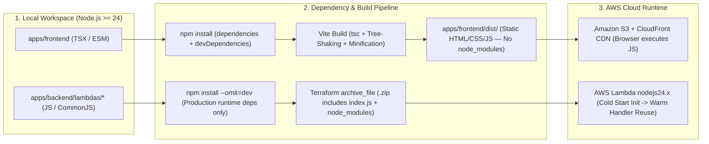
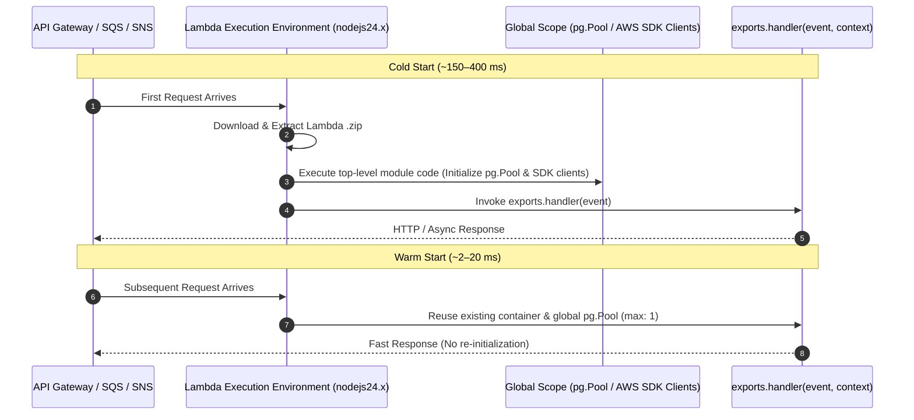

# 🟢 Node.js 24, NPM & Lambda Packaging Guide

CricScore runs on **Node.js 24 (`nodejs24.x`)** across both the **React 19 + Vite 8 Frontend** (`apps/frontend`, ES Modules) and the **8 ZIP-packaged AWS Lambda Functions** (`apps/backend/lambdas/*`, CommonJS).

---

## 🔄 1. Frontend Build vs. Backend Lambda Execution Lifecycle



---

## 📦 2. Frontend vs. Backend Dependency Architecture

| Dimension                | Frontend (`apps/frontend`)                                                        | Backend Lambdas (`apps/backend/lambdas/*`)                                                |
| :----------------------- | :-------------------------------------------------------------------------------- | :---------------------------------------------------------------------------------------- |
| **Module System**        | • ES Modules (`"type": "module"`)                                                 | • CommonJS (`require` / `exports.handler`)                                                |
| **Install Command**      | • `npm install`<br/>• Includes `devDependencies` (`vite`, `typescript`, `vitest`) | • `npm install --omit=dev`<br/>• Strips dev tools before Terraform zipping                |
| **Build Output**         | • Minified static assets in `apps/frontend/dist/`                                 | • Raw `.js` files + production `node_modules/` zipped by Terraform                        |
| **What Uploads to AWS?** | • **Only `dist/`**<br/>• `node_modules/` is never uploaded to S3                  | • **Entire `.zip` archive**<br/>• `index.js` + production `node_modules/` uploaded to AWS |
| **AWS Target**           | • Amazon S3 + CloudFront CDN                                                      | • AWS Lambda (`nodejs24.x` runtime)                                                       |

### Golden Rules of `node_modules`

| Rule                                       | Reason                                                               | Verification Command                    |
| :----------------------------------------- | :------------------------------------------------------------------- | :-------------------------------------- |
| **Never edit `node_modules/`**             | • 100% managed by `npm` and `package-lock.json`                      | `git status --ignored`                  |
| **Never commit `node_modules/` or `.zip`** | • Excluded via `.gitignore` to prevent repository bloat              | `git check-ignore -v node_modules/`     |
| **Keep `package-lock.json` in sync**       | • Guarantees deterministic installs in CI (`npm ci` / `npm install`) | `./infra/scripts/check_dependencies.sh` |

---

## ⚡ 3. AWS Lambda Execution Model (Cold vs. Warm Starts)



| Lambda Best Practice         | Implementation in CricScore                                                                                                              | Source Reference                                                                                 |
| :--------------------------- | :--------------------------------------------------------------------------------------------------------------------------------------- | :----------------------------------------------------------------------------------------------- |
| **Global Connection Reuse**  | • Instantiate `new Pool({ max: 1 })` **outside** `exports.handler`<br/>• Instantiate AWS SDK clients (`SESClient`, `SNSClient`) globally | • `apps/backend/lambdas/match-api/index.js`<br/>• `apps/backend/lambdas/score-update/index.js`   |
| **Non-Blocking Event Loop**  | • Set `context.callbackWaitsForEmptyEventLoop = false`<br/>• Ensures warm `pg.Pool` sockets do not stall Lambda freeze                   | • `apps/backend/lambdas/match-api/index.js`                                                      |
| **Client Release Guarantee** | • Always call `client.release()` inside a `finally` block<br/>• Prevents PostgreSQL connection exhaustion under concurrency              | • `apps/backend/lambdas/match-api/index.js`<br/>• `apps/backend/lambdas/storage-worker/index.js` |

---

## 🛠️ 4. Command Reference (Frontend, Backend & Root Workspace)

### Root Monorepo Commands (`package.json`)

| Command              | Action                                                                          | When to Use                         |
| :------------------- | :------------------------------------------------------------------------------ | :---------------------------------- |
| `npm run dev`        | • Starts Vite local dev server with HMR (`http://localhost:5173`)               | Daily frontend development          |
| `npm run build`      | • Compiles production bundle into `apps/frontend/dist/`                         | Pre-deploy verification             |
| `npm run preview`    | • Serves production `dist/` bundle locally                                      | Testing minified bundle before push |
| `npm run lint`       | • Runs TypeScript compiler check (`tsc --noEmit`)                               | Verifying strict type safety        |
| `npm test`           | • Runs Frontend Vitest suite (`151` tests across `23` suites)                   | Quick frontend regression check     |
| `npm run test:all`   | • Runs Frontend Vitest (`151`) + Backend Vitest (`121`)<br/>• Runs AI Chat eval | Full JS/TS workspace verification   |
| `npm run deps:check` | • Runs `./infra/scripts/check_dependencies.sh` across npm, pip, & Dependabot    | Auditing outdated packages          |

### Runnable Development & Packaging Commands

```bash
# 1. Start Frontend Vite Dev Server
npm run dev

# 2. Type-Check & Lint Frontend (TypeScript + ESLint)
npm run lint --prefix apps/frontend
npm run lint:eslint --prefix apps/frontend

# 3. Run Frontend & Backend Unit Tests
npm run test --prefix apps/frontend
npm run test --prefix apps/backend

# 4. Install Production-Only Dependencies Across All Backend Lambdas (Matches CI Deploy Step)
for d in apps/backend/lambdas/*; do
  if [ -f "$d/package.json" ]; then
    (cd "$d" && npm install --omit=dev --no-audit --no-fund --ignore-scripts)
  fi
done
```

---

## 🛡️ 5. Dependency Security Auditing (`npm audit` & Trivy)

| Scanner                | Scope                                                                        | Trigger                                                                     | Failure Threshold                                  |
| :--------------------- | :--------------------------------------------------------------------------- | :-------------------------------------------------------------------------- | :------------------------------------------------- |
| **`npm audit`**        | • Root lockfile<br/>• `apps/frontend` lockfile<br/>• `apps/backend` lockfile | • Local pre-push (`./infra/scripts/validate_local.sh`)                      | `high` or `critical` (`--audit-level=high`)        |
| **Trivy (`trivy fs`)** | • `apps/frontend`<br/>• `apps/backend/lambdas`<br/>• `apps/ai-service`       | • Local validation (`validate_local.sh`)<br/>• GitHub Actions CI (`ci.yml`) | Fixable `HIGH` or `CRITICAL` CVEs (`exit-code: 1`) |

```bash
# Run high-severity npm audit across workspaces
npm audit --audit-level=high
npm --prefix apps/frontend audit --audit-level=high
npm --prefix apps/backend audit --audit-level=high

# Auto-fix compatible semver vulnerabilities
npm audit fix
```
