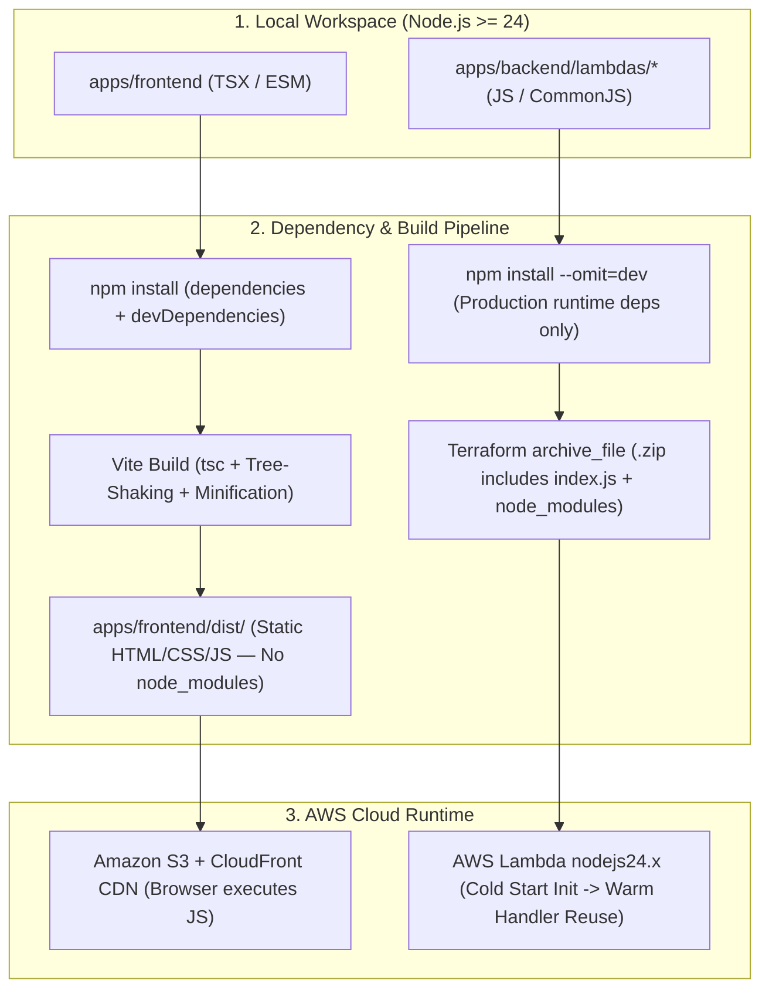
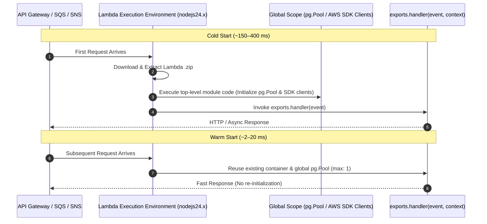

# 🟢 Node.js 24, NPM & Lambda Packaging Guide

CricScore runs on **Node.js 24 (`nodejs24.x`)** across both the **React 19 + Vite 8 Frontend** (`apps/frontend`, ES Modules) and the **8 ZIP-packaged AWS Lambda Functions** (`apps/backend/lambdas/*`, CommonJS).

---

## 🔄 1. Frontend Build vs. Backend Lambda Execution Lifecycle



---

## 📦 2. Frontend vs. Backend Dependency Architecture

- **Frontend SPA (`apps/frontend`):**
  - **Module System**: ES Modules (`"type": "module"`).
  - **Install & Build**: Runs `npm install` (including `devDependencies` like `vite`, `typescript`, and `vitest`) and compiles tree-shaken static assets into `apps/frontend/dist/`.
  - **Cloud Upload Target**: Uploads **only `dist/`** to Amazon S3 + CloudFront CDN (`node_modules/` is never uploaded).
- **Backend Microservices (`apps/backend/lambdas/*`):**
  - **Module System**: CommonJS (`require` / `exports.handler`).
  - **Install & Packaging**: Runs `npm install --omit=dev` to strip dev tools before Terraform's `archive_file` zips `index.js` + production `node_modules/`.
  - **Cloud Upload Target**: Uploads the entire `.zip` archive to AWS Lambda (`nodejs24.x` runtime).

### Golden Rules of `node_modules`

- **Never edit `node_modules/` (`git status --ignored`):**
  - 100% managed by `npm` and `package-lock.json`.
- **Never commit `node_modules/` or `.zip` (`git check-ignore -v node_modules/`):**
  - Excluded via `.gitignore` to prevent repository bloat.
- **Keep `package-lock.json` in sync (`./infra/scripts/check_dependencies.sh`):**
  - Guarantees deterministic installs across local development and CI (`npm ci` / `npm install`).

---

## ⚡ 3. AWS Lambda Execution Model (Cold vs. Warm Starts)



- **Global Connection Reuse (`match-api/index.js`, `score-update/index.js`):**
  - Instantiates `new Pool({ max: 1 })` and AWS SDK clients (`SESClient`, `SNSClient`) **outside** `exports.handler` so warm containers reuse open connections.
- **Non-Blocking Event Loop (`match-api/index.js`):**
  - Sets `context.callbackWaitsForEmptyEventLoop = false` so idle `pg.Pool` sockets never stall Lambda container freeze.
- **Client Release Guarantee (`match-api/index.js`, `storage-worker/index.js`):**
  - Always calls `client.release()` inside a `finally` block to prevent PostgreSQL connection exhaustion under concurrency.

---

## 🛠️ 4. Command Reference (Frontend, Backend & Root Workspace)

### Root Monorepo Commands (`package.json`)

| Command              | Action                                          |
| :------------------- | :---------------------------------------------- |
| `npm run dev`        | Start Vite dev server (`http://localhost:5173`) |
| `npm run build`      | Compile production bundle into `dist/`          |
| `npm run preview`    | Serve production `dist/` bundle locally         |
| `npm run lint`       | Run TypeScript compiler check (`tsc --noEmit`)  |
| `npm test`           | Run Frontend Vitest suite (`151` unit tests)    |
| `npm run test:all`   | Run Frontend (`151`) + Backend (`121`) + eval   |
| `npm run deps:check` | Audit npm, pip, & Dependabot via script         |

### Runnable Development & Packaging Commands

```bash
# 1. Start Frontend Vite Dev Server
npm run dev

# 2. Type-Check & Lint Frontend (TypeScript + ESLint)
npm run lint --prefix apps/frontend
npm run lint:eslint --prefix apps/frontend

# 3. Run Frontend & Backend Unit Tests
npm run test --prefix apps/frontend
npm run test --prefix apps/backend

# 4. Install Production-Only Dependencies Across All Backend Lambdas (Matches CI Deploy Step)
for d in apps/backend/lambdas/*; do
  if [ -f "$d/package.json" ]; then
    (cd "$d" && npm install --omit=dev --no-audit --no-fund --ignore-scripts)
  fi
done
```

---

## 🛡️ 5. Dependency Security Auditing (`npm audit` & Trivy)

- **`npm audit` (Lockfile SCA):**
  - Scans root, `apps/frontend`, and `apps/backend` lockfiles during local pre-push (`./infra/scripts/validate_local.sh`).
  - Fails on any `high` or `critical` vulnerability (`--audit-level=high`).
- **Trivy (`trivy fs` Dependency SCA):**
  - Scans `apps/frontend`, `apps/backend/lambdas`, and `apps/ai-service` in both `validate_local.sh` and GitHub Actions CI (`ci.yml`).
  - Fails on any fixable `HIGH` or `CRITICAL` CVE (`exit-code: 1`).

```bash
# Run high-severity npm audit across workspaces
npm audit --audit-level=high
npm --prefix apps/frontend audit --audit-level=high
npm --prefix apps/backend audit --audit-level=high

# Auto-fix compatible semver vulnerabilities
npm audit fix
```
