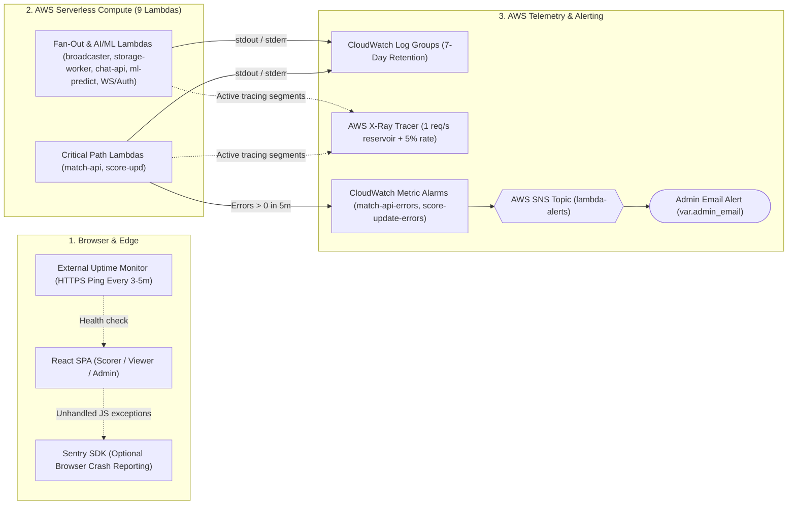

# 🔭 Observability & Monitoring Suite

CricScore combines AWS free-tier telemetry (**CloudWatch Logs**, **CloudWatch Metric Alarms**, **AWS X-Ray**, and **AWS Budgets** — keeping total cloud spend around **~$1/month**) with optional client-side and edge monitoring (**Sentry** and **UptimeRobot / BetterStack**).

**Related Operational Guides**:

- [Cloud Cost & Infrastructure Management (`~$1/month`)](./cost_management.md)
- [Auto-Generated AWS Resources Dashboard](./aws_resources_dashboard.md)
- [Troubleshooting Runbook & Incident Log](./troubleshooting.md)

---

## 🔄 End-to-End Telemetry & Alerting Flow



---

## 1. 📋 CloudWatch Logging (7-Day Retention)

Every API Gateway stage and Lambda function streams logs to a dedicated CloudWatch Log Group with a strict **7-day retention policy** (`retention_in_days = 7` in `infra/terraform/modules/zip_lambda/main.tf`, `lambda.tf`, `apigateway_http.tf`, and `apigateway_websocket.tf`) to prevent storage cost creep.

### Complete Log Group Inventory

Replace `<prefix>` with `cricscoredev` (Dev) or `cricscore` (Prod):

| Log Group                                | Source Component      | Key Events Logged                                                                                                        | Quick CLI Tail Command                                                     |
| :--------------------------------------- | :-------------------- | :----------------------------------------------------------------------------------------------------------------------- | :------------------------------------------------------------------------- |
| `/aws/lambda/<prefix>-match-api`         | `match-api`           | • Match CRUD & `/health` DB probes<br/>• 2nd-innings upsert & S3 backup<br/>• SES email dispatch & admin purges          | `aws logs tail /aws/lambda/cricscoredev-match-api --follow --format short` |
| `/aws/lambda/<prefix>-score-upd`         | `score-upd`           | • `STATE_SYNC` & `LIVE_SCORE_UPDATE` SNS publish IDs<br/>• SQS FIFO (`storage-buffer.fifo`) message IDs                  | `aws logs tail /aws/lambda/cricscoredev-score-upd --follow --format short` |
| `/aws/lambda/<prefix>-storage-worker`    | `storage-worker`      | • SQS FIFO ball persistence & `explicitTotalRuns` updates<br/>• `undo: true` rollbacks & `ai_summary = NULL` resets      | `aws logs tail /aws/lambda/cricscoredev-storage-worker --follow`           |
| `/aws/lambda/<prefix>-broadcaster`       | `broadcaster`         | • DynamoDB connection count & WebSocket fan-out delivery<br/>• Stale socket cleanup (`410 GoneException`)                | `aws logs tail /aws/lambda/cricscoredev-broadcaster --follow`              |
| `/aws/lambda/<prefix>-chat-api`          | `chat-api`            | • Agentic RAG queries & MCP tool calls (`execute_sql`, `search_rules`)<br/>• AI summaries & deterministic POTM injection | `aws logs tail /aws/lambda/cricscoredev-chat-api --follow`                 |
| `/aws/lambda/<prefix>-ml-predict`        | `ml-predict`          | • Hybrid XGBoost (`v2.2.0`) + Markov DP + DLS win-probability requests<br/>• S3 model SHA-256 verification               | `aws logs tail /aws/lambda/cricscoredev-ml-predict --follow`               |
| `/aws/lambda/<prefix>-onconnect`         | `onconnect`           | • New spectator WebSocket `connectionId` registration in DynamoDB                                                        | `aws logs tail /aws/lambda/cricscoredev-onconnect --follow`                |
| `/aws/lambda/<prefix>-ondisconnect`      | `ondisconnect`        | • Disconnected spectator WebSocket `connectionId` removal from DynamoDB                                                  | `aws logs tail /aws/lambda/cricscoredev-ondisconnect --follow`             |
| `/aws/lambda/<prefix>-cognito-presignup` | `cognito-presignup`   | • Guest (`guest-*@cricscore.local`) auto-confirmation vs. standard user sign-up                                          | `aws logs tail /aws/lambda/cricscoredev-cognito-presignup --follow`        |
| `/aws/apigateway/<prefix>-http`          | HTTP API Gateway      | • `$context.requestId`, `sourceIp`, and `requestTime`<br/>• `routeKey` and HTTP `status`                                 | `aws logs tail /aws/apigateway/cricscoredev-http --follow`                 |
| `/aws/apigateway/<prefix>-ws`            | WebSocket API Gateway | • `$connect`, `$disconnect`, and frame routing status codes                                                              | `aws logs tail /aws/apigateway/cricscoredev-ws --follow`                   |

### CloudWatch Logs Insights Queries

Run these in the [CloudWatch Logs Insights console](https://us-east-1.console.aws.amazon.com/cloudwatch/home?region=us-east-1#logsV2:logs-insights):

```sql
-- 1. Find all errors or timeouts across selected Lambda log groups
fields @timestamp, @logStream, @message
| filter @message like /(?i)(ERROR|Exception|Task timed out)/
| sort @timestamp desc
| limit 50
```

```sql
-- 2. Inspect p50, p95, and p99 Lambda latency and cold-start count
filter @type = "REPORT"
| stats count(*) as invocations,
        pct(@duration, 50) as p50_ms,
        pct(@duration, 95) as p95_ms,
        pct(@duration, 99) as p99_ms,
        count(@initDuration) as cold_starts
  by bin(5m)
```

---

## 2. ⚡ AWS X-Ray Distributed Tracing (`infra/terraform/xray.tf`)

| Tracing Parameter      | Configured Value                                                                                                                                                                                                                              | Purpose                                                                                                      |
| :--------------------- | :-------------------------------------------------------------------------------------------------------------------------------------------------------------------------------------------------------------------------------------------- | :----------------------------------------------------------------------------------------------------------- |
| **Sampling Rule Name** | `<project>-sampling`                                                                                                                                                                                                                          | • Throttles trace ingestion to remain within the `100,000` traces/month Free Tier                            |
| **Reservoir Size**     | `1 req/sec`                                                                                                                                                                                                                                   | • Guarantees at least 1 trace is recorded per second when traffic is active                                  |
| **Fixed Rate**         | `5%` (`fixed_rate = 0.05`)                                                                                                                                                                                                                    | • Samples 5% of additional requests beyond the reservoir                                                     |
| **Traced Functions**   | All 9 Lambdas (`mode = "Active"`)                                                                                                                                                                                                             | • Traces `score-upd` $\rightarrow$ SNS/SQS $\rightarrow$ `broadcaster` & `storage-worker`, plus `ml-predict` |
| **AWS Console Links**  | • [X-Ray Service Map](https://us-east-1.console.aws.amazon.com/cloudwatch/home?region=us-east-1#xray:service-map/map)<br/>• [X-Ray Traces Query](https://us-east-1.console.aws.amazon.com/cloudwatch/home?region=us-east-1#xray:traces/query) | • Inspect end-to-end distributed latency and downstream service graphs                                       |

---

## 3. 🛡️ CloudWatch Alarms, SNS Alerts & Budget Guardrails

| Alert / Guardrail               | Terraform Source                 | Metric & Window                     | Threshold           | Notification Target                                           |
| :------------------------------ | :------------------------------- | :---------------------------------- | :------------------ | :------------------------------------------------------------ |
| `<project>-match-api-errors`    | `infra/terraform/lambda.tf`      | `AWS/Lambda Errors` (`Sum`, `300s`) | `> 0 errors`        | `<project>-lambda-alerts` SNS $\rightarrow$ `var.admin_email` |
| `<project>-score-update-errors` | `infra/terraform/lambda.tf`      | `AWS/Lambda Errors` (`Sum`, `300s`) | `> 0 errors`        | `<project>-lambda-alerts` SNS $\rightarrow$ `var.admin_email` |
| `<project>-monthly-budget`      | `infra/terraform/cost_budget.tf` | Monthly AWS Actual Cost (`USD`)     | `> 100%` of `$5.00` | AWS Budgets email $\rightarrow$ `var.admin_email`             |

---

## 4. 🐛 Client & Edge Monitoring (Sentry + External Uptime)

| Layer               | Tool                                   | Configuration / Target                                                            | Verification                                                                             |
| :------------------ | :------------------------------------- | :-------------------------------------------------------------------------------- | :--------------------------------------------------------------------------------------- |
| **Browser Crashes** | **Sentry React SDK** (`@sentry/react`) | • Auto-initializes in `apps/frontend/src/index.tsx` when `VITE_SENTRY_DSN` is set | • Captures unhandled React render errors<br/>• Reports client network exceptions         |
| **Frontend Uptime** | **UptimeRobot / BetterStack**          | • `https://cricscore.venkateshsingamsetty.com` (3–5m interval)                    | • Verifies Route 53 DNS, ACM TLS, and CloudFront CDN                                     |
| **API & DB Uptime** | **UptimeRobot / BetterStack**          | • `https://api.cricscore.venkateshsingamsetty.com/health`                         | • Verifies API Gateway and `match-api` Lambda<br/>• Probes Aiven PostgreSQL (`SELECT 1`) |

---

## 🧪 5. Runnable Telemetry Verification Commands

```bash
# 1. Verify all Lambda & API Gateway log groups enforce 7-day retention
aws logs describe-log-groups \
  --region us-east-1 \
  --log-group-name-prefix "/aws/lambda/cricscore" \
  --query "logGroups[*].[logGroupName,retentionInDays]" \
  --output table

# 2. Check current state of CloudWatch Metric Alarms
aws cloudwatch describe-alarms \
  --region us-east-1 \
  --alarm-name-prefix "cricscore" \
  --query "MetricAlarms[*].[AlarmName,StateValue,MetricName,Threshold]" \
  --output table

# 3. Inspect X-Ray Sampling Rules
aws xray get-sampling-rules \
  --region us-east-1 \
  --query "SamplingRuleRecords[*].SamplingRule.[RuleName,FixedRate,ReservoirSize]" \
  --output table

# 4. Probe Live API & Database Health Endpoint
curl -s "https://api.cricscoredev.venkateshsingamsetty.com/health" | jq .
```

---

## 💸 6. Cost-First Observability Decisions

| Resource                   | AWS Pricing Tier               | Engineering Decision                                                                                                                                     |
| :------------------------- | :----------------------------- | :------------------------------------------------------------------------------------------------------------------------------------------------------- |
| **CloudWatch Dashboard**   | `$3.00/dashboard/mo`           | • **Not provisioned in Terraform**<br/>• Replaced by auto-generated [aws_resources_dashboard.md](./aws_resources_dashboard.md) with direct console links |
| **Log Retention Policy**   | `$0.03/GB/month`               | • **Capped at 7 days (`retention_in_days = 7`)** on every API Gateway and Lambda log group<br/>• Keeps storage well inside the `5 GB/mo` Free Tier       |
| **Metric Alarms (2x/env)** | Free Tier (`≤ 10` alarms)      | • Provisioned strictly for `match-api` and `score-update` critical ingestion paths                                                                       |
| **AWS X-Ray Tracing**      | Free Tier (`≤ 100k` traces/mo) | • Throttled to `1 req/sec` reservoir + `5%` sampling rate (`infra/terraform/xray.tf`)                                                                    |
