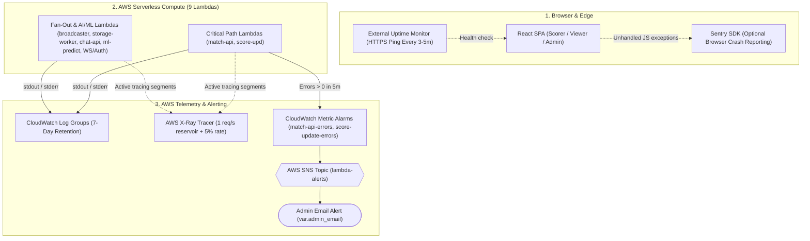

# 🔭 Observability & Monitoring Suite

CricScore combines AWS free-tier telemetry (**CloudWatch Logs**, **CloudWatch Metric Alarms**, **AWS X-Ray**, and **AWS Budgets** — keeping total cloud spend around **~$1/month**) with optional client-side and edge monitoring (**Sentry** and **UptimeRobot / BetterStack**).

**Related Operational Guides**:

- [Cloud Cost & Infrastructure Management (`~$1/month`)](./cost_management.md)
- [Auto-Generated AWS Resources Dashboard](./aws_resources_dashboard.md)
- [Troubleshooting Runbook & Incident Log](./troubleshooting.md)

---

## 🔄 End-to-End Telemetry & Alerting Flow



---

## 1. 📋 CloudWatch Logging (7-Day Retention)

Every API Gateway stage and Lambda function streams logs to a dedicated CloudWatch Log Group with a strict **7-day retention policy** (`retention_in_days = 7` in `infra/terraform/modules/zip_lambda/main.tf`, `lambda.tf`, `apigateway_http.tf`, and `apigateway_websocket.tf`) to prevent storage cost creep.

### Complete Log Group Inventory

Replace `<prefix>` with `cricscoredev` (Dev) or `cricscore` (Prod):

- **`/aws/lambda/<prefix>-match-api` (`match-api`):**
  - Logs Match CRUD, `/health` DB probes, 2nd-innings upserts, S3 backups, SES email dispatches, and admin purges.
  - Tail: `aws logs tail /aws/lambda/cricscoredev-match-api --follow --format short`
- **`/aws/lambda/<prefix>-score-upd` (`score-upd`):**
  - Logs `STATE_SYNC` & `LIVE_SCORE_UPDATE` SNS publish IDs and SQS FIFO (`storage-buffer.fifo`) message IDs.
  - Tail: `aws logs tail /aws/lambda/cricscoredev-score-upd --follow --format short`
- **`/aws/lambda/<prefix>-storage-worker` (`storage-worker`):**
  - Logs SQS FIFO ball persistence, `explicitTotalRuns` updates, `undo: true` rollbacks, and `ai_summary = NULL` resets.
  - Tail: `aws logs tail /aws/lambda/cricscoredev-storage-worker --follow`
- **`/aws/lambda/<prefix>-broadcaster` (`broadcaster`):**
  - Logs DynamoDB connection counts, WebSocket fan-out delivery, and stale socket cleanup (`410 GoneException`).
  - Tail: `aws logs tail /aws/lambda/cricscoredev-broadcaster --follow`
- **`/aws/lambda/<prefix>-chat-api` (`chat-api`):**
  - Logs Agentic RAG queries, MCP tool calls (`execute_sql`, `search_rules`), AI summaries, and deterministic POTM injection.
  - Tail: `aws logs tail /aws/lambda/cricscoredev-chat-api --follow`
- **`/aws/lambda/<prefix>-ml-predict` (`ml-predict`):**
  - Logs hybrid **XGBoost `v2.2.0`** + Markov DP + DLS win-probability requests and S3 model SHA-256 verification.
  - Tail: `aws logs tail /aws/lambda/cricscoredev-ml-predict --follow`
- **`/aws/lambda/<prefix>-onconnect` & `/aws/lambda/<prefix>-ondisconnect` (WebSocket Handlers):**
  - Logs spectator WebSocket `connectionId` registration and removal in DynamoDB.
  - Tail: `aws logs tail /aws/lambda/cricscoredev-onconnect --follow`
- **`/aws/lambda/<prefix>-cognito-presignup` (`cognito-presignup`):**
  - Logs guest (`guest-*@cricscore.local`) auto-confirmation vs. standard user sign-up events.
  - Tail: `aws logs tail /aws/lambda/cricscoredev-cognito-presignup --follow`
- **`/aws/apigateway/<prefix>-http` & `/aws/apigateway/<prefix>-ws` (API Gateway Access Logs):**
  - Logs `$context.requestId`, `sourceIp`, `requestTime`, `routeKey`, and HTTP/WebSocket status codes.
  - Tail: `aws logs tail /aws/apigateway/cricscoredev-http --follow`

### CloudWatch Logs Insights Queries

Run these in the [CloudWatch Logs Insights console](https://us-east-1.console.aws.amazon.com/cloudwatch/home?region=us-east-1#logsV2:logs-insights):

```sql
-- 1. Find all errors or timeouts across selected Lambda log groups
fields @timestamp, @logStream, @message
| filter @message like /(?i)(ERROR|Exception|Task timed out)/
| sort @timestamp desc
| limit 50
```

```sql
-- 2. Inspect p50, p95, and p99 Lambda latency and cold-start count
filter @type = "REPORT"
| stats count(*) as invocations,
        pct(@duration, 50) as p50_ms,
        pct(@duration, 95) as p95_ms,
        pct(@duration, 99) as p99_ms,
        count(@initDuration) as cold_starts
  by bin(5m)
```

---

## 2. ⚡ AWS X-Ray Distributed Tracing (`infra/terraform/xray.tf`)

- **Sampling Rule (`<project>-sampling`):**
  - Throttles trace ingestion to remain well within the `100,000` traces/month AWS Free Tier.
- **Reservoir & Fixed Rate (`1 req/sec` + `5%`):**
  - Guarantees at least `1` trace per second when traffic is active (`reservoir_size = 1`) and samples `5%` (`fixed_rate = 0.05`) of additional requests.
- **Active Function Tracing (`mode = "Active"`):**
  - Enabled across all 9 Lambdas per environment to trace `score-upd` $\rightarrow$ SNS/SQS $\rightarrow$ `broadcaster` & `storage-worker`, plus `ml-predict`.
- **AWS Console Views:**
  - Inspect end-to-end distributed latency in the [X-Ray Service Map](https://us-east-1.console.aws.amazon.com/cloudwatch/home?region=us-east-1#xray:service-map/map) and [X-Ray Traces Query](https://us-east-1.console.aws.amazon.com/cloudwatch/home?region=us-east-1#xray:traces/query).

---

## 3. 🛡️ CloudWatch Alarms, SNS Alerts & Budget Guardrails

- **Match API Error Alarm (`<project>-match-api-errors` in `infra/terraform/lambda.tf`):**
  - Evaluates `AWS/Lambda Errors` (`Sum` over `300s`) and triggers when `> 0 errors` occur.
  - Publishes to `<project>-lambda-alerts` SNS topic $\rightarrow$ `var.admin_email`.
- **Score Update Error Alarm (`<project>-score-update-errors` in `infra/terraform/lambda.tf`):**
  - Evaluates `AWS/Lambda Errors` (`Sum` over `300s`) on the live scoring ingestion Lambda (`> 0 errors`).
  - Publishes to `<project>-lambda-alerts` SNS topic $\rightarrow$ `var.admin_email`.
- **Monthly Spend Guardrail (`<project>-monthly-budget` in `infra/terraform/cost_budget.tf`):**
  - Monitors monthly AWS actual cost (`USD`) against a **`$5.00`** threshold (`> 100%`).
  - Dispatches an automated AWS Budgets email alert to `var.admin_email`.

---

## 4. 🐛 Client & Edge Monitoring (Sentry + External Uptime)

- **Browser Crash Reporting (`@sentry/react` in `apps/frontend/src/index.tsx`):**
  - Auto-initializes when `VITE_SENTRY_DSN` is set to capture unhandled React render errors and client network exceptions.
- **Frontend CDN Uptime (`UptimeRobot / BetterStack`):**
  - Pings `https://cricscore.venkateshsingamsetty.com` every 3–5 minutes to verify Route 53 DNS, ACM TLS, and CloudFront CDN availability.
- **API & PostgreSQL Uptime (`UptimeRobot / BetterStack`):**
  - Pings `https://api.cricscore.venkateshsingamsetty.com/health` to verify API Gateway, `match-api` Lambda, and Aiven PostgreSQL (`SELECT 1`).

---

## 🧪 5. Runnable Telemetry Verification Commands

```bash
# 1. Verify all Lambda & API Gateway log groups enforce 7-day retention
aws logs describe-log-groups \
  --region us-east-1 \
  --log-group-name-prefix "/aws/lambda/cricscore" \
  --query "logGroups[*].[logGroupName,retentionInDays]" \
  --output table

# 2. Check current state of CloudWatch Metric Alarms
aws cloudwatch describe-alarms \
  --region us-east-1 \
  --alarm-name-prefix "cricscore" \
  --query "MetricAlarms[*].[AlarmName,StateValue,MetricName,Threshold]" \
  --output table

# 3. Inspect X-Ray Sampling Rules
aws xray get-sampling-rules \
  --region us-east-1 \
  --query "SamplingRuleRecords[*].SamplingRule.[RuleName,FixedRate,ReservoirSize]" \
  --output table

# 4. Probe Live API & Database Health Endpoint
curl -s "https://api.cricscoredev.venkateshsingamsetty.com/health" | jq .
```

---

## 💸 6. Cost-First Observability Decisions

- **CloudWatch Dashboards (`$3.00/dashboard/mo` Avoided):**
  - Not provisioned in Terraform; replaced by the auto-generated [`aws_resources_dashboard.md`](./aws_resources_dashboard.md) with direct console deep links.
- **7-Day Log Retention (`$0.03/GB/mo` Capped):**
  - Enforces `retention_in_days = 7` on every API Gateway and Lambda log group to stay well inside the `5 GB/mo` Free Tier.
- **Targeted Metric Alarms (`Free Tier ≤ 10 alarms`):**
  - Provisioned strictly for `match-api` and `score-update` critical ingestion paths (`2` alarms per environment).
- **Sampled AWS X-Ray Tracing (`Free Tier ≤ 100k traces/mo`):**
  - Throttled to `1 req/sec` reservoir + `5%` sampling rate (`infra/terraform/xray.tf`).
