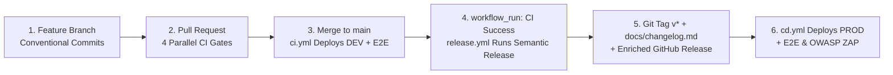

# 🚀 Automated Release & Versioning Process

CricScore automates semantic versioning (`v[Major].[Minor].[Patch]`), changelog generation (`docs/changelog.md`), GitHub Releases, and production deployments using **Semantic Release** (`.releaserc.json`) and **Conventional Commits**.



---

## 1. The Conventional Commit Standard

Every commit message and squash-merged PR title must use a Conventional Commit prefix. `.releaserc.json` maps prefixes to semantic version bumps and changelog sections as follows:

| Commit Prefix                  | Purpose                                                | Version Bump                      | Changelog Section             | Example                            |
| :----------------------------- | :----------------------------------------------------- | :-------------------------------- | :---------------------------- | :--------------------------------- |
| `feat!:` or `BREAKING CHANGE:` | Incompatible breaking change                           | **MAJOR** (`v4.0.0` ➔ `v5.0.0`)   | 🚀 Features                   | `feat!: redesign database schema`  |
| `feat:`                        | New user-facing or platform feature                    | **MINOR** (`v4.19.0` ➔ `v4.20.0`) | 🚀 Features                   | `feat: add dark mode to dashboard` |
| `fix:`                         | Bug fix                                                | **PATCH** (`v4.19.2` ➔ `v4.19.3`) | 🐛 Bug Fixes                  | `fix: resolve CORS issue on API`   |
| `perf:`                        | Performance optimization                               | **PATCH**                         | ⚡ Performance Improvements   | `perf: optimize database query`    |
| `docs:`                        | Documentation update (configured in `.releaserc.json`) | **PATCH**                         | 📚 Documentation              | `docs: update cost management`     |
| `refactor:`                    | Code refactoring (configured in `.releaserc.json`)     | **PATCH**                         | ♻️ Code Refactoring           | `refactor: extract scoring logic`  |
| `chore:`                       | Maintenance / dependency update (`.releaserc.json`)    | **PATCH**                         | 🧰 Maintenance & Dependencies | `chore: update dependencies`       |
| `build:`                       | Build system update                                    | **None** (Skips Release)          | —                             | `build: update semantic release`   |
| `ci:`                          | CI/CD workflow change                                  | **None** (Skips Release)          | ⚙️ CI/CD Pipelines            | `ci: fix github action syntax`     |
| `test:`                        | Test-only addition or update                           | **None** (Skips Release)          | 🧪 Tests                      | `test: add match-api unit tests`   |
| `style:`                       | Formatting / whitespace change                         | **None** (Skips Release)          | 💅 Styles                     | `style: format with prettier`      |

> [!NOTE]
> If a push to `main` contains only `build:`, `ci:`, `test:`, or `style:` commits, Semantic Release exits cleanly without cutting a new tag or triggering `cd.yml`.

---

## 2. End-to-End Release Lifecycle

| Stage                               | Trigger / Actor                                   | Workflow / Script                                           | What Happens                                                                                                                                                                                                                                                                                                          |
| :---------------------------------- | :------------------------------------------------ | :---------------------------------------------------------- | :-------------------------------------------------------------------------------------------------------------------------------------------------------------------------------------------------------------------------------------------------------------------------------------------------------------------- |
| **Step 1: Local Commit**            | Developer (`git commit`)                          | `.husky/pre-commit`                                         | Runs GitLeaks secrets scan and formatting checks locally; no version tags are created on feature branches.                                                                                                                                                                                                            |
| **Step 2: Pull Request**            | Open / update PR to `main`                        | `.github/workflows/ci.yml`                                  | Runs `validate_security`, `validate_frontend`, `validate_backend`, and `validate_python`. Stops without deploying.                                                                                                                                                                                                    |
| **Step 3: Merge & DEV Deploy**      | Squash-merge PR to `main`                         | `.github/workflows/ci.yml`                                  | Runs `deploy_and_test_dev`: DB migrations (`dev`), `terraform init -upgrade`, `terraform apply`, 7-day Lambda log retention, S3/CloudFront deploy, AI evals, 14 Playwright E2E tests, and OWASP ZAP scan.                                                                                                             |
| **Step 4: Version Calculation**     | `workflow_run` (`CI` succeeded on `main`)         | `.github/workflows/release.yml`                             | Checks out `main` with `secrets.GH_PAT`, resets to the exact tested SHA (`github.event.workflow_run.head_sha`), and runs `npx semantic-release`.                                                                                                                                                                      |
| **Step 5: Tag, Changelog & Enrich** | `@semantic-release/*` + `enrich_release_notes.sh` | `.releaserc.json` & `infra/scripts/enrich_release_notes.sh` | 1. Updates `docs/changelog.md` and commits `chore(release): vX.Y.Z [skip ci]` via `GH_PAT` (bypassing PR branch protection).<br>2. Publishes Git tag `vX.Y.Z` and GitHub Release.<br>3. Runs `enrich_release_notes.sh` to enforce a clean `vX.Y.Z` release title and append the linked PR's `## 🎯 Overview` section. |
| **Step 6: PROD Deploy**             | GitHub Release published / `v*` tag               | `.github/workflows/cd.yml`                                  | Runs `deploy_and_test_prod`: DB migrations (`prod`), `terraform init -upgrade`, `terraform apply`, 7-day Lambda log retention, S3/CloudFront deploy, AI evals, Playwright E2E, and OWASP ZAP.                                                                                                                         |

---

## 3. Useful Release & Verification Commands

```bash
# 1. View the latest published GitHub Release and its enriched notes
gh release view

# 2. List recent semantic version tags
git tag --sort=-v:refname | head -n 10

# 3. Manually re-run the release notes enrichment script for the latest release
./infra/scripts/enrich_release_notes.sh

# 4. Manually trigger a production deployment for a specific version tag
gh workflow run cd.yml -f tag=v4.19.2
```

---

## 4. Configuration Reference

| File / Secret                               | Role in Release Pipeline                                                                                                                                                                                                                                     |
| :------------------------------------------ | :----------------------------------------------------------------------------------------------------------------------------------------------------------------------------------------------------------------------------------------------------------- |
| **`.releaserc.json`**                       | Configures `@semantic-release/commit-analyzer`, `@semantic-release/release-notes-generator` (single-line PR subject formatting), `@semantic-release/changelog` (`docs/changelog.md`), `@semantic-release/git` (`[skip ci]`), and `@semantic-release/github`. |
| **`infra/scripts/enrich_release_notes.sh`** | Ensures the GitHub Release title is strictly the tag name (e.g. `v4.19.2`) and appends the `## 🎯 Overview` summary from referenced PRs (`#123`).                                                                                                            |
| **`secrets.GH_PAT`**                        | Repository administrator Personal Access Token used by `release.yml` to push the `chore(release): ... [skip ci]` commit directly to the protected `main` branch.                                                                                             |
| **`package.json` `version` field**          | Ignored. Because CricScore is a deployed AWS Serverless + React SPA platform (not an npm library), versioning is governed strictly by Git tags and GitHub Releases.                                                                                          |
