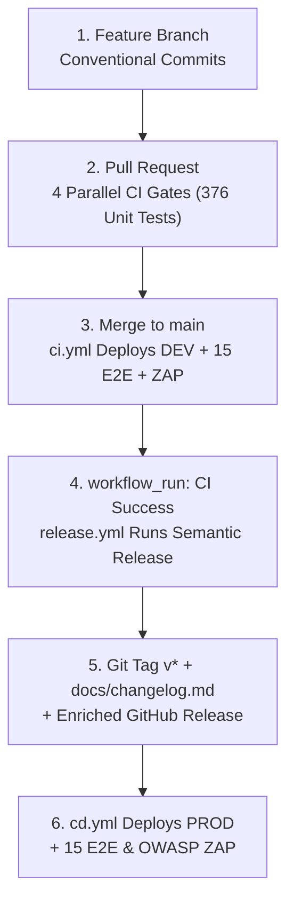

# 🚀 Automated Release & Versioning Process

CricScore automates semantic versioning (`v[Major].[Minor].[Patch]`), changelog generation (`docs/changelog.md`), GitHub Releases, and production deployments using **Semantic Release** (`.releaserc.json`) and **Conventional Commits**.



---

## 1. The Conventional Commit Standard

Every commit message and squash-merged PR title must use a Conventional Commit prefix. `.releaserc.json` maps prefixes to semantic version bumps and changelog sections as follows:

| Commit Prefix                         | Version Bump                      | Changelog Section             |
| :------------------------------------ | :-------------------------------- | :---------------------------- |
| `feat!:` / `BREAKING CHANGE:`         | **MAJOR** (`v4.0.0` ➔ `v5.0.0`)   | 🚀 Features                   |
| `feat:`                               | **MINOR** (`v4.19.0` ➔ `v4.20.0`) | 🚀 Features                   |
| `fix:`                                | **PATCH** (`v4.19.2` ➔ `v4.19.3`) | 🐛 Bug Fixes                  |
| `perf:`                               | **PATCH**                         | ⚡ Performance Improvements   |
| `docs:`                               | **PATCH**                         | 📚 Documentation              |
| `refactor:`                           | **PATCH**                         | ♻️ Code Refactoring           |
| `chore:`                              | **PATCH**                         | 🧰 Maintenance & Dependencies |
| `build:` / `ci:` / `test:` / `style:` | **None** (Skips Release)          | ⚙️ CI / 🧪 Tests / 💅 Styles  |

> [!NOTE]
> If a push to `main` contains only `build:`, `ci:`, `test:`, or `style:` commits, Semantic Release exits cleanly without cutting a new tag or triggering `cd.yml`.

---

## 2. End-to-End Release Lifecycle

1. **Local Commit (`.husky/pre-commit`):**
   - Runs GitLeaks secrets scan and formatting checks locally before commit. No version tags are created on feature branches.
2. **Pull Request (`.github/workflows/ci.yml`):**
   - Runs `validate_security`, `validate_frontend`, `validate_backend`, and `validate_python` (`376` unit tests) in parallel without deploying to AWS.
3. **Merge & DEV Deploy (`.github/workflows/ci.yml`):**
   - Squash-merging to `main` triggers `deploy_and_test_dev`: DB migrations (`dev`), `terraform init -upgrade` & `apply` (ECR `xgboost-cpu ~309 MB`, `countNumber = 1`, `XGBoost v2.2.0`), 7-day Lambda log retention, and S3/CloudFront sync.
   - Runs live AI evals, `15` Playwright E2E tests, and OWASP ZAP baseline scan.
4. **Version Calculation (`.github/workflows/release.yml`):**
   - Triggered automatically via `workflow_run` when `CI` succeeds on `main`.
   - Checks out `main` with `secrets.GH_PAT`, resets to the exact tested commit SHA (`github.event.workflow_run.head_sha`), and executes `npx semantic-release`.
5. **Tag & Release Notes Enrichment (`.releaserc.json` & `infra/scripts/enrich_release_notes.sh`):**
   - Updates `docs/changelog.md` and pushes `chore(release): vX.Y.Z [skip ci]` via `GH_PAT`.
   - Publishes Git tag `vX.Y.Z` and the GitHub Release, then runs `enrich_release_notes.sh` to append the linked PR's `## 🎯 Overview` summary.
6. **PROD Deploy (`.github/workflows/cd.yml`):**
   - Triggered when the GitHub Release (`v*` tag) is published (`~$1/month` combined AWS run rate across `dev` + `prod`).
   - Runs `deploy_and_test_prod`: DB migrations (`prod`), `terraform init -upgrade` & `apply`, 7-day Lambda log retention, S3/CloudFront sync, live AI evals, `15` Playwright E2E tests, and OWASP ZAP scan.

---

## 3. Useful Release & Verification Commands

```bash
# 1. View the latest published GitHub Release and its enriched notes
gh release view

# 2. List recent semantic version tags
git tag --sort=-v:refname | head -n 10

# 3. Manually re-run the release notes enrichment script for the latest release
./infra/scripts/enrich_release_notes.sh

# 4. Manually trigger a production deployment for a specific version tag
gh workflow run cd.yml -f tag=v4.19.2
```

---

## 4. Configuration Reference

- **`.releaserc.json`:**
  - Configures `@semantic-release/commit-analyzer` and `@semantic-release/release-notes-generator`.
  - Updates `docs/changelog.md` via `@semantic-release/changelog` and commits with `[skip ci]`.
- **`infra/scripts/enrich_release_notes.sh`:**
  - Ensures the GitHub Release title is strictly the tag name (e.g., `v4.19.2`) and appends the `## 🎯 Overview` summary from referenced PRs (`#123`).
- **`secrets.GH_PAT`:**
  - Repository administrator Personal Access Token used by `release.yml` to push the `chore(release): ... [skip ci]` commit directly to protected `main`.
- **`package.json` `version`:**
  - Ignored (`private` monorepo); versioning is governed strictly by Git tags and GitHub Releases.
