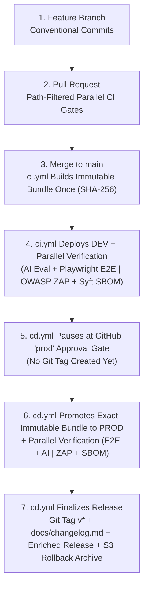

# 🚀 Automated Release & Versioning Process

CricScore automates semantic versioning (`v[Major].[Minor].[Patch]`), changelog generation (`docs/changelog.md`), GitHub Releases, and production deployments using **Semantic Release** (`.releaserc.json`) and **Conventional Commits**.



---

## 1. The Conventional Commit Standard

Every commit message and squash-merged PR title must use a Conventional Commit prefix. `.releaserc.json` maps prefixes to semantic version bumps and changelog sections as follows:

| Commit Prefix                         | Version Bump                      | Changelog Section             |
| :------------------------------------ | :-------------------------------- | :---------------------------- |
| `feat!:` / `BREAKING CHANGE:`         | **MAJOR** (`v4.0.0` ➔ `v5.0.0`)   | 🚀 Features                   |
| `feat:`                               | **MINOR** (`v4.19.0` ➔ `v4.20.0`) | 🚀 Features                   |
| `fix:`                                | **PATCH** (`v4.19.2` ➔ `v4.19.3`) | 🐛 Bug Fixes                  |
| `perf:`                               | **PATCH**                         | ⚡ Performance Improvements   |
| `docs:`                               | **PATCH**                         | 📚 Documentation              |
| `refactor:`                           | **PATCH**                         | ♻️ Code Refactoring           |
| `chore:`                              | **PATCH**                         | 🧰 Maintenance & Dependencies |
| `build:` / `ci:` / `test:` / `style:` | **None** (Skips Release)          | ⚙️ CI / 🧪 Tests / 💅 Styles  |

> [!NOTE]
> If a push to `main` contains only `build:`, `ci:`, `test:`, or `style:` commits, Semantic Release exits cleanly without cutting a new tag or triggering `cd.yml`.

---

## 2. End-to-End Release Lifecycle (Immutable 2-Env Promotion)

1. **Local Commit (`.husky/pre-commit`) & Fast Pre-Push (`.husky/pre-push`):**
   - Pre-commit runs `lint-staged` (Prettier) and `gitleaks` on staged files (and refreshes dashboards only when Terraform/workflows/root packages change).
   - Pre-push runs changed-areas-only validation (`./infra/scripts/validate_local.sh --fast`). No version tags are created on feature branches.
2. **Pull Request (`.github/workflows/ci.yml`):**
   - Uses `dorny/paths-filter` to run only impacted validation suites while keeping all required branch-protection check names (`Lint & Test`, `Backend & Terraform Validation`, `Infrastructure & Secrets Security`, `CodeQL`) green, with a single consolidated Trivy scan.
3. **Merge, Build-Once & DEV Deploy (`.github/workflows/ci.yml`):**
   - Merging to `main` runs `build_bundle`: hydrates Lambda dependencies and builds the environment-agnostic frontend bundle **once**, generates `SHA256SUMS.txt` + `manifest.json`, and archives the immutable bundle to `s3://<dev-backup-bucket>/builds/<short-sha>/`.
   - `deploy_dev` verifies SHA-256 checksums, runs `migrate.sh dev`, applies Terraform on `dev`, injects runtime `/env-config.js`, and syncs to S3/CloudFront.
   - `verify_dev_e2e` (AI Eval + Playwright E2E) and `verify_dev_security` (OWASP ZAP + Syft SBOM) run **in parallel**.
   - **No Git tag is created yet.**
4. **Manual PROD Approval & Immutable Promotion (`.github/workflows/cd.yml`):**
   - Triggered automatically via `workflow_run` when `CI` succeeds on `main`, and immediately pauses at the **`prod` GitHub Environment required-reviewer gate**.
   - Once approved, `deploy_prod` downloads the exact verified `builds/<short-sha>/` bundle from S3, verifies `SHA256SUMS.txt` (**zero `npm install` or frontend rebuild**), runs `migrate.sh prod`, applies Terraform, injects `prod` `/env-config.js`, and syncs to S3/CloudFront.
   - `verify_prod_e2e` and `verify_prod_security` run **in parallel** against live Production (with no extra approval prompts).
5. **Post-PROD SemVer Tag, Changelog & Rollback Archive (`cd.yml -> finalize_release`):**
   - Runs **only after** `deploy_prod`, `verify_prod_e2e`, and `verify_prod_security` all succeed.
   - Resets to the exact verified commit SHA, runs `npx semantic-release` to cut the **single clean `vX.Y.Z` Git tag**, updates `docs/changelog.md` (`chore(release): vX.Y.Z [skip ci]` via `GH_PAT`), publishes and enriches the GitHub Release (`enrich_release_notes.sh`), attaches `cricscore-sbom-prod.spdx.json` + `SHA256SUMS.txt`, and archives the immutable bundle to `s3://<prod-backup-bucket>/releases/vX.Y.Z/` for 1-click tag-based rollback.
   - _(Note: `.github/workflows/release.yml` is retained for manual `workflow_dispatch` override only.)_

---

## 3. Useful Release, Promotion & Rollback Commands

```bash
# 1. View the latest published GitHub Release and its enriched notes
gh release view

# 2. List recent semantic version tags
git tag --sort=-v:refname | head -n 10

# 3. Roll back PROD to the previous verified release tag (default: 'previous')
gh workflow run cd.yml -f action=rollback -f target_ref=previous

# 4. Roll back PROD to a specific release tag (e.g. v4.25.0)
gh workflow run cd.yml -f action=rollback -f target_ref=v4.25.0

# 5. Manually promote a specific verified commit SHA to PROD
gh workflow run cd.yml -f action=deploy -f target_ref=<commit-sha>
```

---

## 4. Configuration Reference

- **`.releaserc.json`:**
  - Configures `@semantic-release/commit-analyzer` and `@semantic-release/release-notes-generator`.
  - Updates `docs/changelog.md` via `@semantic-release/changelog` and commits with `[skip ci]`.
- **`infra/scripts/enrich_release_notes.sh`:**
  - Ensures the GitHub Release title is strictly the tag name (e.g., `v4.19.2`) and appends the `## 🎯 Overview` summary from referenced PRs (`#123`).
- **`secrets.GH_PAT`:**
  - Repository administrator Personal Access Token used by `release.yml` to push the `chore(release): ... [skip ci]` commit directly to protected `main`.
- **`package.json` `version`:**
  - Ignored (`private` monorepo); versioning is governed strictly by Git tags and GitHub Releases.
