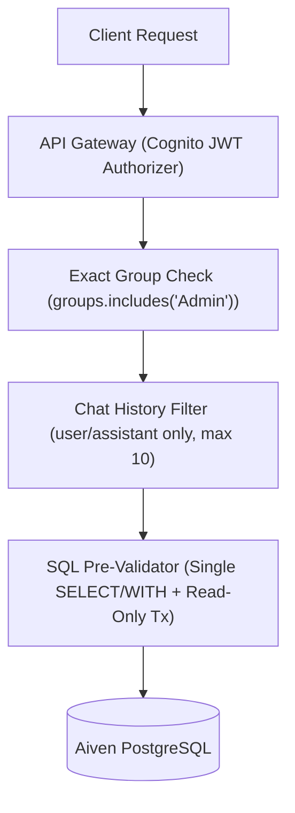

# 🔒 Security Audit Fixes & Hardening Log

This document records the security vulnerabilities identified and remediated during the AI-platform and API security audit, along with their verification commands. All fixes are enforced by automated tests across the **376-test suite** (`151` Frontend + `121` Backend Vitest + `75` AI Service + `29` ML Engine Pytest) plus **`15` Playwright E2E tests**.

---

## 🛡️ Defense-in-Depth Request Flow



---

## 📋 Remediated Security Findings

- **Finding #1 — Client-Supplied `isAdmin` Body Escalation (`Critical` — `apps/backend/lambdas/chat-api/__tests__/`):**
  - **Vulnerability**: `POST /chat` trusted `isAdmin` from the client JSON body and exposed destructive MCP tools (`delete_guest_data`, `delete_incomplete_matches`).
  - **Remediation**: `chatHandler.js` completely ignores client `isAdmin` flags, destructive tools are never registered in chat, and deletions are restricted to authenticated Match Ops endpoints.
- **Finding #2 — Unauthenticated Rulebook RAG Endpoints (`Critical` — `infra/terraform/apigateway_http.tf` & `apps/backend/lambdas/chat-api/`):**
  - **Vulnerability**: `POST /rules/upload`, `GET /rules`, and `DELETE /rules` lacked authentication, allowing unauthorized rulebook modification and embedding credit drain.
  - **Remediation**: Attached the Cognito JWT authorizer in Terraform and enforced `requireAdmin` in `chat-api/config/auth.js` (`Admin` group or `ADMIN_REPORT_EMAIL`).
- **Finding #3 — Unverified `x-scorer-email` Header Fallback (`High` — `apps/backend/lambdas/match-api/` & `score-update/`):**
  - **Vulnerability**: `match-api` and `score-update` accepted an unverified `x-scorer-email` header and granted `Admin` privileges when no JWT claim was present.
  - **Remediation**: Removed all header-derived identity and role fallbacks; user identity and group membership derive strictly from verified Cognito JWT claims.
- **Finding #4 — Substring Admin Group Matching (`Medium` — `apps/backend/lambdas/chat-api/config/auth.js`):**
  - **Vulnerability**: Admin group checks used substring matching, allowing spoofed group names like `"NotAdmin"` to match.
  - **Remediation**: Replaced substring checks with exact array membership matching (`groups.includes('Admin')`) enforced consistently across `match-api` and `chat-api`.
- **Finding #5 — Unvalidated LLM SQL Execution (`Medium` — `apps/backend/lambdas/chat-api/mcp/tools/databaseTools.js`):**
  - **Vulnerability**: `execute_sql` relied solely on `BEGIN READ ONLY` for LLM-generated SQL queries.
  - **Remediation**: Added strict regex AST pre-validation allowing only a single `SELECT`/`WITH` statement and blocking DDL/DML keywords plus `pg_sleep`, `pg_read_file`, `dblink`, and system catalogs.
- **Finding #6 — Chat History Role Injection (`Low` — `apps/backend/lambdas/chat-api/handlers/chatHandler.js`):**
  - **Vulnerability**: Client-supplied chat `history` allowed injecting `system` or `tool` role messages (prompt injection vector).
  - **Remediation**: Filtered incoming history strictly to `user` and `assistant` roles and capped conversation context to the most recent 10 turns.

---

## 🐍 Python AI Service Hardening (`apps/ai-service`)

- **Deterministic Routing & Bounded Specialists**: Built with Python 3.12 and LangGraph (`75` Pytest tests), enforcing parameterized read-only SQL queries and strict schema validation.
- **Deterministic Post-Match Awards**: Player of the Match calculation is 100% deterministic via `computePlayerOfTheMatch` in `summaryHandler.js`, preventing LLM hallucination of match awards.
- **Privacy-Safe Observability**: Optional LangSmith tracing is off by default with payload masking enabled when configured.

---

## ⚠️ Operational Trade-Offs & Known Scope

- **Public Guest Chat (`/chat` & `/chat/summary`):**
  - **Current Posture**: Allows unauthenticated guest access by design, capped by API Gateway route throttling (`5 req/s`, `10` burst).
  - **Scale Recommendation**: Add AWS WAF rate-based rules if public bot traffic scales beyond API Gateway token-bucket limits.
- **Database Role Separation (`execute_sql`):**
  - **Current Posture**: Enforces regex AST pre-validation + `BEGIN READ ONLY` on the application database connection.
  - **Scale Recommendation**: Provision a dedicated PostgreSQL `SELECT`-only database role for analytics queries.
- **CORS Policy (`chat-api`):**
  - **Current Posture**: Uses permissive CORS (`*`) for local and preview flexibility.
  - **Scale Recommendation**: Restrict `Access-Control-Allow-Origin` strictly to the production CloudFront domain.

---

## ⚡ Runnable Security Verification Commands

```bash
# 1. Run Backend security & unit tests (121 Vitest tests)
npm --prefix apps/backend test

# 2. Run Python AI Service tests (75 Pytest tests)
pytest apps/ai-service -q

# 3. Run GitLeaks, Checkov, and Trivy locally via the validation script
./infra/scripts/validate_local.sh --skip-e2e
```
