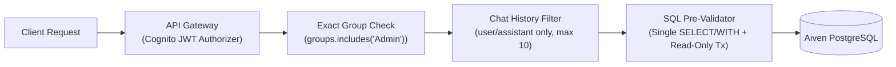

# 🔒 Security Audit Fixes & Hardening Log

This document records the security vulnerabilities identified and remediated during the AI-platform and API security audit, along with their verification commands. All fixes are enforced by automated tests across the **376-test suite** (`151` Frontend + `121` Backend Vitest + `75` AI Service + `29` ML Engine Pytest).

---

## 🛡️ Defense-in-Depth Request Flow



---

## 📋 Remediated Security Findings

| #     | Severity     | Vulnerability Identified                                                                                                                                    | Remediation Implemented                                                                                                                                                                | Verified In                                                       |
| ----- | ------------ | ----------------------------------------------------------------------------------------------------------------------------------------------------------- | -------------------------------------------------------------------------------------------------------------------------------------------------------------------------------------- | ----------------------------------------------------------------- |
| **1** | **Critical** | • `POST /chat` trusted `isAdmin` from the client JSON body<br/>• Exposed destructive MCP tools (`delete_guest_data`, `delete_incomplete_matches`)           | • `chatHandler.js` ignores client `isAdmin` flags<br/>• Destructive tools are never registered in chat<br/>• Deletions are restricted to authenticated Match Ops endpoints             | • `apps/backend/lambdas/chat-api/__tests__/`                      |
| **2** | **Critical** | • `POST /rules/upload`, `GET /rules`, and `DELETE /rules` lacked authentication<br/>• Allowed unauthorized rulebook modification and embedding credit drain | • Attached Cognito JWT authorizer in Terraform (`infra/terraform/api.tf`)<br/>• Enforced `requireAdmin` in `chat-api/config/auth.js` (`Admin` group or `ADMIN_REPORT_EMAIL`)           | • `infra/terraform/api.tf`<br/>• `apps/backend/lambdas/chat-api/` |
| **3** | **High**     | • `match-api` and `score-update` accepted an unverified `x-scorer-email` header<br/>• Granted `Admin` privileges when no JWT claim was present              | • Removed all header-derived identity and role fallbacks<br/>• User identity and group membership derive strictly from verified Cognito JWT claims                                     | • `apps/backend/lambdas/match-api/`<br/>• `score-update/`         |
| **4** | **Medium**   | • Admin group checks used substring matching<br/>• Allowed spoofed group names like `"NotAdmin"` to match                                                   | • Replaced substring checks with exact array membership matching (`groups.includes('Admin')`)<br/>• Enforced consistently across `match-api` and `chat-api`                            | • `apps/backend/lambdas/chat-api/config/auth.js`                  |
| **5** | **Medium**   | • `execute_sql` relied solely on `BEGIN READ ONLY` for LLM-generated SQL queries                                                                            | • Added strict regex AST pre-validation allowing only a single `SELECT`/`WITH` statement<br/>• Blocked DDL/DML keywords plus `pg_sleep`, `pg_read_file`, `dblink`, and system catalogs | • `apps/backend/lambdas/chat-api/mcp/tools/databaseTools.js`      |
| **6** | **Low**      | • Client-supplied chat `history` allowed injecting `system` or `tool` role messages (prompt injection vector)                                               | • Filtered incoming history strictly to `user` and `assistant` roles<br/>• Capped conversation context to the most recent 10 turns                                                     | • `apps/backend/lambdas/chat-api/handlers/chatHandler.js`         |

---

## 🐍 Python AI Service Hardening (`apps/ai-service`)

- **Deterministic Routing & Bounded Specialists**: Built with Python 3.12 and LangGraph (`75` Pytest tests), enforcing parameterized read-only SQL queries and strict schema validation.
- **Deterministic Post-Match Awards**: Player of the Match calculation is 100% deterministic via `computePlayerOfTheMatch` in `summaryHandler.js`, preventing LLM hallucination of match awards.
- **Privacy-Safe Observability**: Optional LangSmith tracing is off by default with payload masking enabled when configured.

---

## ⚠️ Operational Trade-Offs & Known Scope

| Area                                   | Current Posture                                                                | Recommended Hardening if Traffic Scales                                              |
| -------------------------------------- | ------------------------------------------------------------------------------ | ------------------------------------------------------------------------------------ |
| **Public&nbsp;Guest&nbsp;Chat**        | • `/chat` and `/chat/summary` allow unauthenticated guest access by design     | • Enable API Gateway stage throttling<br/>• Add AWS WAF rate-based rules             |
| **Database&nbsp;Role&nbsp;Separation** | • `execute_sql` enforces pre-validation + `BEGIN READ ONLY` on the app DB role | • Provision a dedicated PostgreSQL `SELECT`-only database role for analytics queries |
| **CORS&nbsp;Policy**                   | • `chat-api` uses permissive CORS (`*`) for local and preview flexibility      | • Restrict `Access-Control-Allow-Origin` to the production CloudFront domain         |

---

## ⚡ Runnable Security Verification Commands

```bash
# 1. Run Backend security & unit tests (121 Vitest tests)
npm --prefix apps/backend test

# 2. Run Python AI Service tests (75 Pytest tests)
pytest apps/ai-service -q

# 3. Run GitLeaks, Checkov, and Trivy locally via the validation script
./infra/scripts/validate_local.sh --skip-e2e
```
