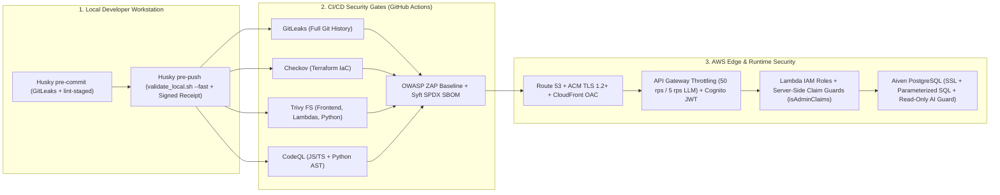

# 🛡️ Enterprise Security Posture & Trade-Offs

CricScore pairs **defense-in-depth DevSecOps guardrails** with explicit **cost-aware architectural trade-offs** to operate the combined Dev + Prod AWS cloud platform at **~$1/month**.

---

## 🏗️ 1. Defense-in-Depth Architecture



---

## 🔒 2. Active Security Controls Inventory

| Security Domain                 | Enforced Control                                                             | Implementation Source                              | Protection Provided                                                                                                                    |
| :------------------------------ | :--------------------------------------------------------------------------- | :------------------------------------------------- | :------------------------------------------------------------------------------------------------------------------------------------- |
| **Edge & CDN**                  | CloudFront Origin Access Control (OAC) + `aws_s3_bucket_public_access_block` | `infra/terraform/frontend.tf`                      | Blocks direct public S3 access; all static traffic must traverse CloudFront HTTPS                                                      |
| **Authentication**              | Cognito User Pool + API Gateway JWT Authorizer (`cognito-authorizer`)        | `infra/terraform/cognito.tf`, `apigateway_http.tf` | Validates cryptographic JWT signature, issuer, and audience at the API Gateway edge                                                    |
| **Authorization**               | Server-side `isAdminClaims(claims)` & `requireAdmin(event)`                  | `match-api/index.js`, `chat-api/config/auth.js`    | Verifies exact `"Admin"` group membership or `ADMIN_REPORT_EMAIL` from verified JWT claims; ignores client headers/body flags          |
| **LLM & API Abuse Protection**  | Route-level token-bucket throttling                                          | `infra/terraform/apigateway_http.tf`               | Caps default API routes at `50 req/s` (`100` burst) and unauthenticated `/chat` & `/chat/summary` routes at **`5 req/s` (`10` burst)** |
| **AI SQL Injection Prevention** | Read-only MCP tool guard (`execute_sql`) + `READ ONLY` transaction           | `apps/backend/lambdas/chat-api/mcp/tools/`         | Rejects `INSERT`/`UPDATE`/`DELETE`/`DROP`/`TRUNCATE` keywords and wraps AI queries in read-only transactions                           |
| **Database SQLi Prevention**    | Parameterized `pg` queries (`$1, $2, ...`) across all Lambdas                | `match-api`, `storage-worker`, `chat-api`          | Neutralizes SQL injection vectors across all user inputs                                                                               |
| **ML Artifact Integrity**       | SHA-256 checksum verification on cold-start model load                       | `apps/ml-engine/predict.py`, `model_manifest.json` | Verifies downloaded S3 `.joblib` model against `model_manifest.json` before unpickling                                                 |
| **Encryption at Rest**          | AWS-managed encryption (`AES256` / `alias/aws/sns` / SQS SSE)                | `frontend.tf`, `s3_backups.tf`, `sqs_sns.tf`       | Encrypts S3 buckets, SNS topics, and SQS FIFO queues at no additional KMS key cost                                                     |

---

## 🤖 3. Automated DevSecOps Scanners (Local Hooks & CI/CD)

| Scanner                | Category           | Local Hook Execution                                      | GitHub Actions Workflow                                                                 | Blocking Threshold                                              |
| :--------------------- | :----------------- | :-------------------------------------------------------- | :-------------------------------------------------------------------------------------- | :-------------------------------------------------------------- |
| **GitLeaks**           | Secret Detection   | `.husky/pre-commit` & `validate_local.sh`                 | `.github/workflows/ci.yml` (`validate_security`)                                        | Any unignored secret in staged changes or Git history           |
| **Checkov**            | Terraform IaC SAST | `validate_local.sh` (`--download-external-modules false`) | `.github/workflows/ci.yml` (`validate_security`)                                        | Any unsuppressed Terraform misconfiguration                     |
| **Trivy (`trivy fs`)** | Dependency SCA     | `validate_local.sh`                                       | `.github/workflows/ci.yml` (`validate_frontend`, `validate_backend`, `validate_python`) | Fixable `HIGH` or `CRITICAL` vulnerabilities (`exit-code: 1`)   |
| **`npm audit`**        | Lockfile SCA       | `validate_local.sh` (`--audit-level=high`)                | Local pre-push gate                                                                     | Any `high` or `critical` npm advisory                           |
| **CodeQL**             | Deep AST SAST      | —                                                         | `.github/workflows/codeql.yml`                                                          | Logical/security flaws in `javascript-typescript` and `python`  |
| **OWASP ZAP**          | Live DAST          | —                                                         | `.github/workflows/ci.yml` & `deploy_prod.yml`                                          | Baseline scan against deployed Dev/Prod URLs (`.zap/rules.tsv`) |
| **Syft**               | SPDX JSON SBOM     | `validate_local.sh` (unless `--fast` / `--skip-sbom`)     | `.github/workflows/sbom.yml`                                                            | Generates `cricscore-sbom.spdx.json` artifact                   |

---

## ⚖️ 4. Intentional Cost & Functionality Trade-Offs (~$1/Month Target)

| Control / Feature                                 | Current Status                     | Monthly Cost Saved             | Architectural Rationale & Compensating Mitigation                                                                                                                                 |
| :------------------------------------------------ | :--------------------------------- | :----------------------------- | :-------------------------------------------------------------------------------------------------------------------------------------------------------------------------------- |
| **AWS WAF & RASP Agents**                         | ❌ Intentionally Omitted           | **~$5.00+/mo + per-rule fees** | Avoids fixed WAF ACL fees and Lambda cold-start degradation. Mitigated by CloudFront, API Gateway route throttling (`5 rps` on `/chat`), Cognito JWT auth, and parameterized SQL. |
| **Private VPC + NAT Gateway**                     | ❌ Intentionally Omitted           | **~$32.00+/mo**                | Lambdas run in AWS-managed public serverless network and connect to Aiven PostgreSQL over TLS (`sslmode=require`) with IAM + JWT authorization.                                   |
| **Customer-Managed KMS Keys (`CMK`)**             | ⚠️ Uses AWS-Managed SSE (`AES256`) | **~$2.00+/mo** (`$1/key/mo`)   | Suppresses `AWS-0095` / `AWS-0132` / `CKV_AWS_145`; uses free AWS-managed encryption (`SSE-S3`, `alias/aws/sns`, `sqs_managed_sse_enabled`).                                      |
| **Content Security Policy (`unsafe-inline`)**     | ⚠️ Relaxed for Styles/Scripts      | —                              | Preserves compatibility with Vite/Amplify runtime styles; React JSX auto-escapes interpolated text and Chat UI sanitizes links (`HighlightedResult`).                             |
| **Cross-Origin Isolation (`COEP`/`COOP`/`CORP`)** | ❌ Intentionally Omitted           | —                              | Strict cross-origin isolation blocks Google Fonts and cross-subdomain API Gateway (`api.*`, `ws.*`) connections; documented in `.zap/rules.tsv`.                                  |
| **Sub-Resource Integrity (`SRI`)**                | ❌ Intentionally Omitted           | —                              | Static bundle assets are served directly from our private S3 bucket via CloudFront OAC rather than third-party script CDNs.                                                       |
| **Checkov / Trivy IaC Suppressions**              | ⚠️ Documented in `.checkov.yaml`   | **~$1.00+/mo**                 | Skips S3 access-log chaining (`CKV_AWS_18`) on secondary buckets and KMS CMK checks to prevent recursive storage/key charges.                                                     |

---

## 🧪 5. Security Verification Commands

```bash
# 1. Run the complete local DevSecOps security & test battery (~25s)
./infra/scripts/validate_local.sh --fast

# 2. Scan git repository for secrets with GitLeaks
gitleaks detect --source . --verbose

# 3. Audit Terraform Infrastructure-as-Code with Checkov
checkov -d infra/terraform/ --framework terraform --download-external-modules false --quiet

# 4. Run Trivy filesystem vulnerability scans across Frontend, Backend Lambdas, and Python AI Service
trivy fs --severity HIGH,CRITICAL --ignore-unfixed --exit-code 1 apps/frontend
trivy fs --severity HIGH,CRITICAL --ignore-unfixed --exit-code 1 apps/backend/lambdas
trivy fs --severity HIGH,CRITICAL --ignore-unfixed --exit-code 1 apps/ai-service

# 5. Generate SPDX Software Bill of Materials (SBOM) via Syft
syft scan dir:. --output spdx-json=cricscore-sbom.spdx.json
```
