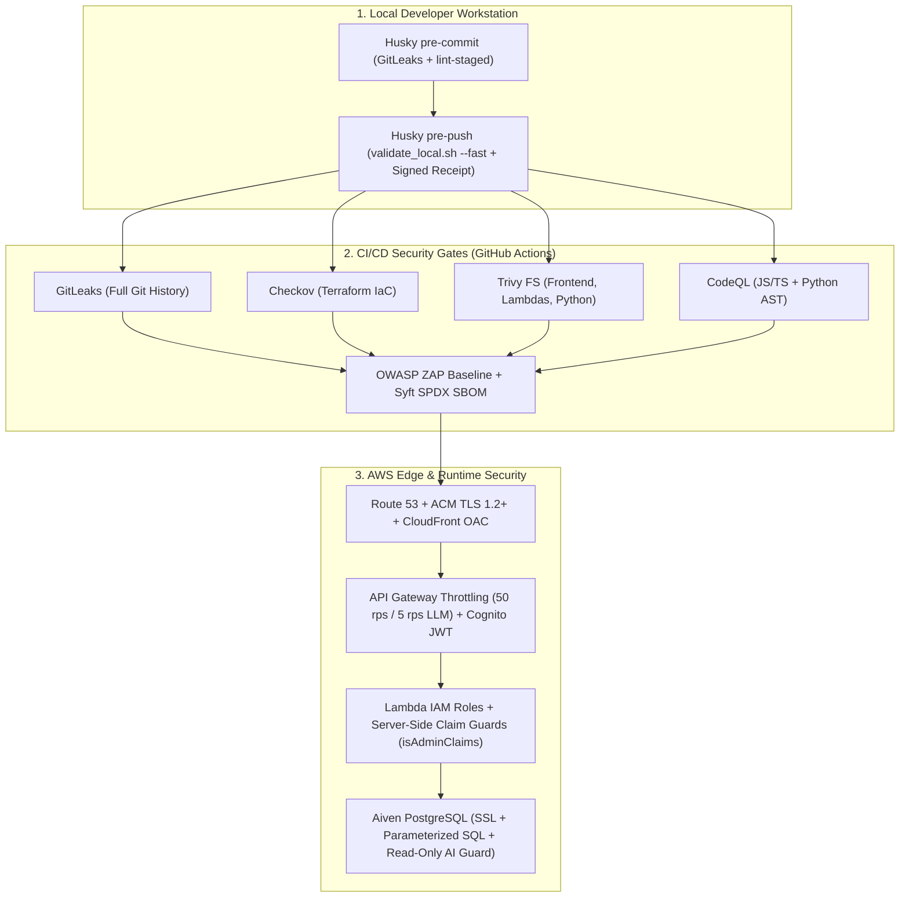

# 🛡️ Enterprise Security Posture & Trade-Offs

CricScore pairs **defense-in-depth DevSecOps guardrails** with explicit **cost-aware architectural trade-offs** to operate the combined Dev + Prod AWS cloud platform at **~$1/month**.

---

## 🏗️ 1. Defense-in-Depth Architecture



---

## 🔒 2. Active Security Controls Inventory

- **Edge & CDN (`infra/terraform/frontend.tf`):**
  - Enforces CloudFront Origin Access Control (OAC) and `aws_s3_bucket_public_access_block`.
  - Blocks direct public S3 access and forces all static traffic through CloudFront HTTPS.
- **Authentication (`infra/terraform/cognito.tf`, `infra/terraform/apigateway_http.tf`):**
  - Cognito User Pool paired with the API Gateway JWT Authorizer (`cognito-authorizer`).
  - Validates cryptographic JWT signatures, issuer, and audience at the API Gateway edge.
- **Authorization (`match-api/index.js`, `chat-api/config/auth.js`):**
  - Server-side `isAdminClaims(claims)` and `requireAdmin(event)` verify exact `"Admin"` group membership or `ADMIN_REPORT_EMAIL` from verified JWT claims.
  - Completely ignores client-supplied headers and request body role flags.
- **LLM & API Throttling (`infra/terraform/apigateway_http.tf`):**
  - Route-level token-bucket throttling caps default API routes at `50 req/s` (`100` burst) and unauthenticated `/chat` & `/chat/summary` routes at **`5 req/s` (`10` burst)**.
- **AI SQLi Prevention (`apps/backend/lambdas/chat-api/mcp/tools/`):**
  - Read-only MCP tool guard (`execute_sql`) rejects `INSERT`/`UPDATE`/`DELETE`/`DROP`/`TRUNCATE` keywords and wraps AI SQL queries in `READ ONLY` transactions.
- **Database SQLi Prevention (`match-api`, `storage-worker`, `chat-api`):**
  - Parameterized `pg` queries (`$1, $2, ...`) across all Lambdas neutralize SQL injection vectors across user inputs.
- **Aiven PostgreSQL Hardening (`match-api`, `storage-worker`, `chat-api`):**
  - In-transit TLS encryption with configurable strict CA bundle verification (`AIVEN_CA_CERT` / `DATABASE_CA_CERT`).
  - Active `10s` statement and query timeouts (`statement_timeout: 10000`, `query_timeout: 10000`) preventing connection exhaustion and runaway slow queries.
  - Least-privilege read-only AI role (`cricscore_ai_reader` in `infra/database/migrations/create_read_only_ai_role.sql`) hard-blocking any DDL/DML write at the database engine level.
- **ML Artifact Integrity (`apps/ml-engine/predict.py`, `apps/ml-engine/model_manifest.json`):**
  - Verifies the SHA-256 checksum of the downloaded S3 `.joblib` model (`XGBoost v2.2.0`) against `model_manifest.json` on cold start before unpickling.
- **Encryption at Rest (`frontend.tf`, `s3_backups.tf`, `sqs_sns.tf`):**
  - Uses AWS-managed encryption (`AES256`, `alias/aws/sns`, and SQS SSE) across S3 buckets, SNS topics, and SQS FIFO queues at zero extra KMS key cost.

---

## 🤖 3. Automated DevSecOps Scanners (Local Hooks & CI/CD)

| Scanner       | Layer             | Blocking Gate                                                                                               |
| :------------ | :---------------- | :---------------------------------------------------------------------------------------------------------- |
| **GitLeaks**  | Secret Detection  | Unignored secrets in commits or history                                                                     |
| **Checkov**   | Terraform IaC     | Unsuppressed IaC misconfigurations                                                                          |
| **Trivy FS**  | Dependency SCA    | Fixable `HIGH` or `CRITICAL` CVEs                                                                           |
| **npm audit** | Lockfile SCA      | Any `high` or `critical` npm advisory                                                                       |
| **CodeQL**    | Deep AST SAST     | JS/TS and Python security/logic flaws                                                                       |
| **OWASP ZAP** | Live DAST         | Baseline scan against Dev & Prod URLs                                                                       |
| **Syft**      | Supply Chain SBOM | Generates `cricscore-sbom.spdx.json` → synced to durable AWS S3 registry (`sboms/`) & GitHub release assets |

- **Execution Pipelines:**
  - **Local Pre-Commit & Pre-Push**: Runs GitLeaks, Checkov (`--download-external-modules false`), Trivy FS, and `npm audit --audit-level=high` via `.husky/pre-commit` and `./infra/scripts/validate_local.sh`.
  - **GitHub Actions CI/CD**: Runs `validate_security`, `validate_frontend`, `validate_backend`, `validate_python`, CodeQL (`codeql.yml`), OWASP ZAP (`.zap/rules.tsv`), and Syft SBOM (`sbom.yml`).

---

## 🔑 4. Zero-Static-Secret Identity: Keyless GitHub Actions OIDC (OpenID Connect)

CricScore eliminates long-lived static AWS IAM user credentials (`AWS_ACCESS_KEY_ID` / `AWS_SECRET_ACCESS_KEY`) from GitHub Secrets in favor of **short-lived, keyless OpenID Connect (OIDC)** token exchange with AWS Security Token Service (STS).

### 🛡️ Why OIDC Replaces Static Keys

1. **Ephemeral Temporary Credentials**: GitHub Actions requests a short-lived OIDC JSON Web Token (JWT) signed by GitHub's authority (`token.actions.githubusercontent.com`). AWS STS validates the token and returns credentials valid for only **15–60 minutes**.
2. **Zero Blast Radius**: No AWS secrets exist inside GitHub repository or environment settings. If CI logs or runner environments are inspected, no static secrets can be exfiltrated.
3. **Cryptographically Scoped Trust**: The IAM role (`cricscore-github-actions-role`) strictly checks that the JWT `sub` matches `repo:venkatesh-singamsetty/cricscore:*` and `aud` is `sts.amazonaws.com`. Third-party repositories, forks, or external callers are blocked at the AWS STS boundary.

### 🚀 Initial "Day 0" AWS Account Bootstrap: Unified Setup Guide

Because an AWS account starts empty, both foundational infrastructure (DNS/State) and GitHub Actions identity federation require a one-time bootstrap from an authenticated developer workstation (`user/venky`):

| Bootstrap Operation            | Tool / Command                                                         | Resources Provisioned in AWS                                                                                    | Why It Runs on Day 0                                                                        |
| :----------------------------- | :--------------------------------------------------------------------- | :-------------------------------------------------------------------------------------------------------------- | :------------------------------------------------------------------------------------------ |
| **1. State & DNS Bootstrap**   | `./infra/scripts/deploy.sh --env dev --use-local-env --bootstrap-only` | S3 remote state bucket, DynamoDB lock table, Route 53 root hosted zone                                          | Required before any environment Terraform code can store state or provision custom domains. |
| **2. OIDC Identity Bootstrap** | `./infra/scripts/bootstrap_oidc.sh`                                    | IAM OIDC Provider (`token.actions.githubusercontent.com`), `cricscore-github-actions-role`, `vars.AWS_ROLE_ARN` | Required before GitHub Actions can authenticate without static access keys.                 |

```bash
# Complete Day 0 AWS Account Bootstrap (Run once per AWS account)

# Step 1: Provision S3 remote state bucket, DynamoDB lock table, and Route 53 hosted zone
./infra/scripts/deploy.sh --env dev --use-local-env --bootstrap-only

# Step 2: Provision keyless GitHub Actions OIDC Provider and IAM role
./infra/scripts/bootstrap_oidc.sh
```

**What `bootstrap_oidc.sh` Does:**

1. Verifies local AWS administrator authentication (`aws sts get-caller-identity`).
2. Idempotently creates the IAM OpenID Connect Provider (`https://token.actions.githubusercontent.com`) with audience `sts.amazonaws.com` and GitHub's root CA thumbprints.
3. Provisions the IAM Role `cricscore-github-actions-role` with a trust policy restricting role assumption strictly to `repo:venkatesh-singamsetty/cricscore:*`.
4. Attaches deployment permissions (`AdministratorAccess`) to allow Terraform infrastructure provisioning, S3 asset synchronization, and CloudFront cache invalidation.
5. Sets the GitHub repository variable `AWS_ROLE_ARN` (`gh variable set AWS_ROLE_ARN -b "arn:aws:iam::<ACCOUNT_ID>:role/cricscore-github-actions-role"`).

Once bootstrapped, all GitHub Actions workflows (`ci.yml`, `cd.yml`, `drift.yml`, `terraform-unlock.yml`) automatically assume this role via `permissions: id-token: write`. Any legacy static keys (`AWS_ACCESS_KEY_ID`) can then be safely revoked and deleted from GitHub Secrets.

### 🛡️ GitHub Repository & Secret Security Hardening ($0.00 Free)

1. **Least-Privilege GitHub Actions Token (`default_workflow_permissions: "read"`)**:
   - Repository-wide default token permission is locked down to read-only (`read`).
   - Every workflow explicitly specifies minimal permissions (e.g. `contents: read`, `id-token: write`, `issues: write`), guaranteeing third-party or newly added actions have no write capabilities by default.
2. **Preventing Automated Pull Request Approvals (`can_approve_pull_request_reviews: false`)**:
   - Automated workflows are barred from approving pull requests, preventing autonomous review-bypass vulnerabilities.
3. **Permanent Removal of Obsolete Secrets**:
   - Legacy and deprecated variables (`VITE_ADMIN_PIN`) have been permanently deleted from GitHub Secrets. Authentication is strictly delegated to AWS Cognito JWT tokens verified server-side.
4. **Scoped Access for the AI Assistant Chat Bot (`create_github_issue`)**:
   - The Chat Assistant's issue reporter utilizes an MCP tool (`create_github_issue`) bounded strictly to `venkatesh-singamsetty/cricscore`.
   - Requires fine-grained PAT scoping with `Issues: Read and Write` and auto-applies `via-cricscore-ai` alongside category labels (`bug`, `feature-request`, `feedback`).
5. **Strict Root CA In-Transit Validation (`AIVEN_CA_CERT`)**:
   - The Aiven Project Root CA (`infra/database/certs/aiven-ca.pem`) is git-ignored and securely stored in GitHub Secrets.
   - Backend connection pools cryptographically verify the certificate chain (`rejectUnauthorized: true, ca: process.env.AIVEN_CA_CERT`), eliminating Man-in-the-Middle (MITM) attacks at zero cost.

---

## ⚖️ 5. Intentional Cost & Functionality Trade-Offs (~$1/Month Target)

- **AWS WAF & RASP (❌ Intentionally Omitted — Saves `~$5.00+/mo` + per-rule fees):**
  - Avoids fixed WAF ACL fees and Lambda cold-start overhead.
  - Compensated by CloudFront OAC, API Gateway route throttling (`5 rps` on `/chat`), Cognito JWT, and parameterized SQL.
- **Private VPC + NAT Gateway (❌ Intentionally Omitted — Saves `~$32.00+/mo`):**
  - Avoids hourly NAT Gateway and ENI charges.
  - Lambdas connect to Aiven PostgreSQL over TLS (`sslmode=require`) with IAM and Cognito JWT authorization.
- **Custom KMS Keys / CMK (⚠️ Uses AWS-Managed `AES256` — Saves `~$2.00+/mo`):**
  - Suppresses `AWS-0095`, `AWS-0132`, and `CKV_AWS_145` to avoid `$1/key/mo` charges.
  - Uses free AWS-managed encryption (`SSE-S3`, `alias/aws/sns`, `sqs_managed_sse_enabled`).
- **CSP `unsafe-inline` (⚠️ Relaxed for Styles/Scripts):**
  - Preserves compatibility with Vite/Amplify runtime styles while React JSX auto-escapes interpolated text and Chat UI sanitizes links (`HighlightedResult`).
- **Cross-Origin Isolation (❌ Intentionally Omitted):**
  - Strict `COEP`/`COOP`/`CORP` headers block Google Fonts and cross-subdomain API Gateway (`api.*`, `ws.*`) connections; documented in `.zap/rules.tsv`.
- **Sub-Resource Integrity / SRI (❌ Intentionally Omitted):**
  - Static bundle assets are served directly from our private S3 bucket via CloudFront OAC rather than third-party script CDNs.
- **IaC Access-Log Chaining (`CKV_AWS_18` Documented in `.checkov.yaml` — Saves `~$1.00+/mo`):**
  - Skips S3 access-log chaining on secondary buckets to prevent recursive log storage and KMS key charges.

---

## 🧪 5. Security Verification Commands

```bash
# 1. Run the complete local DevSecOps security & test battery (~25s, 376 unit tests + scanners)
./infra/scripts/validate_local.sh --fast

# 2. Scan git repository for secrets with GitLeaks
gitleaks detect --source . --verbose

# 3. Audit Terraform Infrastructure-as-Code with Checkov
checkov -d infra/terraform/ --framework terraform --download-external-modules false --quiet

# 4. Run Trivy filesystem vulnerability scans across Frontend, Backend Lambdas, and Python AI Service
trivy fs --severity HIGH,CRITICAL --ignore-unfixed --exit-code 1 apps/frontend
trivy fs --severity HIGH,CRITICAL --ignore-unfixed --exit-code 1 apps/backend/lambdas
trivy fs --severity HIGH,CRITICAL --ignore-unfixed --exit-code 1 apps/ai-service

# 5. Generate SPDX Software Bill of Materials (SBOM) via Syft
syft scan dir:. --output spdx-json=cricscore-sbom.spdx.json
```
