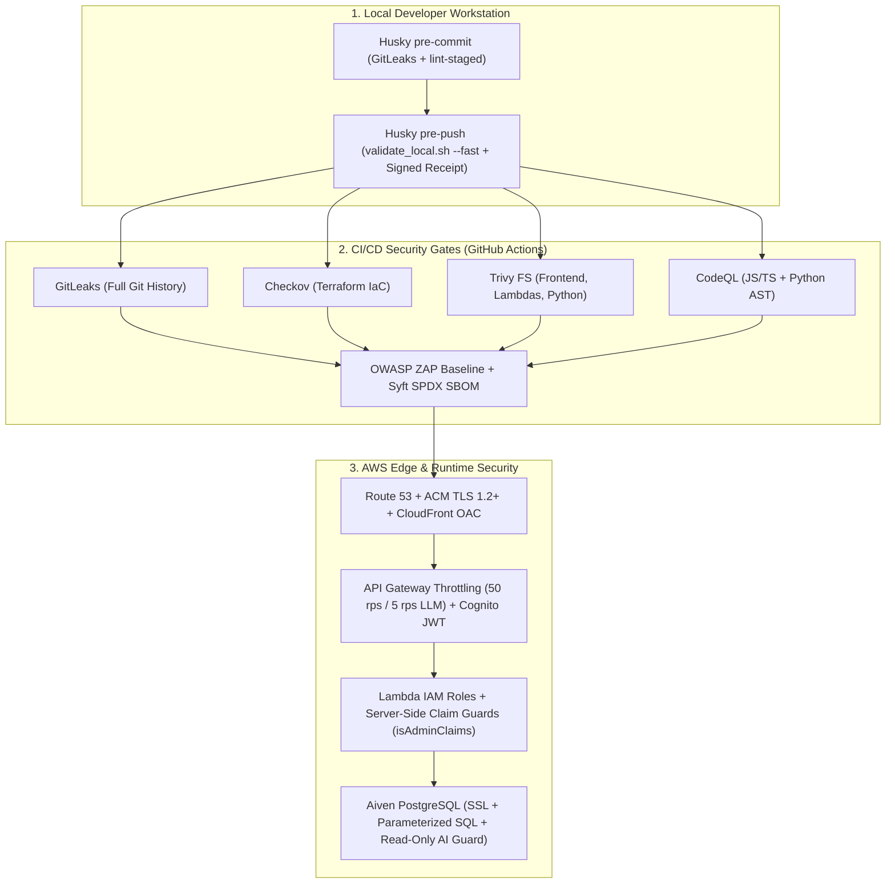

# 🛡️ Enterprise Security Posture & Trade-Offs

CricScore pairs **defense-in-depth DevSecOps guardrails** with explicit **cost-aware architectural trade-offs** to operate the combined Dev + Prod AWS cloud platform at **~$1/month**.

---

## 🏗️ 1. Defense-in-Depth Architecture



---

## 🔒 2. Active Security Controls Inventory

- **Edge & CDN (`infra/terraform/frontend.tf`):**
  - Enforces CloudFront Origin Access Control (OAC) and `aws_s3_bucket_public_access_block`.
  - Blocks direct public S3 access and forces all static traffic through CloudFront HTTPS.
- **Authentication (`infra/terraform/cognito.tf`, `infra/terraform/apigateway_http.tf`):**
  - Cognito User Pool paired with the API Gateway JWT Authorizer (`cognito-authorizer`).
  - Validates cryptographic JWT signatures, issuer, and audience at the API Gateway edge.
- **Authorization (`match-api/index.js`, `chat-api/config/auth.js`):**
  - Server-side `isAdminClaims(claims)` and `requireAdmin(event)` verify exact `"Admin"` group membership or `ADMIN_REPORT_EMAIL` from verified JWT claims.
  - Completely ignores client-supplied headers and request body role flags.
- **LLM & API Throttling (`infra/terraform/apigateway_http.tf`):**
  - Route-level token-bucket throttling caps default API routes at `50 req/s` (`100` burst) and unauthenticated `/chat` & `/chat/summary` routes at **`5 req/s` (`10` burst)**.
- **AI SQLi Prevention (`apps/backend/lambdas/chat-api/mcp/tools/`):**
  - Read-only MCP tool guard (`execute_sql`) rejects `INSERT`/`UPDATE`/`DELETE`/`DROP`/`TRUNCATE` keywords and wraps AI SQL queries in `READ ONLY` transactions.
- **Database SQLi Prevention (`match-api`, `storage-worker`, `chat-api`):**
  - Parameterized `pg` queries (`$1, $2, ...`) across all Lambdas neutralize SQL injection vectors across user inputs.
- **ML Artifact Integrity (`apps/ml-engine/predict.py`, `apps/ml-engine/model_manifest.json`):**
  - Verifies the SHA-256 checksum of the downloaded S3 `.joblib` model (`XGBoost v2.2.0`) against `model_manifest.json` on cold start before unpickling.
- **Encryption at Rest (`frontend.tf`, `s3_backups.tf`, `sqs_sns.tf`):**
  - Uses AWS-managed encryption (`AES256`, `alias/aws/sns`, and SQS SSE) across S3 buckets, SNS topics, and SQS FIFO queues at zero extra KMS key cost.

---

## 🤖 3. Automated DevSecOps Scanners (Local Hooks & CI/CD)

| Scanner       | Layer             | Blocking Gate                           |
| :------------ | :---------------- | :-------------------------------------- |
| **GitLeaks**  | Secret Detection  | Unignored secrets in commits or history |
| **Checkov**   | Terraform IaC     | Unsuppressed IaC misconfigurations      |
| **Trivy FS**  | Dependency SCA    | Fixable `HIGH` or `CRITICAL` CVEs       |
| **npm audit** | Lockfile SCA      | Any `high` or `critical` npm advisory   |
| **CodeQL**    | Deep AST SAST     | JS/TS and Python security/logic flaws   |
| **OWASP ZAP** | Live DAST         | Baseline scan against Dev & Prod URLs   |
| **Syft**      | Supply Chain SBOM | Generates `cricscore-sbom.spdx.json`    |

- **Execution Pipelines:**
  - **Local Pre-Commit & Pre-Push**: Runs GitLeaks, Checkov (`--download-external-modules false`), Trivy FS, and `npm audit --audit-level=high` via `.husky/pre-commit` and `./infra/scripts/validate_local.sh`.
  - **GitHub Actions CI/CD**: Runs `validate_security`, `validate_frontend`, `validate_backend`, `validate_python`, CodeQL (`codeql.yml`), OWASP ZAP (`.zap/rules.tsv`), and Syft SBOM (`sbom.yml`).

---

## ⚖️ 4. Intentional Cost & Functionality Trade-Offs (~$1/Month Target)

- **AWS WAF & RASP (❌ Intentionally Omitted — Saves `~$5.00+/mo` + per-rule fees):**
  - Avoids fixed WAF ACL fees and Lambda cold-start overhead.
  - Compensated by CloudFront OAC, API Gateway route throttling (`5 rps` on `/chat`), Cognito JWT, and parameterized SQL.
- **Private VPC + NAT Gateway (❌ Intentionally Omitted — Saves `~$32.00+/mo`):**
  - Avoids hourly NAT Gateway and ENI charges.
  - Lambdas connect to Aiven PostgreSQL over TLS (`sslmode=require`) with IAM and Cognito JWT authorization.
- **Custom KMS Keys / CMK (⚠️ Uses AWS-Managed `AES256` — Saves `~$2.00+/mo`):**
  - Suppresses `AWS-0095`, `AWS-0132`, and `CKV_AWS_145` to avoid `$1/key/mo` charges.
  - Uses free AWS-managed encryption (`SSE-S3`, `alias/aws/sns`, `sqs_managed_sse_enabled`).
- **CSP `unsafe-inline` (⚠️ Relaxed for Styles/Scripts):**
  - Preserves compatibility with Vite/Amplify runtime styles while React JSX auto-escapes interpolated text and Chat UI sanitizes links (`HighlightedResult`).
- **Cross-Origin Isolation (❌ Intentionally Omitted):**
  - Strict `COEP`/`COOP`/`CORP` headers block Google Fonts and cross-subdomain API Gateway (`api.*`, `ws.*`) connections; documented in `.zap/rules.tsv`.
- **Sub-Resource Integrity / SRI (❌ Intentionally Omitted):**
  - Static bundle assets are served directly from our private S3 bucket via CloudFront OAC rather than third-party script CDNs.
- **IaC Access-Log Chaining (`CKV_AWS_18` Documented in `.checkov.yaml` — Saves `~$1.00+/mo`):**
  - Skips S3 access-log chaining on secondary buckets to prevent recursive log storage and KMS key charges.

---

## 🧪 5. Security Verification Commands

```bash
# 1. Run the complete local DevSecOps security & test battery (~25s, 376 unit tests + scanners)
./infra/scripts/validate_local.sh --fast

# 2. Scan git repository for secrets with GitLeaks
gitleaks detect --source . --verbose

# 3. Audit Terraform Infrastructure-as-Code with Checkov
checkov -d infra/terraform/ --framework terraform --download-external-modules false --quiet

# 4. Run Trivy filesystem vulnerability scans across Frontend, Backend Lambdas, and Python AI Service
trivy fs --severity HIGH,CRITICAL --ignore-unfixed --exit-code 1 apps/frontend
trivy fs --severity HIGH,CRITICAL --ignore-unfixed --exit-code 1 apps/backend/lambdas
trivy fs --severity HIGH,CRITICAL --ignore-unfixed --exit-code 1 apps/ai-service

# 5. Generate SPDX Software Bill of Materials (SBOM) via Syft
syft scan dir:. --output spdx-json=cricscore-sbom.spdx.json
```
