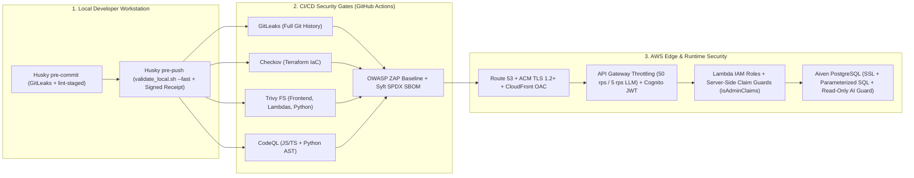

# 🛡️ Enterprise Security Posture & Trade-Offs

CricScore pairs **defense-in-depth DevSecOps guardrails** with explicit **cost-aware architectural trade-offs** to operate the combined Dev + Prod AWS cloud platform at **~$1/month**.

---

## 🏗️ 1. Defense-in-Depth Architecture



---

## 🔒 2. Active Security Controls Inventory

| Security Domain              | Enforced Control                                                             | Implementation Source                                                     | Protection Provided                                                                                                                      |
| :--------------------------- | :--------------------------------------------------------------------------- | :------------------------------------------------------------------------ | :--------------------------------------------------------------------------------------------------------------------------------------- |
| **Edge & CDN**               | CloudFront Origin Access Control (OAC) + `aws_s3_bucket_public_access_block` | • `infra/terraform/frontend.tf`                                           | • Blocks direct public S3 access<br/>• Forces all static traffic through CloudFront HTTPS                                                |
| **Authentication**           | Cognito User Pool + API Gateway JWT Authorizer (`cognito-authorizer`)        | • `infra/terraform/cognito.tf`<br/>• `infra/terraform/apigateway_http.tf` | • Validates cryptographic JWT signature, issuer, and audience at the API Gateway edge                                                    |
| **Authorization**            | Server-side `isAdminClaims(claims)` & `requireAdmin(event)`                  | • `match-api/index.js`<br/>• `chat-api/config/auth.js`                    | • Verifies exact `"Admin"` group membership or `ADMIN_REPORT_EMAIL` from verified JWT claims<br/>• Ignores client headers and body flags |
| **LLM & API Throttling**     | Route-level token-bucket throttling                                          | • `infra/terraform/apigateway_http.tf`                                    | • Caps default API routes at `50 req/s` (`100` burst)<br/>• Caps unauthenticated `/chat` & `/chat/summary` at **`5 req/s` (`10` burst)** |
| **AI SQLi Prevention**       | Read-only MCP tool guard (`execute_sql`) + `READ ONLY` transaction           | • `apps/backend/lambdas/chat-api/mcp/tools/`                              | • Rejects `INSERT`/`UPDATE`/`DELETE`/`DROP`/`TRUNCATE` keywords<br/>• Wraps AI SQL queries in read-only transactions                     |
| **Database SQLi Prevention** | Parameterized `pg` queries (`$1, $2, ...`) across all Lambdas                | • `match-api`<br/>• `storage-worker`<br/>• `chat-api`                     | • Neutralizes SQL injection vectors across all user inputs                                                                               |
| **ML Artifact Integrity**    | SHA-256 checksum verification on cold-start model load                       | • `apps/ml-engine/predict.py`<br/>• `apps/ml-engine/model_manifest.json`  | • Verifies downloaded S3 `.joblib` model (`XGBoost v2.2.0`) against `model_manifest.json` before unpickling                              |
| **Encryption at Rest**       | AWS-managed encryption (`AES256` / `alias/aws/sns` / SQS SSE)                | • `frontend.tf`<br/>• `s3_backups.tf`<br/>• `sqs_sns.tf`                  | • Encrypts S3 buckets, SNS topics, and SQS FIFO queues at no additional KMS key cost                                                     |

---

## 🤖 3. Automated DevSecOps Scanners (Local Hooks & CI/CD)

| Scanner                | Category           | Local Hook Execution                                        | GitHub Actions Workflow                                                                                 | Blocking Threshold                                              |
| :--------------------- | :----------------- | :---------------------------------------------------------- | :------------------------------------------------------------------------------------------------------ | :-------------------------------------------------------------- |
| **GitLeaks**           | Secret Detection   | • `.husky/pre-commit`<br/>• `validate_local.sh`             | • `.github/workflows/ci.yml` (`validate_security`)                                                      | Any unignored secret in staged changes or Git history           |
| **Checkov**            | Terraform IaC SAST | • `validate_local.sh` (`--download-external-modules false`) | • `.github/workflows/ci.yml` (`validate_security`)                                                      | Any unsuppressed Terraform misconfiguration                     |
| **Trivy (`trivy fs`)** | Dependency SCA     | • `validate_local.sh`                                       | • `.github/workflows/ci.yml`<br/>• Runs in `validate_frontend`, `validate_backend`, & `validate_python` | Fixable `HIGH` or `CRITICAL` vulnerabilities (`exit-code: 1`)   |
| **`npm audit`**        | Lockfile SCA       | • `validate_local.sh` (`--audit-level=high`)                | • Local pre-push gate                                                                                   | Any `high` or `critical` npm advisory                           |
| **CodeQL**             | Deep AST SAST      | —                                                           | • `.github/workflows/codeql.yml`                                                                        | Logical/security flaws in `javascript-typescript` and `python`  |
| **OWASP ZAP**          | Live DAST          | —                                                           | • `.github/workflows/ci.yml`<br/>• `.github/workflows/deploy_prod.yml`                                  | Baseline scan against deployed Dev/Prod URLs (`.zap/rules.tsv`) |
| **Syft**               | SPDX JSON SBOM     | • `validate_local.sh` (unless `--fast` / `--skip-sbom`)     | • `.github/workflows/sbom.yml`                                                                          | Generates `cricscore-sbom.spdx.json` artifact                   |

---

## ⚖️ 4. Intentional Cost & Functionality Trade-Offs (~$1/Month Target)

| Control / Feature          | Current Status                     | Monthly Cost Saved             | Architectural Rationale & Compensating Mitigation                                                                                                                               |
| :------------------------- | :--------------------------------- | :----------------------------- | :------------------------------------------------------------------------------------------------------------------------------------------------------------------------------ |
| **AWS WAF & RASP**         | ❌ Intentionally Omitted           | **~$5.00+/mo + per-rule fees** | • Avoids fixed WAF ACL fees and Lambda cold-start degradation<br/>• Mitigated by CloudFront OAC, API Gateway route throttling (`5 rps` on `/chat`), Cognito JWT, & prepared SQL |
| **Private VPC + NAT**      | ❌ Intentionally Omitted           | **~$32.00+/mo**                | • Avoids hourly NAT Gateway and ENI charges<br/>• Lambdas connect to Aiven PostgreSQL over TLS (`sslmode=require`) with IAM + Cognito JWT authorization                         |
| **Custom KMS Keys (CMK)**  | ⚠️ Uses AWS-Managed SSE (`AES256`) | **~$2.00+/mo** (`$1/key/mo`)   | • Suppresses `AWS-0095`, `AWS-0132`, and `CKV_AWS_145`<br/>• Uses free AWS-managed encryption (`SSE-S3`, `alias/aws/sns`, `sqs_managed_sse_enabled`)                            |
| **CSP `unsafe-inline`**    | ⚠️ Relaxed for Styles/Scripts      | —                              | • Preserves compatibility with Vite/Amplify runtime styles<br/>• React JSX auto-escapes interpolated text and Chat UI sanitizes links (`HighlightedResult`)                     |
| **Cross-Origin Isolation** | ❌ Intentionally Omitted           | —                              | • Strict `COEP`/`COOP`/`CORP` blocks Google Fonts and cross-subdomain API Gateway (`api.*`, `ws.*`) connections<br/>• Documented in `.zap/rules.tsv`                            |
| **Sub-Resource Integrity** | ❌ Intentionally Omitted           | —                              | • Static bundle assets are served directly from our private S3 bucket via CloudFront OAC rather than third-party script CDNs                                                    |
| **IaC Suppressions**       | ⚠️ Documented in `.checkov.yaml`   | **~$1.00+/mo**                 | • Skips S3 access-log chaining (`CKV_AWS_18`) on secondary buckets<br/>• Prevents recursive log storage and KMS key charges                                                     |

---

## 🧪 5. Security Verification Commands

```bash
# 1. Run the complete local DevSecOps security & test battery (~25s, 376 unit tests + scanners)
./infra/scripts/validate_local.sh --fast

# 2. Scan git repository for secrets with GitLeaks
gitleaks detect --source . --verbose

# 3. Audit Terraform Infrastructure-as-Code with Checkov
checkov -d infra/terraform/ --framework terraform --download-external-modules false --quiet

# 4. Run Trivy filesystem vulnerability scans across Frontend, Backend Lambdas, and Python AI Service
trivy fs --severity HIGH,CRITICAL --ignore-unfixed --exit-code 1 apps/frontend
trivy fs --severity HIGH,CRITICAL --ignore-unfixed --exit-code 1 apps/backend/lambdas
trivy fs --severity HIGH,CRITICAL --ignore-unfixed --exit-code 1 apps/ai-service

# 5. Generate SPDX Software Bill of Materials (SBOM) via Syft
syft scan dir:. --output spdx-json=cricscore-sbom.spdx.json
```
