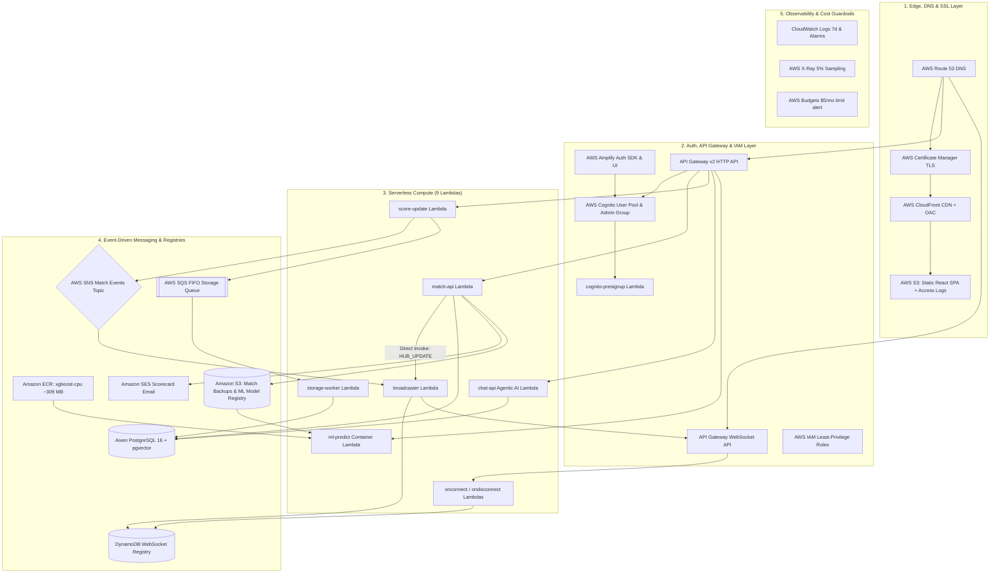

# 🏗️ CricScore Terraform Infrastructure Guide & Tutorial

Step-by-step reference and operational guide for managing CricScore's AWS Infrastructure as Code (IaC) with **Terraform `>= 1.10.0`** (`~$1/month` total AWS run rate across `dev` + `prod` combined).

> [!IMPORTANT]
> For initial account setup, Route 53 bootstrap, and one-command deployment, follow the [Deployment Guide](./deployment.md). Use the manual Terraform commands below when inspecting plans, debugging state, or reviewing infrastructure changes prior to apply.

---

## 🎯 Infrastructure Overview



---

## 📁 Terraform File Directory Layout

All root configuration files live in `infra/terraform/` (with one-time state/DNS bootstrap in `infra/terraform/bootstrap/` and Reusable Lambda packaging in `infra/terraform/modules/zip_lambda/`):

| File                          | AWS Resources Provisioned                                                                                                               | Key Cost & Security Guardrails                                                                                                                           |
| :---------------------------- | :-------------------------------------------------------------------------------------------------------------------------------------- | :------------------------------------------------------------------------------------------------------------------------------------------------------- |
| **`providers.tf`**            | • S3 remote backend (`use_lockfile = true`)<br/>• AWS providers (`us-east-1` for ACM/CloudFront)                                        | • Native S3 `.tflock` locking<br/>• No DynamoDB lock table needed                                                                                        |
| **`variables.tf`**            | • Input variables (`environment`, `domain_name`, `database_url`)<br/>• AI & ML settings (`llm_api_key`, `ml_model_version`)             | • Marks all secret inputs `sensitive = true`                                                                                                             |
| **`outputs.tf`**              | • Exports `http_api_url`, `websocket_url`, `s3_bucket_name`<br/>• Exports `cognito_user_pool_id`, `cloudfront_distribution_id`          | • Consumed automatically by `deploy.sh`, `ci.yml`, and `cd.yml`                                                                                          |
| **`lambda.tf`**               | • 8 Node.js 24 ZIP Lambdas (`modules/zip_lambda`)<br/>• 1 Python 3.12 Docker Lambda (`ml-predict`)<br/>• ECR repo & CloudWatch alarms   | • Builds CPU-only `xgboost-cpu` (`~309 MB`)<br/>• `countNumber = 1` single-image retention (`< 0.62 GB` across `dev` + `prod`)<br/>• 7-day log retention |
| **`apigateway_http.tf`**      | • API Gateway v2 HTTP API (`api.<domain>`)<br/>• Routes (`/matches`, `/match/*`, `/chat`, `/rules/upload`)<br/>• Cognito JWT authorizer | • Payload format v2.0<br/>• CORS locked strictly to frontend origin                                                                                      |
| **`apigateway_websocket.tf`** | • API Gateway v2 WebSocket API (`ws.<domain>`)<br/>• `$connect` and `$disconnect` routes (`prod` stage)                                 | • Pay-per-message WebSocket fan-out                                                                                                                      |
| **`messaging.tf`**            | • SNS `match_events` topic<br/>• SQS FIFO `storage_buffer.fifo` queue<br/>• DynamoDB `connections` table (`PAY_PER_REQUEST`)            | • Content-based SQS deduplication<br/>• 1-day message retention<br/>• On-demand DynamoDB billing                                                         |
| **`cognito.tf`**              | • Cognito User Pool, App Client, and `Admin` group<br/>• User Pool Domain and Pre-SignUp Lambda trigger                                 | • Free tier up to 50,000 MAUs                                                                                                                            |
| **`frontend.tf`**             | • S3 static SPA bucket<br/>• CloudFront CDN with Origin Access Control (OAC)<br/>• ACM TLS certs and Route 53 alias records             | • Private S3 bucket (OAC access only)<br/>• TLS 1.2+ enforced                                                                                            |
| **`iam.tf`**                  | • Least-privilege IAM execution role<br/>• Scoped policies (DynamoDB, SQS, SNS, SES, S3, CloudWatch, X-Ray)                             | • Scoped strictly to project resource ARNs                                                                                                               |
| **`cost_budget.tf`**          | • AWS Budgets monthly cost guardrail (`$5.00/month` limit)                                                                              | • Sends email alert to `admin_email` at 80% (`$4.00`) actual spend                                                                                       |
| **`s3_backups.tf`**           | • Match JSON backups bucket<br/>• Versioned ML model registry (`models/${var.ml_model_version}/`)                                       | • 180-day lifecycle expiration on match backups<br/>• AES-256 server-side encryption                                                                     |
| **`kms_and_logging.tf`**      | • S3 access-logging bucket with public-access block                                                                                     | • 30-day lifecycle expiration on access logs                                                                                                             |
| **`xray.tf`**                 | • AWS X-Ray sampling rule (`cricscore-low-cost-sampling`)                                                                               | • `fixed_rate = 0.05` (5% sampling) + `reservoir_size = 1`<br/>• Stays 100% within AWS X-Ray Free Tier                                                   |
| **`environments/*.tfvars`**   | • `dev.tfvars` and `prod.tfvars` environment defaults                                                                                   | • Isolates `dev` vs `prod` configuration                                                                                                                 |

---

## 🔄 Environment Isolation (`dev` vs `prod`)

CricScore isolates `dev` and `prod` using **separate S3 state keys, separate `.tflock` lock files, and per-environment variable files** (not Terraform workspaces):

| Dimension             | Dev Environment                                       | Prod Environment                                       |
| :-------------------- | :---------------------------------------------------- | :----------------------------------------------------- |
| **State Bucket**      | `$TF_STATE_BUCKET`                                    | `$TF_STATE_BUCKET`                                     |
| **S3 State Key**      | `cricscore/dev/terraform.tfstate`                     | `cricscore/prod/terraform.tfstate`                     |
| **S3 Lock Object**    | `cricscore/dev/terraform.tfstate.tflock`              | `cricscore/prod/terraform.tfstate.tflock`              |
| **tfvars File**       | `infra/terraform/environments/dev.tfvars`             | `infra/terraform/environments/prod.tfvars`             |
| **Resource Prefix**   | `cricscoredev-*`                                      | `cricscore-*`                                          |
| **PostgreSQL Schema** | `dev` (same Aiven DB instance)                        | `prod` (same Aiven DB instance)                        |
| **Deploy Command**    | `./infra/scripts/deploy.sh --env dev --use-local-env` | `./infra/scripts/deploy.sh --env prod --use-local-env` |

---

## 🛠️ Step-by-Step Terraform Operations

### Prerequisites

| Requirement          | Verification Command            | Expected Result                                                            |
| :------------------- | :------------------------------ | :------------------------------------------------------------------------- |
| **Terraform CLI**    | `terraform version`             | • `Terraform v1.10.x` or newer                                             |
| **AWS Credentials**  | `aws sts get-caller-identity`   | • Returns IAM User ARN and Account ID                                      |
| **Docker Daemon**    | `docker info`                   | • Running (required by `null_resource.docker_build_push` for `ml-predict`) |
| **Local Env Config** | `test -f .env.local && echo OK` | • `OK` (populated per [deployment.md](./deployment.md))                    |

### Step 1: Validate syntax and formatting (no AWS calls)

```bash
terraform fmt -check -recursive
terraform -chdir=infra/terraform init -backend=false
terraform -chdir=infra/terraform validate
```

### Step 2: Generate an environment-specific execution plan (`dev` or `prod`)

```bash
set -a && source ./.env.local && set +a

ENV=dev   # Change to 'prod' to preview production changes
if [ "$ENV" = "dev" ]; then
  DEPLOY_DOMAIN="${DEV_DOMAIN_NAME:-${SUBDOMAIN_PREFIX}dev.${ZONE_DOMAIN}}"
  DEPLOY_PROJECT="${DEV_PROJECT_NAME:-${PROJECT_NAME}dev}"
  DEPLOY_PREFIX="${DEV_SUBDOMAIN_PREFIX:-${SUBDOMAIN_PREFIX}dev}"
else
  DEPLOY_DOMAIN="${PROD_DOMAIN_NAME:-${DOMAIN_NAME:-${SUBDOMAIN_PREFIX}.${ZONE_DOMAIN}}}"
  DEPLOY_PROJECT="${PROD_PROJECT_NAME:-$PROJECT_NAME}"
  DEPLOY_PREFIX="${PROD_SUBDOMAIN_PREFIX:-$SUBDOMAIN_PREFIX}"
fi

export TF_VAR_aws_region="${AWS_REGION:-us-east-1}"
export TF_VAR_database_url="$TF_DATABASE_URL"
export TF_VAR_ses_source_email="$TF_SES_SOURCE_EMAIL"
export TF_VAR_admin_email="${ADMIN_EMAIL:-admin@example.com}"
export TF_VAR_llm_api_key="${OPENAI_API_KEY:-${LLM_API_KEY:-}}"
export TF_VAR_openai_api_key="${OPENAI_API_KEY:-}"
export TF_VAR_llm_base_url="${LLM_BASE_URL:-https://api.openai.com/v1}"
export TF_VAR_llm_model="${LLM_MODEL:-gpt-4o-mini}"

terraform -chdir=infra/terraform init -reconfigure -upgrade \
  -backend-config="bucket=$TF_STATE_BUCKET" \
  -backend-config="key=cricscore/$ENV/terraform.tfstate"

terraform -chdir=infra/terraform plan \
  -var-file="environments/$ENV.tfvars" \
  -var="domain_name=$DEPLOY_DOMAIN" \
  -var="zone_domain=$ZONE_DOMAIN" \
  -var="project_name=$DEPLOY_PROJECT" \
  -var="subdomain_prefix=$DEPLOY_PREFIX" \
  -out="$ENV.tfplan"
```

> [!CAUTION]
> Always delete local `*.tfplan` files after inspection (`rm -f infra/terraform/*.tfplan`) as Terraform plan binaries contain resolved secret variables in plaintext.

### Step 3: Apply and publish

For full end-to-end deployment (Lambda hydration, `terraform init -upgrade`, `terraform apply`, 7-day CloudWatch log retention enforcement, frontend build, S3 sync, and CloudFront cache invalidation), always run the canonical deploy script (see [Deployment Guide — Step 4: Deploy](./deployment.md#step-4-deploy)):

```bash
# Deploy Dev (add --migrate when schema changes exist)
./infra/scripts/deploy.sh --env dev --use-local-env

# Deploy Prod (add --migrate when schema changes exist)
./infra/scripts/deploy.sh --env prod --use-local-env
```

### Step 4: Inspect deployed outputs

```bash
terraform -chdir=infra/terraform output
```

| Output Name                  | Description                       | Example Value                             |
| :--------------------------- | :-------------------------------- | :---------------------------------------- |
| `website_url`                | CloudFront custom domain URL      | `https://cricscoredev.yourdomain.com`     |
| `http_api_url`               | API Gateway v2 HTTP endpoint      | `https://api.cricscoredev.yourdomain.com` |
| `websocket_url`              | API Gateway v2 WebSocket endpoint | `wss://ws.cricscoredev.yourdomain.com`    |
| `cognito_user_pool_id`       | Cognito User Pool ID              | `us-east-1_AbCdEfGh`                      |
| `cognito_client_id`          | Cognito SPA App Client ID         | `1a2b3c4d5e6f7g8h9i0j`                    |
| `s3_bucket_name`             | Frontend SPA hosting bucket       | `cricscoredev.yourdomain.com`             |
| `cloudfront_distribution_id` | CloudFront Distribution ID        | `E123456789ABCD`                          |

---

## 🔒 State Management & Force Unlock

| Scenario                    | Recommended Action                                                                                         | Command / Workflow                                                             |
| :-------------------------- | :--------------------------------------------------------------------------------------------------------- | :----------------------------------------------------------------------------- |
| **Normal Operation**        | • Native S3 state locking (`use_lockfile = true`)<br/>• Automatically creates and removes `.tflock`        | Automatic during `plan` / `apply`                                              |
| **Stale Lock in GitHub CI** | • Trigger the **Terraform Force Unlock** workflow in GitHub Actions<br/>• Pass `environment` and `lock_id` | `gh workflow run terraform-unlock.yml -f environment=dev -f lock_id=<LOCK_ID>` |
| **Stale Lock via CLI**      | • Initialize the target environment backend<br/>• Run `terraform force-unlock`                             | `terraform -chdir=infra/terraform force-unlock <LOCK_ID>`                      |

---

## 📖 Useful Operational Commands

```bash
# 1. Detect out-of-band AWS drift without mutating state (exit code 2 = drift detected)
terraform -chdir=infra/terraform plan -detailed-exitcode -var-file="environments/dev.tfvars"

# 2. Force-recreate a single Lambda function (e.g., match-api)
terraform -chdir=infra/terraform apply -var-file="environments/dev.tfvars" \
  -replace="module.match_api.aws_lambda_function.this"

# 3. Refresh state from live AWS APIs only
terraform -chdir=infra/terraform plan -refresh-only -var-file="environments/dev.tfvars"

# 4. Enforce 7-day retention on all Lambda CloudWatch Log Groups (automatically run by deploy.sh, ci.yml, and cd.yml)
for lg in $(aws logs describe-log-groups --region us-east-1 --log-group-name-prefix "/aws/lambda/cricscore-" --query "logGroups[].logGroupName" --output text); do
  aws logs put-retention-policy --region us-east-1 --log-group-name "$lg" --retention-in-days 7
done
```

---

© 2026 CricScore Infrastructure & DevOps. 🏎️🏁🚀
