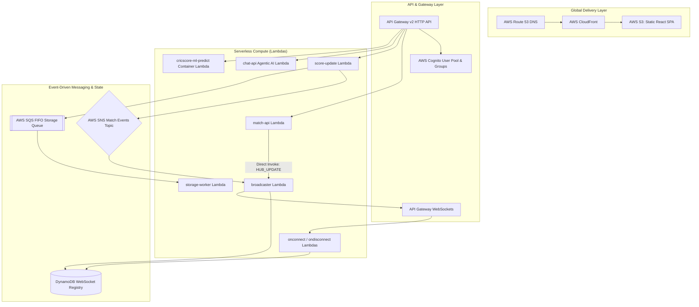

# 🏗️ CricScore Terraform Infrastructure Guide & Tutorial

This document is a comprehensive step-by-step tutorial and reference guide for managing CricScore's Infrastructure as Code (IaC) using **Terraform**.

CricScore's AWS application infrastructure is managed with Terraform. Account setup and external services still require configuration outside Terraform; see the deployment guide.

> [!IMPORTANT]
> For a fresh clone, follow the [deployment guide](./deployment.md) for bootstrap and deployment. The deploy script supplies the backend and environment-specific inputs, but applies changes automatically. The manual plan steps below are for reviewing an environment's proposed infrastructure changes; they assume bootstrap is complete and `.env.local` is configured.

---

## 🎯 Infrastructure Overview

CricScore uses Terraform to provision and manage:



---

## 📁 Terraform File Directory Layout

| File                          | Responsibilities & Resources Defined                                                                                                                                                              |
| :---------------------------- | :------------------------------------------------------------------------------------------------------------------------------------------------------------------------------------------------ |
| **`providers.tf`**            | Configures the S3 remote backend with native S3 state locking and dual AWS provider aliases (`us-east-1` for CloudFront ACM SSL certificates).                                                    |
| **`variables.tf`**            | Declares input parameters (`environment`, `domain_name`, `database_url`, `llm_api_key`, etc.).                                                                                                    |
| **`outputs.tf`**              | Exports runtime endpoints (API Gateway URLs, Cognito Pool IDs, S3 bucket names) for consumption by deploy scripts and frontend builds.                                                            |
| **`lambda.tf`**               | Defines the ZIP-based application Lambda functions and the container-image prediction Lambda, including memory, timeouts, tracing, and environment variables.                                     |
| **`apigateway_http.tf`**      | Configures API Gateway v2 HTTP API routes (`/matches`, `/chat`, `/rules/upload`) and Cognito JWT Authorizers.                                                                                     |
| **`apigateway_websocket.tf`** | Configures WebSocket API Gateway (`$connect`, `$disconnect`, `$default`), routes, and WebSocket deployment stages.                                                                                |
| **`messaging.tf`**            | Configures the SNS match-events topic, FIFO SQS storage queue, and SNS subscription. The score-update Lambda also sends persistence messages directly to SQS; no dead-letter queue is configured. |
| **`cognito.tf`**              | Provisions an AWS Cognito User Pool, app client, `Admin` user group, and user-pool domain.                                                                                                        |
| **`frontend.tf`**             | Provisions S3 Bucket for React static hosting, CloudFront CDN distribution, ACM SSL Certificates, and Route 53 A records.                                                                         |
| **`iam.tf`**                  | Defines a shared Lambda execution role and attached policies for the application's AWS service integrations.                                                                                      |
| **`cost_budget.tf`**          | Configures the monthly AWS cost budget and actual-cost email notification.                                                                                                                        |
| **`kms_and_logging.tf`**      | Configures the S3 access-logging bucket and its public-access block.                                                                                                                              |
| **`xray.tf`**                 | Configures an AWS X-Ray sampling rule. Lambda tracing is configured in the Lambda resources.                                                                                                      |
| **`environments/`**           | Contains environment-specific variable configurations (`dev.tfvars` and `prod.tfvars`).                                                                                                           |

---

## 🛠️ Terraform Validation and Plan Review

### Prerequisites

Before running Terraform commands, ensure you have:

1. **Terraform CLI** installed: the configuration requires `>= 1.10.0`; the repository's CI and deployment workflows use Terraform `1.10.x`.
2. **AWS CLI v2** configured with IAM deployment credentials: `aws sts get-caller-identity`
3. Completed the deployment guide's bootstrap, with the hosted zone delegated and the Terraform state bucket available.
4. A complete, private `.env.local` in the repository root. Never commit it or a generated plan file.

---

### Step 1: Validate Terraform without AWS changes

Run formatting and configuration validation. Initializing with `-backend=false` avoids connecting to or modifying remote state:

```bash
terraform fmt -check -recursive
terraform -chdir=infra/terraform init -backend=false
terraform -chdir=infra/terraform validate
```

### Step 2: Create an environment-specific plan

The plan uses the same state bucket, environment-specific naming, and secret inputs as the deployment script. Set `ENV` to `dev` or `prod`; do not use a development database URL for a production plan.

```bash
set -a
source ./.env.local
set +a

ENV=dev
case "$ENV" in
  dev)
    DEPLOY_DOMAIN="${DEV_DOMAIN_NAME:-${SUBDOMAIN_PREFIX}dev.${ZONE_DOMAIN}}"
    DEPLOY_PROJECT="${DEV_PROJECT_NAME:-${PROJECT_NAME}dev}"
    DEPLOY_PREFIX="${DEV_SUBDOMAIN_PREFIX:-${SUBDOMAIN_PREFIX}dev}"
    ;;
  prod)
    DEPLOY_DOMAIN="${PROD_DOMAIN_NAME:-${DOMAIN_NAME:-${SUBDOMAIN_PREFIX}.${ZONE_DOMAIN}}}"
    DEPLOY_PROJECT="${PROD_PROJECT_NAME:-$PROJECT_NAME}"
    DEPLOY_PREFIX="${PROD_SUBDOMAIN_PREFIX:-$SUBDOMAIN_PREFIX}"
    ;;
  *)
    echo "ENV must be dev or prod" >&2
    exit 1
    ;;
esac

export TF_VAR_aws_region="${AWS_REGION:-us-east-1}"
export TF_VAR_database_url="$TF_DATABASE_URL"
export TF_VAR_ses_source_email="$TF_SES_SOURCE_EMAIL"
export TF_VAR_admin_email="${ADMIN_EMAIL:-admin@example.com}"
export TF_VAR_llm_api_key="$LLM_API_KEY"
export TF_VAR_openai_api_key="${OPENAI_API_KEY:-}"
export TF_VAR_llm_base_url="${LLM_BASE_URL:-https://api.openai.com/v1}"
export TF_VAR_llm_model="${LLM_MODEL:-gpt-4o-mini}"

terraform -chdir=infra/terraform init -reconfigure \
  -backend-config="bucket=$TF_STATE_BUCKET" \
  -backend-config="key=cricscore/$ENV/terraform.tfstate"

terraform -chdir=infra/terraform plan \
  -var-file="environments/$ENV.tfvars" \
  -var="domain_name=$DEPLOY_DOMAIN" \
  -var="zone_domain=$ZONE_DOMAIN" \
  -var="project_name=$DEPLOY_PROJECT" \
  -var="subdomain_prefix=$DEPLOY_PREFIX" \
  -out="$ENV.tfplan"
```

Review every proposed change, especially any destroy or replacement. A plan file can contain sensitive values; keep it local and remove it when finished. This plan review does not deploy the frontend.

### Step 3: Apply and publish

For a full deployment, use the [deployment guide's deploy command](./deployment.md#step-4-deploy). It runs `terraform apply -auto-approve` and then builds and publishes the frontend; it calculates a fresh plan rather than applying the saved `*.tfplan` file. Re-review if the Terraform state or configuration changed since the plan review. Avoid running an unreviewed apply against production.

### Step 4: Inspect deployed outputs

View the exported Terraform outputs (API Gateway IDs, Cognito Client IDs, CloudFront Distro IDs):

```bash
terraform -chdir=infra/terraform output
```

Output example:

```hcl
api_gateway_id       = "a1b2c3d4e5"
ws_api_gateway_id    = "w9x8y7z6v5"
cognito_user_pool_id = "us-east-1_AbCdEfGh"
cloudfront_domain    = "d123456789.cloudfront.net"
```

---

## 🔒 State Management & Locking

### How State Locking Works

To prevent simultaneous deployments from corrupting the Terraform state file, Terraform creates a `.tflock` object beside the state file in S3 during operations such as `plan` and `apply`. The AWS identity running Terraform needs permission to get, put, and delete that lock object.

### How to Force Unlock (Emergency Cleanup)

If a CI/CD job crashes or the network drops mid-deployment, the lock may remain active. You can unlock the environment with Terraform's force-unlock workflow:

1. Navigate to the GitHub repository **Actions** tab.
2. Select the **Terraform Force Unlock** workflow on the left.
3. Click **Run workflow**, select the stuck environment (`dev` or `prod`), and paste the **Lock ID** from the error logs.
4. Click **Run workflow** to execute the unlock. The workflow uses the matching environment state key and removes the stale S3 lock file.

_(Alternatively, from `infra/terraform`, initialize with `-backend-config="bucket=$TF_STATE_BUCKET"` and the matching dev/prod state key, then run `terraform force-unlock <lock-id>`. Verify the lock is stale first; force-unlocking an active operation can cause state conflicts. Do not manually delete the `.tflock` object.)_

---

## 🔄 Environment Isolation (`dev` vs `prod`)

CricScore separates the `dev` and `prod` configurations with **distinct S3 state keys and variable files** (not Terraform workspaces):

Both environments store their state in the S3 bucket configured by `TF_STATE_BUCKET` in `.env.local` (and the GitHub environment variable with the same name). Their different state keys also give them separate lock objects; for example, dev uses `cricscore/dev/terraform.tfstate.tflock` and prod uses `cricscore/prod/terraform.tfstate.tflock`.

| Environment | State Key                          | Lock Object                               | Variable File              | Domain Name                |
| :---------- | :--------------------------------- | :---------------------------------------- | :------------------------- | :------------------------- |
| **Dev**     | `cricscore/dev/terraform.tfstate`  | `cricscore/dev/terraform.tfstate.tflock`  | `environments/dev.tfvars`  | `cricscoredev.example.com` |
| **Prod**    | `cricscore/prod/terraform.tfstate` | `cricscore/prod/terraform.tfstate.tflock` | `environments/prod.tfvars` | `cricscore.example.com`    |

Both environments use the same Terraform configuration files, with separate state, lock objects, and environment-specific values. Terraform only locks the state key being operated on, so dev and prod do not contend for one shared lock; concurrent runs targeting the same environment do contend for that environment's lock.

---

## ⚡ Helper Script: Automated Deployment

Instead of manually running individual Terraform steps, use the canonical deployment script:

```bash
# Installs dependencies, applies Terraform, builds and uploads the frontend, then invalidates CloudFront
./infra/scripts/deploy.sh --env dev

# For PROD
./infra/scripts/deploy.sh --env prod
```

The local script does not run database migrations. Run the migration script separately with the correct environment and database URL; the CI deployment workflows run migrations as part of their deployment jobs.

---

## 📖 Useful Terraform Operational Commands

```bash
# Force replace a single resource (e.g., recreate match-api Lambda)
terraform apply -var-file="environments/dev.tfvars" -replace="module.match_api.aws_lambda_function.this"

# Preview changes detected by refreshing state from AWS
terraform plan -refresh-only -var-file="environments/dev.tfvars"

# Targeted plans are for exceptional recovery/debugging, not routine deployments
terraform plan -var-file="environments/dev.tfvars" -target="aws_cognito_user_pool.pool"
```

---

© 2026 CricScore Infrastructure & DevOps. 🏎️🏁🚀
