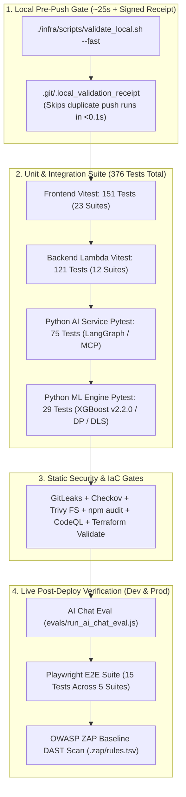

# 🧪 Testing Strategy & Verification Matrix

CricScore enforces a multi-layer testing architecture spanning **`376` automated unit and integration tests** (`151` Frontend Vitest + `121` Backend Vitest + `75` AI Service Pytest + `29` ML Engine Pytest), **`15` Playwright End-to-End (E2E) tests** across 5 suites, live **AI Chat evaluations**, and **OWASP ZAP DAST** scans.

---

## 🏗️ 1. Testing Pyramid & CI/CD Verification Pipeline



---

## 📊 2. Complete Test Suite Inventory (`376` Unit/Integration + `15` E2E)

| Layer / Runner                 |  Test Count   | Suites / Files | Run Command                                |
| :----------------------------- | :-----------: | :------------: | :----------------------------------------- |
| **Frontend (`Vitest` + RTL)**  |   **`151`**   |  `23` suites   | `npm run test --prefix apps/frontend`      |
| **Backend Lambdas (`Vitest`)** |   **`121`**   |  `12` suites   | `npm run test --prefix apps/backend`       |
| **Python AI (`Pytest`)**       |   **`75`**    |   `6` files    | `pytest apps/ai-service -q`                |
| **Python ML (`Pytest`)**       |   **`29`**    |   `1` suite    | `pytest apps/ml-engine/test_predict.py -q` |
| **Playwright E2E**             |   **`15`**    |   `5` suites   | `npm run test:e2e:dev`                     |
| **AI Chat Eval (`Node.js`)**   | **Live HTTP** | `1` benchmark  | `npm run test:ai`                          |

### What Each Layer Verifies

- **1. Frontend (`Vitest` + React Testing Library — `151` tests in `apps/frontend/src/test/*.test.{ts,tsx}`):**
  - Standard Edition DLS par score (1–50 overs), partnership math, and deterministic Player of the Match (`potmUtils`).
  - Live WebSocket score merge (`applyLiveScoreToMatches`) and monotonic 2nd-innings transitions.
  - Component behavior across `LiveScoreboard`, `MatchView`, `MatchSetup`, `AdminPanel`, and `ChatComponent`.
  - DOM XSS link sanitization and mobile touch layout guardrails.
- **2. Backend Lambdas (`Vitest` — `121` tests in `apps/backend/lambdas/**/*.test.js`):**
  - `match-api` CRUD, Cognito JWT / Admin group authorization, and HTML SES scorecard formatting.
  - `score-update` SNS + SQS FIFO dual fan-out and `storage-worker` idempotent ball persistence / `undo: true` rollback.
  - `broadcaster` `410 GoneException` stale socket pruning and `cognito-presignup` guest auto-confirmation.
  - `chat-api` in-memory MCP tools, read-only SQL guardrails, and deterministic POTM summary generation.
- **3. Python AI Service (`Pytest` — `75` tests in `apps/ai-service/tests/test_*.py`):**
  - Deterministic 4-agent intent router (Weather, Rulebook RAG, Live DB SQL, GitHub Issue Reporter).
  - LangGraph state execution, `[Source: ...]` citation grounding, destructive prompt refusal, and MCP stdio round-trips.
- **4. Python ML Engine (`Pytest` — `29` tests in `apps/ml-engine/test_predict.py`):**
  - Format-agnostic Markov Chain Dynamic Programming (`win_probability.py`) across 1, 5, and 20 overs.
  - Champion **XGBoost (`v2.2.0`)** blending (`xgboost-cpu ~309 MB`, ECR `countNumber = 1`), DLS resource parity, tail-ender factor, and S3 SHA-256 model checksum verification.
- **5. Playwright End-to-End (`15` tests in `apps/e2e/tests/*.spec.ts`):**
  - Homepage UI smoke checks, live REST API contracts, and `/chat` + `/chat/summary` validation.
  - Simultaneous Scorer + Spectator multi-browser WebSocket live sync and a complete 2-over match user journey.
- **6. AI Chat Evaluation (`evals/run_ai_chat_eval.js`):**
  - Sends benchmark cricket and tournament rulebook prompts from `evals/ai-chat-eval.json` to `/chat`.
  - Records response latency and pass/fail assertions to `evals/latest-ai-chat-eval-results.json`.

---

## ⚡ 3. Fast Local Pre-Push Validation & Zero-Waste Hook Caching

| Validation Mode           | Command                                         | Runtime  |
| :------------------------ | :---------------------------------------------- | :------: |
| **Ultra-Fast Pre-Push**   | `./infra/scripts/validate_local.sh --fast`      | **~25s** |
| **Skip E2E Only**         | `./infra/scripts/validate_local.sh --skip-e2e`  | **~35s** |
| **Skip SBOM Only**        | `./infra/scripts/validate_local.sh --skip-sbom` | **~90s** |
| **Dependency & PR Audit** | `npm run deps:check`                            | **~8s**  |

### Checks Executed by Mode

- **`--fast` (~25s — Default `.husky/pre-push` gate):**
  - Frontend `tsc --noEmit` + `151` Vitest tests + production Vite build.
  - Backend `121` Vitest tests + Python `75` AI & `29` ML Pytest suites (`376` unit tests total).
  - `npm audit`, Terraform `fmt`/`validate`, Checkov IaC scan, GitLeaks secret detection, Trivy FS scan, and dependency drift checks.
- **`--skip-e2e` (~35s):**
  - Runs every check in `--fast` **plus** Syft SPDX SBOM generation (`cricscore-sbom.spdx.json`).
- **`--skip-sbom` (~90s):**
  - Runs every check in `--fast` **plus** the live `15`-test Playwright E2E suite against `dev`.
- **`npm run deps:check` (~8s):**
  - Checks open GitHub Dependabot PRs and audits outdated `npm` and `pip` packages across all workspaces.

### Zero-Waste Receipt Workflow (`.git/.local_validation_receipt`)

1. Commit your changes first (`git commit -m "..."`).
2. Run `./infra/scripts/validate_local.sh --fast` (or let `git push` trigger `.husky/pre-push` automatically).
3. `validate_local.sh` stamps a state receipt (`HEAD:clean`) in `.git/.local_validation_receipt`.
4. When `git push` runs, `.husky/pre-push` verifies the receipt and exits in **< 0.1s**:
   `⚡ Local validation already passed for <commit>. Skipping duplicate tests!`

```bash
# Run fast local validation and stamp the pre-push receipt
./infra/scripts/validate_local.sh --fast

# Emergency bypass (only when deploying hotfixes already verified in CI)
SKIP_PRE_PUSH=1 git push
```

---

## 🔬 4. Detailed Test Breakdown by Layer

### 4.1 Frontend Unit & Component Integration Tests (`151` Tests)

- **1. Core App & Navigation (`apps/frontend/src/test/App.test.tsx`):**
  - Verifies role-based view switching (`VIEWER`, `SCORER`, `ADMIN_PANEL`).
  - Validates cross-session identity protection (`prevEmailRef`) and `?matchId=` deep-link hydration.
- **2. Live Score Merge Engine (`apps/frontend/src/test/applyLiveScoreToMatches.test.ts`):**
  - Verifies monotonic 2nd-innings WebSocket updates and `previousInnings` retention.
  - Tests dynamic 2nd-innings creation and instant `COMPLETED` transition on target chase.
- **3. Scorer Console & Modals (`MatchView.test.tsx`, `MatchViewModals.test.tsx`, `MatchSetup.test.tsx`):**
  - Verifies the 6-legal-ball over tracker across wides and no-balls.
  - Tests wicket/batter selection modals, toss winner & decision persistence, and `Undo` synchronization.
- **4. Spectator Scoreboard (`LiveScoreboard.test.tsx`, `Scoreboard.test.tsx`):**
  - Verifies full batting squad status rendering (`🏏 BATTING`, `NOT OUT`, `YET TO BAT`, `DID NOT BAT`).
  - Tests singular/plural victory margins (`WON BY 1 RUN`) and `TEST 🧪` vs. `GUEST 👻` visual badges.
- **5. DLS, POTM & Partnerships (`dlsUtils.test.ts`, `partnershipUtils.test.ts`, `potmUtils.test.ts`):**
  - Verifies Standard Edition DLS par score calculations across 1–50 overs.
  - Tests deterministic Player of the Match (POTM) points and unbroken/retired-hurt partnerships.
- **6. AI Chat & Predictions (`ChatComponent.test.tsx`, `AiMatchPrediction.test.tsx`, `HighlightedResult.test.tsx`):**
  - Verifies multi-agent quick prompts and Markdown table rendering.
  - Tests DOM XSS link sanitization and live hybrid win-probability bar updates.
- **7. Admin & Auth Guards (`AdminPanel.test.tsx`, `scorerAccess.test.ts`, `authConfig.test.ts`, `useWebSocket.test.ts`):**
  - Verifies Admin bulk cleanup triggers (Guest, Incomplete, and Test matches).
  - Tests Cognito configuration and exponential-backoff WebSocket reconnection.

### 4.2 Backend Lambda Unit & API Authorization Tests (`121` Tests)

- **1. `match-api` (`apps/backend/lambdas/match-api/index.test.js`):**
  - Enforces `POST /match` without JWT $\rightarrow$ `401` and non-owner `DELETE` $\rightarrow$ `403`.
  - Verifies `GET /admin/users` non-admin $\rightarrow$ `403`, automatic `is_test` tagging, and SES HTML scorecard reports.
- **2. `score-update` (`apps/backend/lambdas/score-update/index.test.js`):**
  - Verifies parallel SNS (`match-events`) + SQS FIFO (`storage-buffer.fifo`) dual fan-out.
  - Enforces match ownership and Admin group authorization checks.
- **3. `storage-worker` (`apps/backend/lambdas/storage-worker/index.test.js`):**
  - Verifies authoritative `explicitTotalRuns` and `batting_position` upserts.
  - Tests `undo: true` ball deletion, player/bowler stat subtraction, and `ai_summary = NULL` cache invalidation.
- **4. `broadcaster` & WebSocket Handlers (`broadcaster/index.test.js`, `onconnect/index.test.js`, `ondisconnect/index.test.js`):**
  - Verifies SNS and direct `HUB_UPDATE` payload parsing.
  - Tests DynamoDB connection table scanning and `410 GoneException` stale socket cleanup.
- **5. `cognito-presignup` (`apps/backend/lambdas/cognito-presignup/index.test.js`):**
  - Auto-confirms ephemeral `guest-*@cricscore.local` scorer accounts while keeping standard email verification for regular users.
- **6. `chat-api` & MCP Tools (`chat-api/handlers/*.test.js`, `chat-api/mcp/tools/*.test.js`):**
  - Enforces read-only SQL execution (`execute_sql`) and `requireAdmin` on `/rules/*` endpoints.
  - Tests Open-Meteo weather forecasts, rate-limited GitHub issue creation, plain-English overs formatting, and deterministic POTM summaries.

### 4.3 Python AI Service (`75` Tests) & ML Engine (`29` Tests)

- **`apps/ai-service` (`75` Pytest tests — `test_router.py`, `test_graph.py`, `test_tools.py`, `test_handler.py`, `test_mcp.py`, `test_mcp_stdio.py`):**
  - Verifies deterministic intent routing across the 4 specialists (Weather, RAG, DB, GitHub).
  - Tests LangGraph state transitions, `[Source: ...]` citation grounding, destructive prompt refusal, and MCP stdio server round-trips.
- **`apps/ml-engine` (`29` Pytest tests — `test_predict.py`):**
  - Verifies format-agnostic 1-over, 5-over, and 20-over Markov DP calculations across 1st and 2nd innings.
  - Tests DLS par score alignment, **XGBoost (`v2.2.0`)** + Markov DP blending (`xgboost-cpu ~309 MB`, `countNumber = 1`), and S3 SHA-256 model checksum verification.

### 4.4 Playwright End-to-End Suites (`15` Tests Across 5 Suites)

- **1. UI Smoke Suite (`apps/e2e/tests/smoke.spec.ts` — Browser UI):**
  - Verifies homepage title, responsive navigation bar, and match setup entrypoint.
- **2. Core REST API Suite (`apps/e2e/tests/api.spec.ts` — HTTP API):**
  - Tests live `/health`, `/matches`, and `/match/predict` contracts against the deployed backend (`~$1/month` AWS footprint).
- **3. AI Assistant API Suite (`apps/e2e/tests/ai-api.spec.ts` — HTTP API):**
  - Verifies `/chat` and `/chat/summary` input validation, guardrails, and response schemas.
- **4. Multi-Browser Live Sync (`apps/e2e/tests/multi-browser-live-sync.spec.ts` — 2 Browser Contexts):**
  - Opens simultaneous **Scorer** and **Spectator** browser contexts.
  - Verifies sub-100ms WebSocket ball delivery broadcast and live `Undo` synchronization.
- **5. Full 2-Over Match User Journey (`apps/e2e/tests/user-journey.spec.ts` — Full Browser Flow):**
  - Automates an entire match via Guest Scorer (custom squads, toss, wides, no-balls, and wickets).
  - Verifies innings break transition, 2nd-innings chase completion, and the Official Result banner.

---

## 🚦 5. CI/CD Pull Request Gates (`.github/workflows/ci.yml` & `codeql.yml`)

Every Pull Request targeting `main` must pass all **5 mandatory gates** before merging:

| PR Gate / Job           | Suites Covered                        | Blocking |
| :---------------------- | :------------------------------------ | :------: |
| **`validate_security`** | Secrets & Terraform IaC Security      |  ✅ Yes  |
| **`validate_frontend`** | Lint, `151` Vitest, Trivy, Vite Build |  ✅ Yes  |
| **`validate_backend`**  | `121` Vitest, Trivy, Terraform Check  |  ✅ Yes  |
| **`validate_python`**   | `75` AI + `29` ML Pytest, Trivy       |  ✅ Yes  |
| **`CodeQL Analysis`**   | JS/TS & Python AST Static Analysis    |  ✅ Yes  |

### Exact Commands Executed per Gate

- **1. `validate_security`:**
  - `gitleaks detect`
  - `checkov -d infra/terraform/ --framework terraform --download-external-modules false`
- **2. `validate_frontend`:**
  - `npm run lint` (`tsc --noEmit`) & `npm run test` (**`151` tests**)
  - `trivy fs apps/frontend` & `npm run build`
- **3. `validate_backend`:**
  - `npm test` (**`121` tests**) & `trivy fs apps/backend/lambdas`
  - `terraform fmt -check -recursive` & `terraform validate`
- **4. `validate_python`:**
  - `pytest apps/ai-service -q` (**`75` tests**) & `pytest apps/ml-engine/test_predict.py -q` (**`29` tests**)
  - `trivy fs apps/ai-service`
- **5. `CodeQL Analysis`:**
  - GitHub CodeQL SAST security queries across `javascript-typescript` and `python`.

---

## 🧪 6. Runnable Test Commands Cheat Sheet

```bash
# --- 1. Run Individual Unit / Integration Suites ---
npm run test --prefix apps/frontend                              # 151 Frontend Vitest tests
npm run test --prefix apps/backend                               # 121 Backend Lambda Vitest tests
./apps/ai-service/.venv/bin/pytest apps/ai-service -q            # 75 Python AI Service Pytest tests
./apps/ml-engine/venv/bin/pytest apps/ml-engine/test_predict.py -q # 29 Python ML Engine Pytest tests

# --- 2. Run Playwright E2E Tests Against Dev ---
npm run test:e2e:dev                                             # All 15 E2E tests (headless)
npm run test:e2e:dev:headed                                      # All 15 E2E tests (headed browser)
npm run test:e2e:sync:headed                                     # Multi-browser Scorer + Spectator live sync
npm run test:e2e:journey:headed                                  # Full 2-over match user journey

# --- 3. Run AI Chat Evaluation & ML Model Comparison ---
CHAT_API_URL=https://api.cricscoredev.venkateshsingamsetty.com npm run test:ai
./apps/ml-engine/venv/bin/python apps/ml-engine/compare_models.py v2.2.0
```

---

## 🧹 7. Test Match Isolation (`TEST 🧪` vs `GUEST 👻`)

- **`is_test` Auto-Tagging (`idx_matches_is_test`):** Matches created with `isTest: true`, `test-*` emails, or `TEST` / `SYNC` / `TEAM A` squad names automatically set `is_test = TRUE` in PostgreSQL.
- **Visual Badge Separation:** `MatchList` and `LiveScoreboard` display a purple **`TEST 🧪`** badge for automated test fixtures and a **`GUEST 👻`** badge for human guest scorers.
- **One-Click Cleanup:** Admins can purge test fixtures anytime via **Admin Panel → Database Management → 🧪 Delete Test Matches** (`DELETE /admin/matches/test`).
