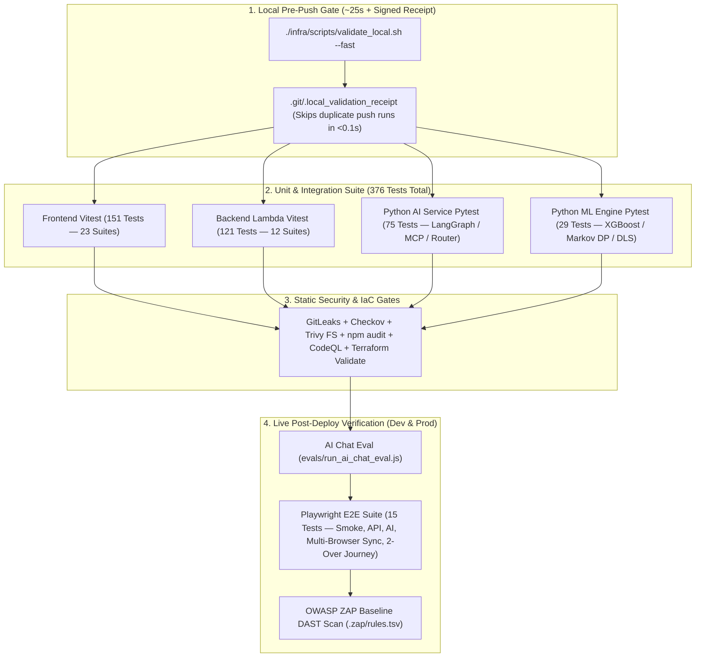

# 🧪 Testing Strategy & Verification Matrix

CricScore enforces a multi-layer testing architecture spanning **`376` automated unit and integration tests** (`151` Frontend Vitest + `121` Backend Vitest + `75` AI Service Pytest + `29` ML Engine Pytest), **`15` Playwright End-to-End (E2E) tests** across 5 suites, live **AI Chat evaluations**, and **OWASP ZAP DAST** scans.

---

## 🏗️ 1. Testing Pyramid & CI/CD Verification Pipeline



---

## 📊 2. Complete Test Suite Inventory (`376` Unit/Integration + `15` E2E)

| Layer / Runner                 |  Test Count   | Suites / Files                                         | What It Verifies                                                                                                                                                                                                                                      | Run Command                                |
| :----------------------------- | :-----------: | :----------------------------------------------------- | :---------------------------------------------------------------------------------------------------------------------------------------------------------------------------------------------------------------------------------------------------- | :----------------------------------------- |
| **Frontend (`Vitest` + RTL)**  |   **`151`**   | `apps/frontend/src/test/*.test.{ts,tsx}` (`23` suites) | • DLS par score (1–50 overs), partnership math, & deterministic POTM<br/>• Live WebSocket merge (`applyLiveScoreToMatches`)<br/>• `LiveScoreboard`, `MatchView`, `MatchSetup`, `AdminPanel`, & `ChatComponent`<br/>• XSS sanitization & mobile layout | `npm run test --prefix apps/frontend`      |
| **Backend Lambdas (`Vitest`)** |   **`121`**   | `apps/backend/lambdas/**/*.test.js` (`12` suites)      | • `match-api` CRUD/JWT/Admin auth & HTML SES scorecard formatting<br/>• `score-update` SNS+SQS fan-out & `storage-worker` persistence / `undo: true`<br/>• `broadcaster` `410` socket pruning & `cognito-presignup`<br/>• `chat-api` MCP tools & POTM | `npm run test --prefix apps/backend`       |
| **Python AI (`Pytest`)**       |   **`75`**    | `apps/ai-service/tests/test_*.py`                      | • Deterministic 4-agent router (Weather, RAG, DB, GitHub)<br/>• LangGraph execution & citation grounding<br/>• Destructive prompt refusal & MCP stdio server round-trips                                                                              | `pytest apps/ai-service -q`                |
| **Python ML (`Pytest`)**       |   **`29`**    | `apps/ml-engine/test_predict.py`                       | • Format-agnostic Markov DP (`win_probability.py`)<br/>• XGBoost (`v2.2.0`) blending, DLS resource parity, & tail factor<br/>• S3 model SHA-256 checksum verification                                                                                 | `pytest apps/ml-engine/test_predict.py -q` |
| **Playwright E2E**             |   **`15`**    | `apps/e2e/tests/*.spec.ts` (`5` suites)                | • Homepage smoke test & live REST API contract<br/>• `/chat` & `/chat/summary` AI API checks<br/>• Simultaneous Scorer + Spectator WebSocket live sync<br/>• Full 2-over match lifecycle (`user-journey`)                                             | `npm run test:e2e:dev`                     |
| **AI Chat Eval (`Node.js`)**   | **Live HTTP** | `evals/run_ai_chat_eval.js`                            | • Sends benchmark cricket & rulebook prompts from `evals/ai-chat-eval.json` to `/chat`<br/>• Logs latency and pass/fail status to `evals/latest-ai-chat-eval-results.json`                                                                            | `npm run test:ai`                          |

---

## ⚡ 3. Fast Local Pre-Push Validation & Zero-Waste Hook Caching

| Validation Mode           | Command                                         | Typical Runtime | Checks Executed                                                                                                                                                                          |
| :------------------------ | :---------------------------------------------- | :-------------: | :--------------------------------------------------------------------------------------------------------------------------------------------------------------------------------------- |
| **Ultra-Fast Pre-Push**   | `./infra/scripts/validate_local.sh --fast`      |    **~25s**     | • Frontend `tsc` + `151` Vitest + build<br/>• Backend `121` Vitest + Python `75` & `29` Pytest (`376` total)<br/>• `npm audit`, Terraform fmt/validate, Checkov, GitLeaks, Trivy, & deps |
| **Skip E2E Only**         | `./infra/scripts/validate_local.sh --skip-e2e`  |    **~35s**     | • Everything in `--fast`<br/>• **Plus** Syft SPDX SBOM generation (`cricscore-sbom.spdx.json`)                                                                                           |
| **Skip SBOM Only**        | `./infra/scripts/validate_local.sh --skip-sbom` |    **~90s**     | • Everything in `--fast`<br/>• **Plus** full `15`-test Playwright E2E suite                                                                                                              |
| **Dependency & PR Audit** | `npm run deps:check`                            |     **~8s**     | • Checks open GitHub Dependabot PRs<br/>• Audits outdated `npm` and `pip` packages across all workspaces                                                                                 |

### Zero-Waste Receipt Workflow (`.git/.local_validation_receipt`)

1. Commit your changes first (`git commit -m "..."`).
2. Run `./infra/scripts/validate_local.sh --fast` (or let `git push` trigger `.husky/pre-push` automatically).
3. `validate_local.sh` stamps a state receipt (`HEAD:clean`) in `.git/.local_validation_receipt`.
4. When `git push` runs, `.husky/pre-push` verifies the receipt and exits in **< 0.1s**:
   `⚡ Local validation already passed for <commit>. Skipping duplicate tests!`

```bash
# Run fast local validation and stamp the pre-push receipt
./infra/scripts/validate_local.sh --fast

# Emergency bypass (only when deploying hotfixes already verified in CI)
SKIP_PRE_PUSH=1 git push
```

---

## 🔬 4. Detailed Test Breakdown by Layer

### 4.1 Frontend Unit & Component Integration Tests (`151` Tests)

| Test Suite                   | File Path                                                                                                | Key Scenarios Verified                                                                                                                                      |
| :--------------------------- | :------------------------------------------------------------------------------------------------------- | :---------------------------------------------------------------------------------------------------------------------------------------------------------- |
| **Core App & Navigation**    | • `apps/frontend/src/test/App.test.tsx`                                                                  | • Role-based view switching (`VIEWER`, `SCORER`, `ADMIN_PANEL`)<br/>• Cross-session identity guard (`prevEmailRef`) & deep-link hydration                   |
| **Live Score Merge Engine**  | • `apps/frontend/src/test/applyLiveScoreToMatches.test.ts`                                               | • Monotonic 2nd-innings WebSocket updates & `previousInnings` retention<br/>• Dynamic 2nd-innings creation & instant `COMPLETED` transition on target chase |
| **Scorer Console & Modals**  | • `MatchView.test.tsx`<br/>• `MatchViewModals.test.tsx`<br/>• `MatchSetup.test.tsx`                      | • 6-legal-ball over tracker across wides/no-balls<br/>• Wicket/batter modals, toss winner & decision persistence, and undo sync                             |
| **Spectator Scoreboard**     | • `LiveScoreboard.test.tsx`<br/>• `Scoreboard.test.tsx`                                                  | • Full batting squad status (`🏏 BATTING`, `NOT OUT`, `YET TO BAT`)<br/>• Singular/plural victory margins (`WON BY 1 RUN`) & `TEST 🧪` vs `GUEST 👻` badges |
| **DLS, POTM & Partnerships** | • `dlsUtils.test.ts`<br/>• `partnershipUtils.test.ts`<br/>• `potmUtils.test.ts`                          | • Standard Edition DLS par score calculation (1–50 overs)<br/>• Deterministic Player of the Match (POTM) points & unbroken/retired-hurt partnerships        |
| **AI Chat & Predictions**    | • `ChatComponent.test.tsx`<br/>• `AiMatchPrediction.test.tsx`<br/>• `HighlightedResult.test.tsx`         | • Multi-agent prompts & Markdown table rendering<br/>• DOM XSS link sanitization & live win-probability bar                                                 |
| **Admin & Auth Guards**      | • `AdminPanel.test.tsx`<br/>• `scorerAccess.test.ts` & `authConfig.test.ts`<br/>• `useWebSocket.test.ts` | • Bulk cleanup triggers (Guest, Incomplete, Test matches)<br/>• Cognito config & exponential-backoff WebSocket reconnect                                    |

### 4.2 Backend Lambda Unit & API Authorization Tests (`121` Tests)

| Lambda / Module            | Test File Path                                                                                   | Key Scenarios Verified                                                                                                                                                                |
| :------------------------- | :----------------------------------------------------------------------------------------------- | :------------------------------------------------------------------------------------------------------------------------------------------------------------------------------------ |
| **`match-api`**            | • `apps/backend/lambdas/match-api/index.test.js`                                                 | • `POST /match` without JWT $\rightarrow$ `401` & non-owner `DELETE` $\rightarrow$ `403`<br/>• `GET /admin/users` non-admin $\rightarrow$ `403`, `is_test` tagging, & SES HTML report |
| **`score-update`**         | • `apps/backend/lambdas/score-update/index.test.js`                                              | • Parallel SNS (`match-events`) + SQS FIFO (`storage-buffer.fifo`) dispatch<br/>• Match ownership & Admin authorization checks                                                        |
| **`storage-worker`**       | • `apps/backend/lambdas/storage-worker/index.test.js`                                            | • Authoritative `explicitTotalRuns` & `batting_position` upsert<br/>• `undo: true` ball deletion, player/bowler stat subtraction, & `ai_summary = NULL` cache invalidation            |
| **`broadcaster` & WS**     | • `broadcaster/index.test.js`<br/>• `onconnect/index.test.js`<br/>• `ondisconnect/index.test.js` | • SNS & direct `HUB_UPDATE` payload parsing<br/>• DynamoDB connection scan & `410 GoneException` stale socket cleanup                                                                 |
| **`cognito-presignup`**    | • `apps/backend/lambdas/cognito-presignup/index.test.js`                                         | • Auto-confirms `guest-*@cricscore.local` accounts<br/>• Leaves standard users on standard email verification                                                                         |
| **`chat-api` & MCP Tools** | • `chat-api/handlers/*.test.js`<br/>• `chat-api/mcp/tools/*.test.js`                             | • Read-only SQL enforcement (`execute_sql`) & `requireAdmin` on `/rules/*`<br/>• Open-Meteo weather, rate-limited GitHub issues, plain-English overs, & deterministic POTM summary    |

### 4.3 Python AI Service (`75` Tests) & ML Engine (`29` Tests)

| Python Package                     | Test Files                                                                                                                     | Key Scenarios Verified                                                                                                                                                  |
| :--------------------------------- | :----------------------------------------------------------------------------------------------------------------------------- | :---------------------------------------------------------------------------------------------------------------------------------------------------------------------- |
| **`apps/ai-service` (`75` tests)** | • `tests/test_router.py` & `test_graph.py`<br/>• `test_tools.py` & `test_handler.py`<br/>• `test_mcp.py` & `test_mcp_stdio.py` | • Intent routing across Weather/RAG/DB/GitHub specialists & LangGraph transitions<br/>• Citation grounding, destructive prompt refusal, & stdio MCP protocol round-trip |
| **`apps/ml-engine` (`29` tests)**  | • `apps/ml-engine/test_predict.py`                                                                                             | • 1-over, 5-over, and 20-over formats across 1st & 2nd innings<br/>• DLS par score alignment, XGBoost (`v2.2.0`) + Markov DP blending, & SHA-256 model checksum check   |

### 4.4 Playwright End-to-End Suites (`15` Tests Across 5 Suites)

| Suite File                                       | Target             | What It Automates                                                                                                                                               |
| :----------------------------------------------- | :----------------- | :-------------------------------------------------------------------------------------------------------------------------------------------------------------- |
| `apps/e2e/tests/smoke.spec.ts`                   | Browser UI         | • Verifies homepage title, navigation bar, and match setup entrypoint                                                                                           |
| `apps/e2e/tests/api.spec.ts`                     | HTTP API           | • Tests live `/health`, `/matches`, and `/match/predict` contracts                                                                                              |
| `apps/e2e/tests/ai-api.spec.ts`                  | HTTP API           | • Verifies `/chat` and `/chat/summary` validation and error responses                                                                                           |
| `apps/e2e/tests/multi-browser-live-sync.spec.ts` | 2 Browser Contexts | • Opens simultaneous **Scorer** + **Spectator** browsers<br/>• Verifies live ball delivery broadcast and `Undo` synchronization                                 |
| `apps/e2e/tests/user-journey.spec.ts`            | Full Browser Flow  | • Automates a complete match via Guest Scorer (squads, toss, wides/no-balls/wickets)<br/>• Verifies innings break, chase completion, and Official Result banner |

---

## 🚦 5. CI/CD Pull Request Gates (`.github/workflows/ci.yml` & `codeql.yml`)

Every Pull Request targeting `main` must pass all **5 mandatory gates** before merging:

| PR Gate / Job           | Suites Covered                               | Exact Commands Run                                                                                                                            |
| :---------------------- | :------------------------------------------- | :-------------------------------------------------------------------------------------------------------------------------------------------- |
| **`validate_security`** | Secrets & Terraform IaC Security             | • `gitleaks detect`<br/>• `checkov -d infra/terraform/ --framework terraform --download-external-modules false`                               |
| **`validate_frontend`** | Lint, Unit/Component Tests, Trivy, Build     | • `npm run lint` (`tsc --noEmit`) & `npm run test` (**`151` tests**)<br/>• `trivy fs apps/frontend` & `npm run build`                         |
| **`validate_backend`**  | Lambda Unit Tests, Trivy, Terraform Validate | • `npm test` (**`121` tests**) & `trivy fs apps/backend/lambdas`<br/>• `terraform fmt -check -recursive` & `terraform validate`               |
| **`validate_python`**   | Python AI Service & ML Engine Tests, Trivy   | • `pytest apps/ai-service -q` (**`75` tests**) & `pytest apps/ml-engine/test_predict.py -q` (**`29` tests**)<br/>• `trivy fs apps/ai-service` |
| **`CodeQL Analysis`**   | Dual-Language AST Static Analysis            | • CodeQL security queries across `javascript-typescript` and `python`                                                                         |

---

## 🧪 6. Runnable Test Commands Cheat Sheet

```bash
# --- 1. Run Individual Unit / Integration Suites ---
npm run test --prefix apps/frontend                              # 151 Frontend Vitest tests
npm run test --prefix apps/backend                               # 121 Backend Lambda Vitest tests
./apps/ai-service/.venv/bin/pytest apps/ai-service -q            # 75 Python AI Service Pytest tests
./apps/ml-engine/venv/bin/pytest apps/ml-engine/test_predict.py -q # 29 Python ML Engine Pytest tests

# --- 2. Run Playwright E2E Tests Against Dev ---
npm run test:e2e:dev                                             # All 15 E2E tests (headless)
npm run test:e2e:dev:headed                                      # All 15 E2E tests (headed browser)
npm run test:e2e:sync:headed                                     # Multi-browser Scorer + Spectator live sync
npm run test:e2e:journey:headed                                  # Full 2-over match user journey

# --- 3. Run AI Chat Evaluation & ML Model Comparison ---
CHAT_API_URL=https://api.cricscoredev.venkateshsingamsetty.com npm run test:ai
./apps/ml-engine/venv/bin/python apps/ml-engine/compare_models.py v2.2.0
```

---

## 🧹 7. Test Match Isolation (`TEST 🧪` vs `GUEST 👻`)

| Feature                     | Mechanism                                                                                                                                       | How to Clean Up                                                                              |
| :-------------------------- | :---------------------------------------------------------------------------------------------------------------------------------------------- | :------------------------------------------------------------------------------------------- |
| **`is_test` Auto-Tagging**  | • Matches created with `isTest: true`, `test-*` emails, or `TEST`/`SYNC`/`TEAM A` squad names set `is_test = TRUE` (`idx_matches_is_test`)      | • Admin Panel $\rightarrow$ **Database Management** $\rightarrow$ **🧪 Delete Test Matches** |
| **Visual Badge Separation** | • `MatchList` and `LiveScoreboard` display a purple **`TEST 🧪`** badge for automated test fixtures<br/>• Real guests show **`GUEST 👻`** badge | • `DELETE /admin/matches/test` (Admin JWT required)                                          |
