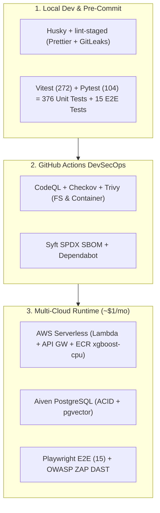

# 🛠️ Toolchain, MLOps & DevSecOps Stack

This reference catalogs the runtime frameworks, machine learning libraries, infrastructure tools, and automated security scanners powering CricScore across development, CI/CD, and production (`~$1/month` total AWS cost for Dev + Prod combined).

---

## 🔄 Toolchain Lifecycle Across Dev, CI & Cloud

---

## 1. Core Application, AI & MLOps Stack

- **Node.js & npm (`Node.js 24.x`):**
  - Executes the 8 ZIP-packaged backend AWS Lambda microservices and runs monorepo workspace build scripts.
- **React & Vite (`React 19` + `Vite 8`):**
  - Powers the mobile-first dark-mode scoreboard, scorer keypad, and live WebSocket dashboard with Hot Module Replacement (HMR).
- **TypeScript & ESLint (Strict Static Typing):**
  - Prevents type regressions across frontend components and enforces API contract safety.
- **XGBoost & Scikit-Learn (Champion `XGBoost v2.2.0`):**
  - Computes live ball-by-ball win probability (`Validation ROC-AUC = 0.7723`, `Test ROC-AUC = 0.7529`), blended with Markov DP and DLS par calculations.
- **LangGraph & MCP (`Python 3.12` Agentic AI):**
  - Orchestrates specialist agents and `pgvector` rulebook RAG, paired with deterministic `computePlayerOfTheMatch` (`summaryHandler.js`).
- **MLflow & DVC (MLOps Governance):**
  - Tracks model hyperparameters and ROC-AUC/Brier metrics while versioning reproducible training datasets (`t20s_json.zip.dvc`).

---

## 2. Testing Frameworks (`376` Unit/Integration Tests + E2E)

| Framework            | Target Suite               | Tests | Command                                    |
| :------------------- | :------------------------- | :---: | :----------------------------------------- |
| **Vitest (RTL)**     | Frontend (`apps/frontend`) | `151` | `npm --prefix apps/frontend test`          |
| **Vitest (Mocks)**   | Backend (`apps/backend`)   | `121` | `npm --prefix apps/backend test`           |
| **Pytest (AI)**      | AI Service (`ai-service`)  | `75`  | `pytest apps/ai-service -q`                |
| **Pytest (ML)**      | ML Engine (`ml-engine`)    | `29`  | `pytest apps/ml-engine/test_predict.py -q` |
| **Playwright (E2E)** | Browser Suite (`e2e/`)     | `15`  | `npx playwright test`                      |

---

## 3. Infrastructure & Cloud Automation (`~$1/month` Footprint)

- **Terraform (`~1.10`):**
  - Provisions all AWS serverless resources (API Gateway, Lambda, DynamoDB, S3, CloudFront, Cognito, ECR) and manages Aiven PostgreSQL from a single root module.
- **Amazon ECR (`xgboost-cpu ~309 MB`):**
  - Hosts the lightweight `ml-predict` container image and enforces a strict `countNumber = 1` lifecycle policy so ECR storage stays within the `~$1/month` budget.
- **AWS CLI:**
  - Performs S3 static asset syncs, CloudFront cache invalidations, and ECR container pushes during CI/CD deployments.
- **GitHub Actions:**
  - Runs PR validation, automated semantic releases, nightly Terraform drift detection (`drift.yml`), and daily Aiven database keep-alive pings (`keepalive.yml`).

---

## 4. Application Security (AppSec) & Governance

| Tool                 | Layer        | Purpose                                     |
| :------------------- | :----------- | :------------------------------------------ |
| **GitLeaks**         | Secrets      | Pre-commit & CI full-history secret scan    |
| **CodeQL**           | SAST         | AST analysis for JS/TS & Python flaws       |
| **Trivy**            | SCA          | Blocks fixable `HIGH`/`CRITICAL` CVEs       |
| **Checkov**          | IaC Security | Audits `infra/terraform` misconfigurations  |
| **OWASP ZAP**        | DAST         | Post-deploy baseline scan against live URLs |
| **Syft**             | SBOM         | Generates SPDX JSON supply-chain manifest   |
| **Husky & Prettier** | Git Hooks    | Runs `lint-staged` & `validate_local.sh`    |
| **Semantic Release** | Versioning   | Automates semver tags & `docs/changelog.md` |
