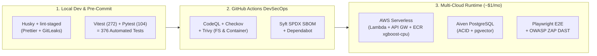

# 🛠️ Toolchain, MLOps & DevSecOps Stack

This reference catalogs the runtime frameworks, machine learning libraries, infrastructure tools, and automated security scanners powering CricScore across development, CI/CD, and production (`~$1/month` total AWS cost for Dev + Prod combined).

---

## 🔄 Toolchain Lifecycle Across Dev, CI & Cloud

---

## 1. Core Application, AI & MLOps Stack

| Tool / Library             | Layer                 | Verified Version / Footprint    | Purpose in CricScore                                                                                                      |
| -------------------------- | --------------------- | ------------------------------- | ------------------------------------------------------------------------------------------------------------------------- |
| **Node.js & npm**          | Runtime / Package Mgr | `Node.js 24.x`                  | Executes backend AWS Lambda microservices and workspace build scripts.                                                    |
| **React & Vite**           | Frontend SPA          | `React 19` / `Vite`             | Mobile-first dark-mode scoreboard, scorer keypad, and live WebSocket dashboard with HMR.                                  |
| **TypeScript & ESLint**    | Static Typing & Lint  | Strict TS                       | Prevents type regressions across frontend components and API contracts.                                                   |
| **XGBoost & Scikit-Learn** | ML Win Prediction     | Champion **`XGBoost (v2.2.0)`** | Live ball-by-ball win probability (`Validation ROC-AUC = 0.7723`, `Test ROC-AUC = 0.7529`) blended with Markov DP & DLS.  |
| **LangGraph & MCP**        | Agentic AI            | Python `3.12`                   | Orchestrates specialist agents, pgvector rulebook RAG, and deterministic `computePlayerOfTheMatch` (`summaryHandler.js`). |
| **MLflow & DVC**           | MLOps Governance      | Local / CI Tracking             | Tracks model hyperparameters, ROC-AUC/Brier metrics, and reproducible dataset versions.                                   |

---

## 2. Testing Frameworks (`376` Unit/Integration Tests + E2E)

| Framework                    | Target Suite                     | Test Count | Command to Run                             |
| ---------------------------- | -------------------------------- | ---------- | ------------------------------------------ |
| **Vitest + Testing Library** | Frontend (`apps/frontend`)       | `151`      | `npm --prefix apps/frontend test`          |
| **Vitest + aws-sdk-mock**    | Backend Lambdas (`apps/backend`) | `121`      | `npm --prefix apps/backend test`           |
| **Pytest**                   | Agentic AI (`apps/ai-service`)   | `75`       | `pytest apps/ai-service -q`                |
| **Pytest**                   | ML Engine (`apps/ml-engine`)     | `29`       | `pytest apps/ml-engine/test_predict.py -q` |
| **Playwright**               | End-to-End Browser (`e2e/`)      | E2E Suite  | `npx playwright test`                      |

---

## 3. Infrastructure & Cloud Automation (`~$1/month` Footprint)

| Tool                           | Purpose                                                                                                                                                        |
| ------------------------------ | -------------------------------------------------------------------------------------------------------------------------------------------------------------- |
| **Terraform (`~1.10`)**        | Provisions AWS serverless resources (API Gateway, Lambda, DynamoDB, S3, CloudFront, Cognito, ECR) and Aiven PostgreSQL from a single root module.              |
| **Amazon ECR (`xgboost-cpu`)** | Hosts the lightweight `ml-predict` container (`~309 MB`) with a strict `countNumber = 1` lifecycle policy so ECR storage stays within the `~$1/mo` budget.     |
| **AWS CLI**                    | Performs S3 static asset syncs, CloudFront cache invalidations, and ECR container pushes during deployment.                                                    |
| **GitHub Actions**             | Runs PR validation, automated semantic releases, nightly Terraform drift detection (`drift.yml`), and daily Aiven database keep-alive pings (`keepalive.yml`). |

---

## 4. Application Security (AppSec) & Governance

| Tool                 | Security Category         | Enforcement Gate                                                                                                                           |
| -------------------- | ------------------------- | ------------------------------------------------------------------------------------------------------------------------------------------ |
| **GitLeaks**         | Secrets Detection         | Scans staged commits (pre-commit hook) and full Git history in CI; blocks any hardcoded keys or credentials.                               |
| **CodeQL**           | SAST (Semantic Code Scan) | Scans JavaScript/TypeScript on every PR and push to `main` for XSS, SQL injection, and taint-flow vulnerabilities.                         |
| **Trivy**            | SCA (Dependency & Image)  | Scans `apps/frontend`, `apps/backend/lambdas`, `apps/ai-service`, and the `ml-predict` container for fixable `HIGH`/`CRITICAL` CVEs.       |
| **Checkov**          | IaC Security              | Audits `infra/terraform` on every PR to enforce encryption, least-privilege IAM, and secure bucket configurations.                         |
| **OWASP ZAP**        | DAST (Runtime Baseline)   | Executes an automated baseline vulnerability scan against the live deployed URL after Dev and Prod deployments.                            |
| **Syft**             | Supply Chain (SBOM)       | Generates an SPDX JSON Software Bill of Materials (`sbom.yml`) weekly and on pushes to `main`.                                             |
| **Husky & Prettier** | Local Git Hooks           | `pre-commit` formats staged files via `lint-staged` and runs GitLeaks; `pre-push` executes `./infra/scripts/validate_local.sh --skip-e2e`. |
| **Semantic Release** | Automated Versioning      | Parses Conventional Commits (`feat:`, `fix:`) to bump versions, update `docs/changelog.md`, and publish GitHub releases.                   |
