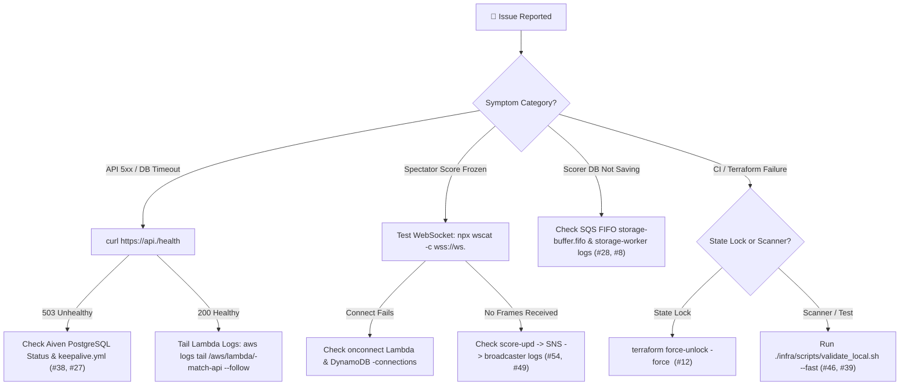

# 🚨 Troubleshooting Runbook & Incident Fix Log

This runbook provides a **Quick-Navigation Symptom-to-Fix Index**, a **Diagnostic Triage Flowchart**, **Runnable Diagnostic & Remediation Commands**, and the **54 Resolved Engineering Incidents** organized by domain.

---

## 🧭 1. Quick-Navigation Symptom-to-Fix Index

| Symptom Observed                                           | Likely Layer                            | Primary Root Cause                                                                | Immediate Fix / Command                                                                                              |    Incident #     |
| :--------------------------------------------------------- | :-------------------------------------- | :-------------------------------------------------------------------------------- | :------------------------------------------------------------------------------------------------------------------- | :---------------: |
| **Viewer / Match List doesn't update on new match**        | `match-api` $\rightarrow$ `broadcaster` | `BROADCASTER_LAMBDA` env var mismatch or unhandled direct `HUB_UPDATE` payload    | • Verify `BROADCASTER_LAMBDA` points to `module.broadcaster.function_name`<br/>• Check `broadcaster` CloudWatch logs |   **#54, #49**    |
| **AI Summary stuck on `"0/0"` or `"5 balls"` on 6th ball** | `chat-api` / `storage-worker`           | Cached `ai_summary` not cleared on score update, or `0.5` overs decimal misparsed | • `storage-worker` & `match-api` set `ai_summary = NULL`<br/>• `summaryHandler` counts legal `ball_events` rows      | **#53, #52, #51** |
| **Batters displayed out of order on full scorecard**       | `match-api` / `storage-worker`          | Missing `batting_position` column or missing `ORDER BY batting_position ASC`      | • Query `players` with `ORDER BY batting_position ASC NULLS LAST, runs DESC`                                         |   **#49, #47**    |
| **`Error acquiring the state lock` in Terraform**          | Terraform S3 State                      | Previous Terraform run crashed/cancelled before releasing `.tflock`               | • Run `terraform force-unlock -force <LOCK_ID>`<br/>• Or trigger the GitHub Force Unlock workflow                    |      **#12**      |
| **Database connection timeout after days of inactivity**   | Aiven PostgreSQL                        | Aiven Free Tier pauses instances after 3 days of zero connections                 | • Trigger `.github/workflows/keepalive.yml` (`SELECT 1;`)<br/>• Or probe `GET /health`                               |    **#38, #1**    |
| **`SELF_SIGNED_CERT_IN_CHAIN` in Node 24 Lambda**          | `storage-worker` / `match-api`          | Node 24 strict TLS validation against Aiven intermediate CA                       | • Configure `ssl: { rejectUnauthorized: false }` in `pg.Pool`                                                        |      **#27**      |
| **`Runtime.ImportModuleError: Cannot find module 'pg'`**   | Lambda ZIP Package                      | Terraform archived Lambda folder before `npm install --omit=dev` ran              | • Run `npm install --omit=dev` in each `apps/backend/lambdas/*` directory before `terraform apply`                   |      **#15**      |
| **`npm ci` fails with `EUSAGE` in CI**                     | `package-lock.json`                     | Lockfile out of sync with `package.json`                                          | • Run `npm install` in root, `apps/frontend`, `apps/backend`, and each Lambda directory                              |      **#39**      |
| **SES email sent (`MessageId`) but dropped by Gmail**      | Amazon SES / Route 53                   | Using `@gmail.com` as `SES_SOURCE` fails Gmail DMARC alignment                    | • Use verified custom domain (`noreply@<domain>`)<br/>• Configure Route 53 DKIM CNAME + SPF TXT records              | **#26, #21, #16** |
| **Playwright E2E test pollutes live match list**           | `apps/e2e` / `match-api`                | Test matches created against deployed environment                                 | • Matches auto-tagged with `is_test = TRUE` (`TEST 🧪`)<br/>• Purge via `DELETE /admin/matches/test`                 |      **#44**      |

---

## 🔄 2. Incident Triage Flowchart



---

## 🛠️ 3. Runnable Diagnostic & Fix Commands

### CloudWatch, SQS & Database Diagnostics

```bash
# 1. Probe API & PostgreSQL connectivity
curl -i "https://api.cricscoredev.venkateshsingamsetty.com/health"

# 2. Tail critical ingestion & persistence Lambda logs in real time
aws logs tail /aws/lambda/cricscoredev-match-api --follow --format short
aws logs tail /aws/lambda/cricscoredev-score-upd --follow --format short
aws logs tail /aws/lambda/cricscoredev-storage-worker --follow --format short
aws logs tail /aws/lambda/cricscoredev-broadcaster --follow --format short

# 3. Inspect SQS FIFO queue depth (ApproximateNumberOfMessages / NotVisible)
aws sqs get-queue-attributes \
  --queue-url "$(aws sqs get-queue-url --queue-name cricscoredev-storage-buffer.fifo --query QueueUrl --output text)" \
  --attribute-names ApproximateNumberOfMessages ApproximateNumberOfMessagesNotVisible \
  --output table

# 4. Inspect active WebSocket connections in DynamoDB
aws dynamodb scan \
  --table-name cricscoredev-connections \
  --select COUNT \
  --region us-east-1
```

### Common Infrastructure & CI Fixes

```bash
# 1. Release a stuck Terraform S3 state lock
cd infra/terraform
terraform init -backend-config="bucket=venky-2026-terraform-state" -backend-config="key=cricscore/dev/terraform.tfstate"
terraform force-unlock -force <LOCK_ID>

# 2. Rebuild all Lambda production node_modules before packaging
for d in apps/backend/lambdas/*; do
  if [ -f "$d/package.json" ]; then
    (cd "$d" && npm install --omit=dev --no-audit --no-fund --ignore-scripts)
  fi
done

# 3. Run full local validation suite before pushing
./infra/scripts/validate_local.sh --fast
```

---

## 📋 4. Complete Engineering Incident Log (#1 – #54)

### 📡 Category A: Live Scoring, WebSocket Broadcast & Scoreboard Sync

|   #    | Incident Title                                       | Symptom                                                                                                           | Root Cause                                                                                                                                                                                                                          | Resolution Implemented                                                                                                                                                                                                                                    |
| :----: | :--------------------------------------------------- | :---------------------------------------------------------------------------------------------------------------- | :---------------------------------------------------------------------------------------------------------------------------------------------------------------------------------------------------------------------------------- | :-------------------------------------------------------------------------------------------------------------------------------------------------------------------------------------------------------------------------------------------------------- |
| **54** | **Viewer & Match List Not Refreshing on New Match**  | • Viewer page required manual reload on new match or innings switch<br/>• Unbatted players missing from scorecard | • `BROADCASTER_LAMBDA` set to resource name instead of `module.broadcaster.function_name`<br/>• `broadcaster` only parsed SNS records, ignoring direct `HUB_UPDATE`<br/>• `Scoreboard.tsx` hid `ballsFaced === 0 && !isOut` batters | • Passed `module.broadcaster.function_name` in `lambda.tf`<br/>• Updated `broadcaster/index.js` to parse SNS, `event.body`, and direct payloads + prune `410` sockets<br/>• Rendered full squad with `🏏 BATTING`, `NOT OUT`, `YET TO BAT`, `DID NOT BAT` |
| **49** | **Viewer Scoreboard Stale on Mobile Reconnect**      | • Viewer froze if WebSocket briefly dropped<br/>• Batters appeared in random heap order                           | • `LiveScoreboard.tsx` lacked a polling fallback when WS dropped<br/>• `/details` query lacked `ORDER BY` on `players`                                                                                                              | • Added 5s fallback polling interval during `LIVE` / `INNINGS_BREAK` matches<br/>• Added `ORDER BY batting_position ASC NULLS LAST, runs DESC`                                                                                                            |
| **47** | **Full Scoreboard Sorted by Runs vs. Batting Order** | • Lower-order high scorers appeared above openers                                                                 | • `players` table had no `batting_position` column<br/>• Queried with `ORDER BY runs DESC`                                                                                                                                          | • Added `batting_position INT` migration<br/>• `MatchView` & `storage-worker` persist `battingOrderNames` order                                                                                                                                           |
| **28** | **Rapid-Fire Score Tap Desync**                      | • Scorer tapped `"1"` 6 times rapidly<br/>• UI showed `6/0` but DB/spectators showed `3/0`                        | • Overlapping async React closures sent stale state before prior request finished                                                                                                                                                   | • Added synchronous `isProcessingRef.current = true` lock in `MatchView`                                                                                                                                                                                  |
| **24** | **Match Deletion Desync (Scorer vs Admin)**          | • Scorer kept scoring a match an Admin had already deleted                                                        | • Scorer client didn't check if match still existed in DB                                                                                                                                                                           | • Added Cloud-Existence `404` check on ball sync that triggers an autonomous local state reset                                                                                                                                                            |
| **23** | **Cross-User LocalStorage Ghosting**                 | • User B logged in and saw User A's active match state                                                            | • Shared global `cricscore-live-innings` LocalStorage key                                                                                                                                                                           | • Scoped keys by match (`cric-live-match-{matchId}`) and user email (`cric-match-state-{email}`)<br/>• Added `prevEmailRef` identity guard                                                                                                                |
| **22** | **URL `?matchId=` Haunting**                         | • Refreshing after logout or new match reopened old match                                                         | • Stale `?matchId=` query parameter remained in address bar                                                                                                                                                                         | • Scrubbed URL via `window.history.replaceState` after hydration, logout, and new match creation                                                                                                                                                          |
| **19** | **Scorer Tab-Switch State Loss**                     | • Switching mobile browser tabs lost active view and pending crease selections                                    | • State was local to child component                                                                                                                                                                                                | • Added ball-by-ball `onStateChange` root sync<br/>• Persisted active `view` in `localStorage`                                                                                                                                                            |
| **14** | **Intrusive Browser `window.prompt` for Overs**      | • Editing match overs opened a native browser prompt dialog                                                       | • Quick prototype used `window.prompt()`                                                                                                                                                                                            | • Replaced with inline editable overs input (`Enter` to save, `Escape` to cancel)                                                                                                                                                                         |
| **11** | **Match Hub Tab Clutter & Unpinned Striker**         | • Separate "Fans Live" and "Old Matches" tabs<br/>• Non-striker sometimes listed first                            | • Split tab state and unsorted crease array                                                                                                                                                                                         | • Unified into a single **Match Hub** with `LIVE`/`COMPLETED` badges<br/>• Pinned striker at top of crease card                                                                                                                                           |
| **10** | **"Less Score" Bug on Spectator Screen**             | • Spectators trailed scorer by 1 delivery                                                                         | • `postScoreUpdate` omitted explicit `totalRuns` and `totalWickets`                                                                                                                                                                 | • Included finalized `InningsState` totals (`explicitTotalRuns`) in every `postScoreUpdate` payload                                                                                                                                                       |
| **9**  | **"1 Run Extra" Double-Counting Bug**                | • Spectator score was 1 run higher than scorer                                                                    | • Backend both `SET` total runs and incremented by ball runs                                                                                                                                                                        | • Treated scorer's transmitted `explicitTotalRuns` as single authoritative total                                                                                                                                                                          |
| **8**  | **Aggregate Player/Bowler Stat Mismatch on Undo**    | • Team total reverted on Undo, but batter/bowler stats stayed inflated                                            | • Undo only updated `innings` table                                                                                                                                                                                                 | • Updated `storage-worker` undo handler to fetch deleted `ball_events` row<br/>• Subtracted batter/bowler runs, balls, and wickets                                                                                                                        |
| **7**  | **Undo Ghost Balls in Timeline**                     | • Undone balls remained in DB and shallow-copied React history                                                    | • Local-only undo + mutable array references                                                                                                                                                                                        | • Sent `undo: true` event to delete last `ball_events` row<br/>• Enforced immutable React state updates                                                                                                                                                   |
| **5**  | **New Bowler Showing Global Over Count (`1.1`)**     | • 2nd bowler's first ball displayed `1.1` overs instead of `0.1`                                                  | • Backend derived bowler overs from global innings `overNumber`                                                                                                                                                                     | • Sent explicit personal `bowlerOvers` and `bowlerBalls` from `MatchView` to `storage-worker`                                                                                                                                                             |
| **4**  | **End-of-Over Display Lag (`2.0` vs `3.0`)**         | • 6th ball showed `2.0` overs for several seconds                                                                 | • Backend used ball's over index instead of post-delivery total                                                                                                                                                                     | • Passed post-delivery `totalOvers` & `totalBalls`<br/>• Added `syncOnly` mode for immediate crease updates                                                                                                                                               |
| **3**  | **Fans Live White Screen on Tab Change**             | • Switching views left stale/blank component state                                                                | • React reused component instance without remounting                                                                                                                                                                                | • Added `key={hubKey}` on `LiveScoreboard`<br/>• Hydrated immediately from DB snapshot                                                                                                                                                                    |
| **2**  | **Empty Match Analytics Modal**                      | • Analytics modal showed 0 players and 0 runs                                                                     | • `players` and `bowlers` tables weren't initialized on `POST /match`                                                                                                                                                               | • Bulk-inserted full squads during `POST /match`<br/>• Updated player and bowler stats on every ball                                                                                                                                                      |

---

### 🤖 Category B: AI Summary, Agentic Chat & Data Formatting

|   #    | Incident Title                                       | Symptom                                                                                 | Root Cause                                                                                                                                                                                         | Resolution Implemented                                                                                                                                                            |
| :----: | :--------------------------------------------------- | :-------------------------------------------------------------------------------------- | :------------------------------------------------------------------------------------------------------------------------------------------------------------------------------------------------- | :-------------------------------------------------------------------------------------------------------------------------------------------------------------------------------- |
| **53** | **AI Summary Stuck on `"0/0"` & Unstarted `"0/0"`**  | • Live AI summaries remained cached at `0/0`<br/>• Unstarted matches showed `0/0 (0.0)` | • `summaryHandler.js` only invalidated zero-ball summaries when `status === "COMPLETED"`<br/>• `storage-worker` didn't clear `ai_summary`<br/>• `MatchList.tsx` rendered `0/0 (0.0)` before ball 1 | • Invalidated stale markers for both `LIVE` and `COMPLETED`<br/>• Set `ai_summary = NULL` on every score update<br/>• Rendered `—` in `MatchList.tsx` until first ball/run/wicket |
| **52** | **AI Summary Showing `"5 Balls"` on 6th-Ball Win**   | • 1-over chase won on 6th ball was described as `"5 balls"`                             | • Immediate match completion skipped next-tick over-flip (`0.5` stored in DB)                                                                                                                      | • Counted legal balls directly from `ball_events` (`COUNT(*) FILTER (WHERE extra_type NOT IN ('WIDE','NO_BALL'))`)                                                                |
| **51** | **AI Summary Writing Decimal Overs (`"0.5 overs"`)** | • LLM echoed raw decimal (`0.5 overs`) instead of plain English (`5 balls`)             | • `formatOvers()` included `"0.5 overs (...)"` prefix in prompt                                                                                                                                    | • Replaced with `ballsToOversText()` emitting strictly plain English (`"5 balls"`, `"1 over and 2 balls"`)                                                                        |
| **50** | **AI Summary Hallucinating Toss Winner & Decision**  | • Summary guessed toss winner from `batFirstTeam`                                       | • DB lacked `toss_winner` and `toss_decision` columns                                                                                                                                              | • Added `add_toss_fields.sql` migration & `MatchSetup.tsx` selectors<br/>• Injected explicit toss + deterministic POTM prompt in `summaryHandler.js`                              |

---

### 🗄️ Category C: Database, SES Email, CORS & Lambda Runtime

|   #    | Incident Title                                           | Symptom                                                                       | Root Cause                                                                     | Resolution Implemented                                                                                                                  |
| :----: | :------------------------------------------------------- | :---------------------------------------------------------------------------- | :----------------------------------------------------------------------------- | :-------------------------------------------------------------------------------------------------------------------------------------- |
| **38** | **Aiven Free Tier Database Auto-Pause**                  | • Backend timed out after 3 days of zero traffic                              | • Aiven pauses free-tier PostgreSQL after 72h of inactivity                    | • Added daily `.github/workflows/keepalive.yml` cron job executing `SELECT 1;`                                                          |
| **27** | **Aiven PostgreSQL `SELF_SIGNED_CERT_IN_CHAIN`**         | • `storage-worker` failed TLS handshake<br/>• SQS messages stuck `NotVisible` | • Node 24 rejected Aiven self-signed intermediate CA                           | • Configured `ssl: { rejectUnauthorized: false }` in `pg.Pool` and TLS env handling                                                     |
| **26** | **SES Sandbox Rejection for Unverified Emails**          | • Sending scorecards to arbitrary external user emails failed in SES Sandbox  | • AWS SES Sandbox requires verified recipient addresses                        | • Added instant **Share Scorecard Link (`?matchId=`)** deep-link hydration<br/>• Scoped SES to verified domains and addresses           |
| **21** | **SES Gmail DMARC Drop (`SES_SOURCE` Spoofing)**         | • SES returned `MessageId`, but Gmail silently dropped the email              | • Sending from `@gmail.com` via AWS SES fails Gmail DMARC policy               | • Verified custom domain in SES with Route 53 DKIM CNAME + SPF TXT records (`noreply@<domain>`)                                         |
| **20** | **Orphaned Innings/Player Rows on Match Delete**         | • Deleting a match left child records in `innings` and `players`              | • Missing foreign-key cascade and admin purge route                            | • Enforced `ON DELETE CASCADE` on all foreign keys<br/>• Added Admin `DELETE /matches` (`TRUNCATE ... CASCADE`)                         |
| **16** | **`SES MessageRejected` & Missing `DELETE` Routes**      | • Admin delete and email report calls failed with `Failed to fetch`           | • Missing `ses:SendEmail` IAM policy and API Gateway routes                    | • Added `ses:SendEmail` to `iam.tf`<br/>• Provisioned `DELETE /match/{matchId}` + `POST /match/{matchId}/email` in `apigateway_http.tf` |
| **15** | **`Runtime.ImportModuleError: Cannot find module 'pg'`** | • Lambda crashed on invocation with missing `pg` driver                       | • Lambda `.zip` created without running `npm install --omit=dev`               | • Automated `npm install --omit=dev` across `apps/backend/lambdas/*` in `deploy.sh` and `ci.yml`                                        |
| **13** | **CORS Preflight Blocking `PATCH /match/{matchId}`**     | • Editing overs worked locally but failed network save                        | • `PATCH` missing from `Access-Control-Allow-Methods` and `apigateway_http.tf` | • Added `PATCH` to CORS headers<br/>• Provisioned `aws_apigatewayv2_route.patch_match`                                                  |
| **6**  | **Slow Match Creation (`POST /match` Latency)**          | • Creating a match took several seconds                                       | • 25+ sequential single-row `INSERT` round-trips                               | • Consolidated squad initialization into single-query bulk `INSERT` statements inside a `BEGIN/COMMIT` transaction                      |
| **1**  | **Lambda 3s Timeout on Cold SSL Handshake**              | • `Task timed out after 3.00 seconds` during initial DB writes                | • `128 MB` CPU share + `3s` timeout was too tight for cold PG SSL handshake    | • Increased `score-upd` and `storage-worker` to `256 MB` RAM and `30s` timeout                                                          |

---

### ⚙️ Category D: CI/CD Pipelines, Terraform, Security Scanners & E2E Testing

|   #    | Incident Title                                         | Symptom                                                                       | Root Cause                                                                                             | Resolution Implemented                                                                                      |
| :----: | :----------------------------------------------------- | :---------------------------------------------------------------------------- | :----------------------------------------------------------------------------------------------------- | :---------------------------------------------------------------------------------------------------------- |
| **48** | **Playwright E2E Timeout on 6th-Ball `RUN OUT`**       | • `Select New Batter` modal didn't open when `RUN OUT` occurred on final ball | • `isOversDone` was `true` on ball 6, immediately ending the innings instead of prompting for a batter | • Moved `RUN OUT` test step to **ball 5** (`isMatchEnding = false`)<br/>• Scored winning run on **ball 6**  |
| **46** | **CodeQL Flagging Generated Playwright Reports**       | • CodeQL SAST failed on `playwright-report/index.html`                        | • Generated Playwright report was tracked in Git                                                       | • Added `playwright-report/` and `test-results/` to `.gitignore`<br/>• Untracked generated report artifacts |
| **45** | **Checkov SARIF Upload `Resource not accessible`**     | • SARIF upload step failed in GitHub Actions                                  | • Workflow lacked `security-events: write` permission                                                  | • Scoped permissions or disabled external SARIF upload where read-only token is used                        |
| **44** | **Playwright E2E Polluting Live Match List**           | • Automated E2E runs left test matches visible alongside real matches         | • E2E tests ran against deployed environment without test tagging                                      | • Added `is_test BOOLEAN` column (`TEST 🧪` badge)<br/>• Added `DELETE /admin/matches/test` bulk cleanup    |
| **43** | **Optimistic UI Lock Race Condition in E2E Tests**     | • Rapid Playwright clicks dropped ball events during network round-trip       | • `isProcessingRef` lock ignored clicks while previous ball request was in flight                      | • Synchronized Playwright ball actions with network/UI unlock completion                                    |
| **42** | **Playwright Locators Failing on Legacy Selectors**    | • `locator.click: Target closed` in `user-journey.spec.ts`                    | • Outdated test selectors didn't match updated `MatchSetup` / `MatchView` DOM                          | • Updated `user-journey.spec.ts` to use deterministic inputs and accessible role locators                   |
| **41** | **React 19 `act(...)` Unmount Warnings in Vitest**     | • Console warnings during async component tests                               | • Async promises resolved after test unmount                                                           | • Wrapped async state transitions in `await act(async () => { ... })`                                       |
| **40** | **CI Ignoring `apps/backend/package-lock.json`**       | • Updating backend root lockfile didn't trigger CI                            | • Overly narrow `paths` filter in workflow                                                             | • Removed restrictive path filters so all workspace changes run CI validation                               |
| **39** | **`npm ci` Crash (`npm error EUSAGE`)**                | • CI failed immediately on dependency install                                 | • `package.json` and `package-lock.json` drift                                                         | • Synchronized lockfiles across all workspaces<br/>• Validated via `check_dependencies.sh`                  |
| **37** | **OWASP ZAP Opening Duplicate Header Issues**          | • Nightly ZAP scan flagged COEP/COOP headers omitted for CDN/WS compatibility | • Default ZAP baseline ruleset alerts on informational header rules                                    | • Added `.zap/rules.tsv` to `IGNORE` documented trade-offs (`10055`, `90004`)                               |
| **36** | **Node 20 / Punycode Deprecation Warnings in CI**      | • Actions printed Node 20 and `[DEP0040]` deprecation warnings                | • Older action versions (`checkout@v4`) used legacy runtimes                                           | • Upgraded to `actions/checkout@v7`, `setup-node@v7`, and Node 24 across workflows                          |
| **35** | **OWASP ZAP Artifact Upload 400 Error**                | • ZAP failed uploading report artifact                                        | • `zaproxy/action-baseline@v0.12.0` used deprecated `upload-artifact@v3`                               | • Upgraded `zaproxy/action-baseline` to `v0.15.0`                                                           |
| **34** | **OWASP ZAP `Errno 13 Permission denied`**             | • ZAP Docker container couldn't write `zap.yaml` to runner workspace          | • Container `zap` user lacked write permission on `runner`-owned workspace                             | • Added `chmod -R 777 ${{ github.workspace }}` step prior to ZAP scan                                       |
| **33** | **OWASP ZAP Issue Creation `Resource not accessible`** | • ZAP failed when attempting to open a GitHub issue                           | • Missing `issues: write` permission in deploy job                                                     | • Added `permissions: issues: write` and `contents: read` to `deploy_and_test_dev`                          |
| **32** | **Local Setup Failures on Fresh Mac / Linux**          | • Missing `node@24`, `terraform`, `aws`, or `jq` blocked `deploy.sh`          | • No automated prerequisite installer                                                                  | • Created OS-aware `infra/scripts/setup.sh` bootstrap script                                                |
| **31** | **Hardcoded Domains in CI/CD Workflows**               | • Workflows weren't portable across `dev` and `prod` environments             | • Hardcoded domain strings in YAML                                                                     | • Parameterized workflows with GitHub Environment `vars.DOMAIN_NAME` and `vars.PROJECT_NAME`                |
| **30** | **Local `apps/frontend/.env` Overwritten on Deploy**   | • `deploy.sh` wiped custom `.env` variables                                   | • Script used destructive `>` redirect instead of key update                                           | • Updated `infra/scripts/deploy.sh` to update/append `VITE_*` endpoints non-destructively                   |
| **29** | **Terraform `TF_VAR_` Hydration Mismatch**             | • `terraform apply` failed with missing required variables                    | • `.env.local` used uppercase `DOMAIN_NAME` while Terraform required `TF_VAR_domain_name`              | • Automated `export TF_VAR_*` mapping in `infra/scripts/deploy.sh`                                          |
| **12** | **Terraform S3 State Lock (`Error acquiring lock`)**   | • Deployment blocked by stale `.tflock` file in S3                            | • Cancelled or crashed Terraform run didn't release lock                                               | • Added `.github/workflows/unlock.yml`<br/>• Documented `terraform force-unlock -force <LOCK_ID>`           |
