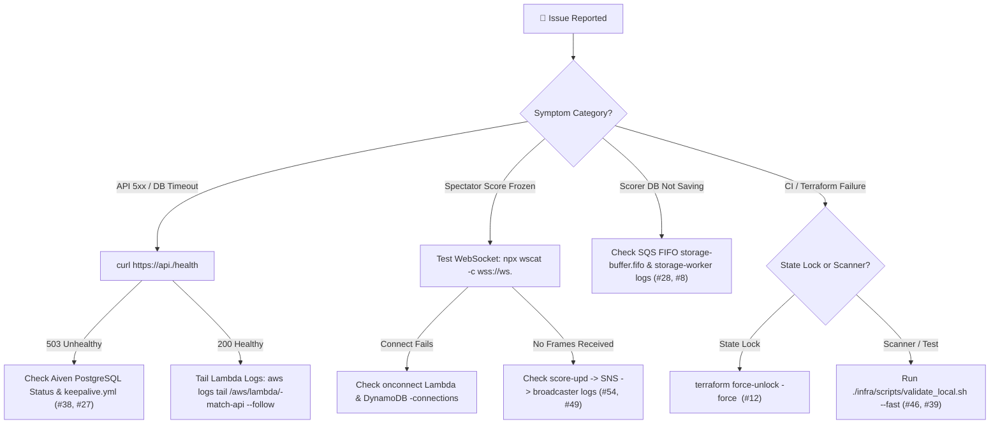

# 🚨 Troubleshooting Runbook & Incident Fix Log

This runbook provides a **Quick-Navigation Symptom-to-Fix Index**, a **Diagnostic Triage Flowchart**, **Runnable Diagnostic & Remediation Commands**, and the **54 Resolved Engineering Incidents** organized by domain across CricScore (`~$1/month` AWS + Aiven serverless architecture, **XGBoost `v2.2.0`** in `xgboost-cpu ~309 MB` with ECR `countNumber = 1`, **`376`** unit tests, and **`15`** Playwright E2E tests).

---

## 🧭 1. Quick-Navigation Symptom-to-Fix Index

| Symptom Observed                                 | Likely Layer                  |    Incident #     |
| :----------------------------------------------- | :---------------------------- | :---------------: |
| **Viewer / Match List frozen on new match**      | `match-api` ➔ `broadcaster`   |   **#54, #49**    |
| **AI Summary stuck on `"0/0"` or `"5 balls"`**   | `chat-api` / `storage-worker` | **#53, #52, #51** |
| **Batters displayed out of batting order**       | `match-api` / `players`       |   **#49, #47**    |
| **`Error acquiring the state lock` (Terraform)** | Terraform S3 State            |      **#12**      |
| **DB connection timeout after inactivity**       | Aiven PostgreSQL              |    **#38, #1**    |
| **`SELF_SIGNED_CERT_IN_CHAIN` in Node 24**       | `pg.Pool` TLS Config          |      **#27**      |
| **`Cannot find module 'pg'` in Lambda**          | Lambda ZIP Packaging          |      **#15**      |
| **`npm ci` fails with `EUSAGE` in CI**           | `package-lock.json`           |      **#39**      |
| **SES email sent (`MessageId`) but dropped**     | Amazon SES / Route 53         | **#26, #21, #16** |
| **Playwright E2E pollutes live match list**      | `apps/e2e` / `match-api`      |      **#44**      |

### Immediate Fixes for Top 10 Symptoms

- **1. Viewer / Match List doesn't update on new match (`#54`, `#49`):**
  - **Root Cause:** `BROADCASTER_LAMBDA` env var mismatch or unhandled direct `HUB_UPDATE` payload.
  - **Immediate Fix:** Verify `BROADCASTER_LAMBDA` points to `module.broadcaster.function_name` and check `broadcaster` CloudWatch logs.
- **2. AI Summary stuck on `"0/0"` or `"5 balls"` on 6th ball (`#53`, `#52`, `#51`):**
  - **Root Cause:** Cached `ai_summary` not cleared on score update, or `0.5` overs decimal misparsed.
  - **Immediate Fix:** Ensure `storage-worker` & `match-api` set `ai_summary = NULL` and `summaryHandler` counts legal `ball_events` rows.
- **3. Batters displayed out of order on full scorecard (`#49`, `#47`):**
  - **Root Cause:** Missing `batting_position` column or missing `ORDER BY batting_position ASC`.
  - **Immediate Fix:** Query `players` with `ORDER BY batting_position ASC NULLS LAST, runs DESC`.
- **4. `Error acquiring the state lock` in Terraform (`#12`):**
  - **Root Cause:** Previous Terraform run crashed or was cancelled before releasing `.tflock` in S3.
  - **Immediate Fix:** Run `terraform force-unlock -force <LOCK_ID>` or trigger the GitHub Force Unlock workflow.
- **5. Database connection timeout after days of inactivity (`#38`, `#1`):**
  - **Root Cause:** Aiven Free Tier pauses PostgreSQL instances after 3 days of zero connections.
  - **Immediate Fix:** Trigger `.github/workflows/keepalive.yml` (`SELECT 1;`) or probe `GET /health`.
- **6. `SELF_SIGNED_CERT_IN_CHAIN` in Node 24 Lambda (`#27`):**
  - **Root Cause:** Node 24 strict TLS validation against Aiven intermediate CA.
  - **Immediate Fix:** Configure `ssl: { rejectUnauthorized: false }` in `pg.Pool`.
- **7. `Runtime.ImportModuleError: Cannot find module 'pg'` (`#15`):**
  - **Root Cause:** Terraform archived the Lambda folder before `npm install --omit=dev` ran.
  - **Immediate Fix:** Run `npm install --omit=dev` in each `apps/backend/lambdas/*` directory before `terraform apply`.
- **8. `npm ci` fails with `EUSAGE` in CI (`#39`):**
  - **Root Cause:** Lockfile out of sync with `package.json`.
  - **Immediate Fix:** Run `npm install` in root, `apps/frontend`, `apps/backend`, and each Lambda directory.
- **9. SES email sent (`MessageId`) but dropped by Gmail (`#26`, `#21`, `#16`):**
  - **Root Cause:** Using `@gmail.com` as `SES_SOURCE` fails Gmail DMARC alignment.
  - **Immediate Fix:** Use verified custom domain (`noreply@<domain>`) with Route 53 DKIM CNAME + SPF TXT records.
- **10. Playwright E2E test pollutes live match list (`#44`):**
  - **Root Cause:** E2E test matches created against deployed environment.
  - **Immediate Fix:** Matches auto-tag with `is_test = TRUE` (`TEST 🧪`); purge via `DELETE /admin/matches/test`.

---

## 🔄 2. Incident Triage Flowchart



---

## 🛠️ 3. Runnable Diagnostic & Fix Commands

### CloudWatch, SQS & Database Diagnostics

```bash
# 1. Probe API & PostgreSQL connectivity
curl -i "https://api.cricscoredev.venkateshsingamsetty.com/health"

# 2. Tail critical ingestion & persistence Lambda logs in real time
aws logs tail /aws/lambda/cricscoredev-match-api --follow --format short
aws logs tail /aws/lambda/cricscoredev-score-upd --follow --format short
aws logs tail /aws/lambda/cricscoredev-storage-worker --follow --format short
aws logs tail /aws/lambda/cricscoredev-broadcaster --follow --format short

# 3. Inspect SQS FIFO queue depth (ApproximateNumberOfMessages / NotVisible)
aws sqs get-queue-attributes \
  --queue-url "$(aws sqs get-queue-url --queue-name cricscoredev-storage-buffer.fifo --query QueueUrl --output text)" \
  --attribute-names ApproximateNumberOfMessages ApproximateNumberOfMessagesNotVisible \
  --output table

# 4. Inspect active WebSocket connections in DynamoDB
aws dynamodb scan \
  --table-name cricscoredev-connections \
  --select COUNT \
  --region us-east-1
```

### Common Infrastructure & CI Fixes

```bash
# 1. Release a stuck Terraform S3 state lock
cd infra/terraform
terraform init -backend-config="bucket=venky-2026-terraform-state" -backend-config="key=cricscore/dev/terraform.tfstate"
terraform force-unlock -force <LOCK_ID>

# 2. Rebuild all Lambda production node_modules before packaging
for d in apps/backend/lambdas/*; do
  if [ -f "$d/package.json" ]; then
    (cd "$d" && npm install --omit=dev --no-audit --no-fund --ignore-scripts)
  fi
done

# 3. Run full local validation suite before pushing
./infra/scripts/validate_local.sh --fast
```

---

## 📋 4. Complete Engineering Incident Log (#1 – #54)

### 📡 Category A: Live Scoring, WebSocket Broadcast & Scoreboard Sync

- **Incident #54 — Viewer & Match List Not Refreshing on New Match:**
  - **Symptom:** Viewer page required manual reload on new match or innings switch, and unbatted players were missing from the scorecard.
  - **Root Cause:** `BROADCASTER_LAMBDA` was set to a resource name instead of `module.broadcaster.function_name`; `broadcaster` only parsed SNS records (ignoring direct `HUB_UPDATE`); `Scoreboard.tsx` hid `ballsFaced === 0 && !isOut` batters.
  - **Resolution:** Passed `module.broadcaster.function_name` in `lambda.tf`, updated `broadcaster/index.js` to parse SNS, `event.body`, and direct payloads while pruning `410` sockets, and rendered full squads with `🏏 BATTING`, `NOT OUT`, `YET TO BAT`, and `DID NOT BAT`.
- **Incident #49 — Viewer Scoreboard Stale on Mobile Reconnect:**
  - **Symptom:** Viewer froze if the WebSocket briefly dropped on mobile, and batters appeared in random heap order.
  - **Root Cause:** `LiveScoreboard.tsx` lacked a polling fallback when WS dropped, and the `/details` query lacked an `ORDER BY` clause on `players`.
  - **Resolution:** Added a 5s fallback polling interval during `LIVE` / `INNINGS_BREAK` matches and added `ORDER BY batting_position ASC NULLS LAST, runs DESC`.
- **Incident #47 — Full Scoreboard Sorted by Runs vs. Batting Order:**
  - **Symptom:** Lower-order high scorers appeared above opening batters on the full scorecard.
  - **Root Cause:** `players` table had no `batting_position` column and was queried with `ORDER BY runs DESC`.
  - **Resolution:** Added the `batting_position INT` migration and updated `MatchView` + `storage-worker` to persist `battingOrderNames` order.
- **Incident #28 — Rapid-Fire Score Tap Desync:**
  - **Symptom:** Scorer tapped `"1"` 6 times rapidly; UI showed `6/0` while DB and spectators showed `3/0`.
  - **Root Cause:** Overlapping async React closures sent stale state before the prior request finished.
  - **Resolution:** Added a synchronous `isProcessingRef.current = true` lock in `MatchView`.
- **Incident #24 — Match Deletion Desync (Scorer vs. Admin):**
  - **Symptom:** Scorer kept scoring a match that an Admin had already deleted.
  - **Root Cause:** Scorer client did not verify whether the match still existed in PostgreSQL.
  - **Resolution:** Added a Cloud-Existence `404` check on ball sync that triggers an autonomous local state reset.
- **Incident #23 — Cross-User LocalStorage Ghosting:**
  - **Symptom:** User B logged in and saw User A's active match state.
  - **Root Cause:** Shared global `cricscore-live-innings` LocalStorage key.
  - **Resolution:** Scoped keys by match (`cric-live-match-{matchId}`) and user email (`cric-match-state-{email}`), and added the `prevEmailRef` identity guard.
- **Incident #22 — URL `?matchId=` Haunting:**
  - **Symptom:** Refreshing after logout or new match creation reopened an old match.
  - **Root Cause:** Stale `?matchId=` query parameter remained in the browser address bar.
  - **Resolution:** Scrubbed the URL via `window.history.replaceState` after hydration, logout, and new match creation.
- **Incident #19 — Scorer Tab-Switch State Loss:**
  - **Symptom:** Switching mobile browser tabs lost the active view and pending crease selections.
  - **Root Cause:** Crease state lived only inside a child component.
  - **Resolution:** Added ball-by-ball `onStateChange` root sync and persisted active `view` in `localStorage`.
- **Incident #14 — Intrusive Browser `window.prompt` for Overs:**
  - **Symptom:** Editing match overs opened a blocking native browser prompt dialog.
  - **Root Cause:** Initial prototype used `window.prompt()`.
  - **Resolution:** Replaced with an inline editable overs input (`Enter` to save, `Escape` to cancel).
- **Incident #11 — Match Hub Tab Clutter & Unpinned Striker:**
  - **Symptom:** Separate "Fans Live" and "Old Matches" tabs cluttered navigation, and the non-striker was sometimes listed first.
  - **Root Cause:** Split tab state and unsorted crease array.
  - **Resolution:** Unified into a single **Match Hub** with `LIVE`/`COMPLETED` badges and pinned the striker at the top of the crease card.
- **Incident #10 — "Less Score" Bug on Spectator Screen:**
  - **Symptom:** Spectators trailed the scorer by 1 delivery.
  - **Root Cause:** `postScoreUpdate` omitted explicit `totalRuns` and `totalWickets`.
  - **Resolution:** Included finalized `InningsState` totals (`explicitTotalRuns`) in every `postScoreUpdate` payload.
- **Incident #9 — "1 Run Extra" Double-Counting Bug:**
  - **Symptom:** Spectator score was 1 run higher than the scorer console.
  - **Root Cause:** Backend both `SET` total runs and incremented by ball runs.
  - **Resolution:** Treated the scorer's transmitted `explicitTotalRuns` as the single authoritative total.
- **Incident #8 — Aggregate Player/Bowler Stat Mismatch on Undo:**
  - **Symptom:** Team total reverted on `Undo`, but batter and bowler stats remained inflated.
  - **Root Cause:** Undo handler only updated the `innings` table.
  - **Resolution:** Updated `storage-worker` undo handler to fetch the deleted `ball_events` row and subtract batter/bowler runs, balls, and wickets.
- **Incident #7 — Undo Ghost Balls in Timeline:**
  - **Symptom:** Undone balls remained in the database and shallow-copied React history.
  - **Root Cause:** Local-only undo combined with mutable array references.
  - **Resolution:** Sent `undo: true` events to delete the last `ball_events` row and enforced immutable React state updates.
- **Incident #5 — New Bowler Showing Global Over Count (`1.1`):**
  - **Symptom:** Second bowler's first ball displayed `1.1` overs instead of `0.1`.
  - **Root Cause:** Backend derived bowler overs from global innings `overNumber`.
  - **Resolution:** Sent explicit personal `bowlerOvers` and `bowlerBalls` from `MatchView` to `storage-worker`.
- **Incident #4 — End-of-Over Display Lag (`2.0` vs. `3.0`):**
  - **Symptom:** 6th ball showed `2.0` overs for several seconds.
  - **Root Cause:** Backend used the ball's over index instead of post-delivery total overs.
  - **Resolution:** Passed post-delivery `totalOvers` & `totalBalls` and added `syncOnly` mode for immediate crease updates.
- **Incident #3 — Fans Live White Screen on Tab Change:**
  - **Symptom:** Switching views left a stale or blank component state.
  - **Root Cause:** React reused the component instance without remounting.
  - **Resolution:** Added `key={hubKey}` on `LiveScoreboard` and hydrated immediately from the DB snapshot.
- **Incident #2 — Empty Match Analytics Modal:**
  - **Symptom:** Analytics modal showed 0 players and 0 runs.
  - **Root Cause:** `players` and `bowlers` tables were not initialized on `POST /match`.
  - **Resolution:** Bulk-inserted full squads during `POST /match` and updated player/bowler stats on every delivery.

---

### 🤖 Category B: AI Summary, Agentic Chat & Data Formatting

- **Incident #53 — AI Summary Stuck on `"0/0"` & Unstarted `"0/0"`:**
  - **Symptom:** Live AI summaries remained cached at `0/0`, and unstarted matches displayed `0/0 (0.0)`.
  - **Root Cause:** `summaryHandler.js` only invalidated zero-ball summaries when `status === "COMPLETED"`, `storage-worker` didn't clear `ai_summary`, and `MatchList.tsx` rendered `0/0 (0.0)` before ball 1.
  - **Resolution:** Invalidated stale markers for both `LIVE` and `COMPLETED`, set `ai_summary = NULL` on every score update, and rendered `—` in `MatchList.tsx` until the first ball/run/wicket.
- **Incident #52 — AI Summary Showing `"5 Balls"` on 6th-Ball Win:**
  - **Symptom:** 1-over chase won on the 6th ball was described as `"5 balls"`.
  - **Root Cause:** Immediate match completion skipped the next-tick over-flip (`0.5` stored in DB).
  - **Resolution:** Counted legal balls directly from `ball_events` (`COUNT(*) FILTER (WHERE extra_type NOT IN ('WIDE','NO_BALL'))`).
- **Incident #51 — AI Summary Writing Decimal Overs (`"0.5 overs"`):**
  - **Symptom:** LLM echoed raw decimal (`0.5 overs`) instead of plain English (`5 balls`).
  - **Root Cause:** `formatOvers()` included a `"0.5 overs (...)"` prefix in the prompt.
  - **Resolution:** Replaced with `ballsToOversText()` emitting strictly plain English (`"5 balls"`, `"1 over and 2 balls"`).
- **Incident #50 — AI Summary Hallucinating Toss Winner & Decision:**
  - **Symptom:** Summary guessed the toss winner from `batFirstTeam`.
  - **Root Cause:** Database lacked `toss_winner` and `toss_decision` columns.
  - **Resolution:** Added `add_toss_fields.sql` migration & `MatchSetup.tsx` selectors, and injected explicit toss + deterministic POTM prompt in `summaryHandler.js`.

---

### 🗄️ Category C: Database, SES Email, CORS & Lambda Runtime

- **Incident #38 — Aiven Free Tier Database Auto-Pause:**
  - **Symptom:** Backend timed out after 3 days of zero traffic.
  - **Root Cause:** Aiven pauses free-tier PostgreSQL instances after 72 hours of inactivity.
  - **Resolution:** Added a daily `.github/workflows/keepalive.yml` cron job executing `SELECT 1;`.
- **Incident #27 — Aiven PostgreSQL `SELF_SIGNED_CERT_IN_CHAIN`:**
  - **Symptom:** `storage-worker` failed TLS handshake and SQS messages stuck in `NotVisible`.
  - **Root Cause:** Node 24 rejected Aiven's self-signed intermediate CA.
  - **Resolution:** Configured `ssl: { rejectUnauthorized: false }` in `pg.Pool` and TLS environment handling.
- **Incident #26 — SES Sandbox Rejection for Unverified Emails:**
  - **Symptom:** Sending scorecards to arbitrary external user emails failed in SES Sandbox.
  - **Root Cause:** AWS SES Sandbox requires verified recipient addresses.
  - **Resolution:** Added instant **Share Scorecard Link (`?matchId=`)** deep-link hydration and scoped SES to verified domains and addresses.
- **Incident #21 — SES Gmail DMARC Drop (`SES_SOURCE` Spoofing):**
  - **Symptom:** SES returned a valid `MessageId`, but Gmail silently dropped the email.
  - **Root Cause:** Sending from `@gmail.com` via AWS SES fails Gmail DMARC policy.
  - **Resolution:** Verified custom domain in SES with Route 53 DKIM CNAME + SPF TXT records (`noreply@<domain>`).
- **Incident #20 — Orphaned Innings/Player Rows on Match Delete:**
  - **Symptom:** Deleting a match left child records in `innings` and `players`.
  - **Root Cause:** Missing foreign-key cascade and admin purge route.
  - **Resolution:** Enforced `ON DELETE CASCADE` on all foreign keys and added Admin `DELETE /matches` (`TRUNCATE ... CASCADE`).
- **Incident #16 — `SES MessageRejected` & Missing `DELETE` Routes:**
  - **Symptom:** Admin delete and email report calls failed with `Failed to fetch`.
  - **Root Cause:** Missing `ses:SendEmail` IAM policy and API Gateway routes.
  - **Resolution:** Added `ses:SendEmail` to `iam.tf` and provisioned `DELETE /match/{matchId}` + `POST /match/{matchId}/email` in `apigateway_http.tf`.
- **Incident #15 — `Runtime.ImportModuleError: Cannot find module 'pg'`:**
  - **Symptom:** Lambda crashed on invocation with missing `pg` driver.
  - **Root Cause:** Lambda `.zip` was created without running `npm install --omit=dev`.
  - **Resolution:** Automated `npm install --omit=dev` across `apps/backend/lambdas/*` in `deploy.sh` and `ci.yml`.
- **Incident #13 — CORS Preflight Blocking `PATCH /match/{matchId}`:**
  - **Symptom:** Editing overs worked locally but failed network save.
  - **Root Cause:** `PATCH` was missing from `Access-Control-Allow-Methods` and `apigateway_http.tf`.
  - **Resolution:** Added `PATCH` to CORS headers and provisioned `aws_apigatewayv2_route.patch_match`.
- **Incident #6 — Slow Match Creation (`POST /match` Latency):**
  - **Symptom:** Creating a match took several seconds.
  - **Root Cause:** 25+ sequential single-row `INSERT` round-trips.
  - **Resolution:** Consolidated squad initialization into single-query bulk `INSERT` statements inside a `BEGIN/COMMIT` transaction.
- **Incident #1 — Lambda 3s Timeout on Cold SSL Handshake:**
  - **Symptom:** `Task timed out after 3.00 seconds` during initial DB writes.
  - **Root Cause:** `128 MB` CPU share + `3s` timeout was too tight for a cold PostgreSQL SSL handshake.
  - **Resolution:** Increased `score-upd` and `storage-worker` to `256 MB` RAM and `30s` timeout.

---

### ⚙️ Category D: CI/CD Pipelines, Terraform, Security Scanners & E2E Testing

- **Incident #48 — Playwright E2E Timeout on 6th-Ball `RUN OUT`:**
  - **Symptom:** `Select New Batter` modal didn't open when `RUN OUT` occurred on the final ball.
  - **Root Cause:** `isOversDone` was `true` on ball 6, immediately ending the innings instead of prompting for a batter.
  - **Resolution:** Moved the `RUN OUT` test step to **ball 5** (`isMatchEnding = false`) and scored the winning run on **ball 6**.
- **Incident #46 — CodeQL Flagging Generated Playwright Reports:**
  - **Symptom:** CodeQL SAST failed on `playwright-report/index.html`.
  - **Root Cause:** Generated Playwright report artifacts were tracked in Git.
  - **Resolution:** Added `playwright-report/` and `test-results/` to `.gitignore` and untracked generated report artifacts.
- **Incident #45 — Checkov SARIF Upload `Resource not accessible`:**
  - **Symptom:** SARIF upload step failed in GitHub Actions.
  - **Root Cause:** Workflow lacked `security-events: write` permission.
  - **Resolution:** Scoped permissions appropriately or disabled external SARIF upload where a read-only token is used.
- **Incident #44 — Playwright E2E Polluting Live Match List:**
  - **Symptom:** Automated E2E runs left test matches visible alongside real matches.
  - **Root Cause:** E2E tests ran against the deployed environment without test tagging.
  - **Resolution:** Added the `is_test BOOLEAN` column (`TEST 🧪` badge) and `DELETE /admin/matches/test` bulk cleanup.
- **Incident #43 — Optimistic UI Lock Race Condition in E2E Tests:**
  - **Symptom:** Rapid Playwright clicks dropped ball events during network round-trips.
  - **Root Cause:** `isProcessingRef` lock ignored clicks while a previous ball request was in flight.
  - **Resolution:** Synchronized Playwright ball actions with network/UI unlock completion.
- **Incident #42 — Playwright Locators Failing on Legacy Selectors:**
  - **Symptom:** `locator.click: Target closed` in `user-journey.spec.ts`.
  - **Root Cause:** Outdated test selectors didn't match the updated `MatchSetup` / `MatchView` DOM.
  - **Resolution:** Updated `user-journey.spec.ts` to use deterministic inputs and accessible role locators.
- **Incident #41 — React 19 `act(...)` Unmount Warnings in Vitest:**
  - **Symptom:** Console warnings appeared during async component tests.
  - **Root Cause:** Async promises resolved after test unmount.
  - **Resolution:** Wrapped async state transitions in `await act(async () => { ... })`.
- **Incident #40 — CI Ignoring `apps/backend/package-lock.json`:**
  - **Symptom:** Updating the backend root lockfile didn't trigger CI.
  - **Root Cause:** Overly narrow `paths` filter in the workflow.
  - **Resolution:** Removed restrictive path filters so all workspace changes run CI validation.
- **Incident #39 — `npm ci` Crash (`npm error EUSAGE`):**
  - **Symptom:** CI failed immediately on dependency install.
  - **Root Cause:** `package.json` and `package-lock.json` drift.
  - **Resolution:** Synchronized lockfiles across all workspaces and validated via `check_dependencies.sh`.
- **Incident #37 — OWASP ZAP Opening Duplicate Header Issues:**
  - **Symptom:** Nightly ZAP scan flagged COEP/COOP headers omitted for CDN/WS compatibility.
  - **Root Cause:** Default ZAP baseline ruleset alerts on informational header rules.
  - **Resolution:** Added `.zap/rules.tsv` to `IGNORE` documented trade-offs (`10055`, `90004`).
- **Incident #36 — Node 20 / Punycode Deprecation Warnings in CI:**
  - **Symptom:** GitHub Actions printed Node 20 and `[DEP0040]` deprecation warnings.
  - **Root Cause:** Older action versions (`checkout@v4`) used legacy runtimes.
  - **Resolution:** Upgraded to `actions/checkout@v7`, `setup-node@v7`, and Node 24 across workflows.
- **Incident #35 — OWASP ZAP Artifact Upload 400 Error:**
  - **Symptom:** ZAP failed when uploading the report artifact.
  - **Root Cause:** `zaproxy/action-baseline@v0.12.0` used deprecated `upload-artifact@v3`.
  - **Resolution:** Upgraded `zaproxy/action-baseline` to `v0.15.0`.
- **Incident #34 — OWASP ZAP `Errno 13 Permission denied`:**
  - **Symptom:** ZAP Docker container couldn't write `zap.yaml` to the runner workspace.
  - **Root Cause:** Container `zap` user lacked write permission on the `runner`-owned workspace.
  - **Resolution:** Added a `chmod -R 777 ${{ github.workspace }}` step prior to the ZAP scan.
- **Incident #33 — OWASP ZAP Issue Creation `Resource not accessible`:**
  - **Symptom:** ZAP failed when attempting to open a GitHub issue.
  - **Root Cause:** Missing `issues: write` permission in the deploy job.
  - **Resolution:** Added `permissions: issues: write` and `contents: read` to `deploy_and_test_dev`.
- **Incident #32 — Local Setup Failures on Fresh Mac / Linux:**
  - **Symptom:** Missing `node@24`, `terraform`, `aws`, or `jq` blocked `deploy.sh`.
  - **Root Cause:** No automated prerequisite installer existed.
  - **Resolution:** Created the OS-aware `infra/scripts/setup.sh` bootstrap script.
- **Incident #31 — Hardcoded Domains in CI/CD Workflows:**
  - **Symptom:** Workflows weren't portable across `dev` and `prod` environments.
  - **Root Cause:** Hardcoded domain strings in YAML.
  - **Resolution:** Parameterized workflows with GitHub Environment `vars.DOMAIN_NAME` and `vars.PROJECT_NAME`.
- **Incident #30 — Local `apps/frontend/.env` Overwritten on Deploy:**
  - **Symptom:** `deploy.sh` wiped custom `.env` variables.
  - **Root Cause:** Script used a destructive `>` redirect instead of key-level updates.
  - **Resolution:** Updated `infra/scripts/deploy.sh` to update/append `VITE_*` endpoints non-destructively.
- **Incident #29 — Terraform `TF_VAR_` Hydration Mismatch:**
  - **Symptom:** `terraform apply` failed with missing required variables.
  - **Root Cause:** `.env.local` used uppercase `DOMAIN_NAME` while Terraform required `TF_VAR_domain_name`.
  - **Resolution:** Automated `export TF_VAR_*` mapping in `infra/scripts/deploy.sh`.
- **Incident #12 — Terraform S3 State Lock (`Error acquiring lock`):**
  - **Symptom:** Deployment blocked by a stale `.tflock` file in S3.
  - **Root Cause:** Cancelled or crashed Terraform run didn't release the lock.
  - **Resolution:** Added `.github/workflows/unlock.yml` and documented `terraform force-unlock -force <LOCK_ID>`.
