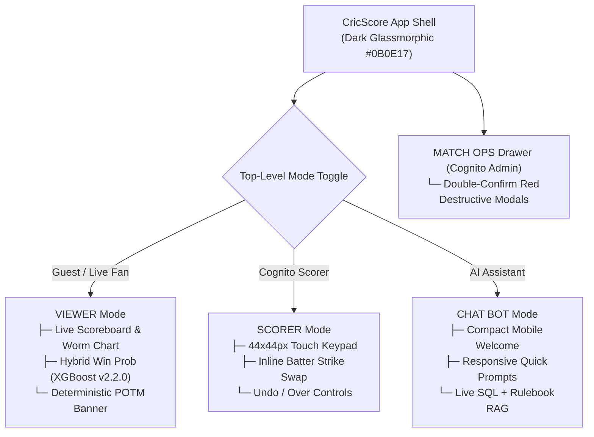

# 🎨 CricScore UI/UX Refinement Checklist & Design System

This guide defines the mobile-first UI/UX standards, accessibility guardrails, and component refinement checklist for the CricScore frontend (`apps/frontend`).

---

## 🧭 UI Architecture & Operational Modes



---

## 🎨 Core Design Tokens

| Token Category         | Specification                                         | Purpose                                                                 |
| ---------------------- | ----------------------------------------------------- | ----------------------------------------------------------------------- |
| **Primary Background** | `#0B0E17` (Deep Navy Glassmorphic)                    | Reduces eye strain and maximizes neon accent contrast on mobile screens |
| **Accent Highlights**  | Cyan (`#06B6D4`) & Purple (`#A855F7`)                 | Distinguishes active striker, current bowler, and live win-prob gauges  |
| **Touch Target Size**  | Minimum `44x44px` (`min-h-11 min-w-11`)               | Prevents mis-taps during rapid ball-by-ball outdoor scoring             |
| **Secondary Contrast** | `65%–70%` opacity (`text-slate-300` / ≥ `4.5:1` WCAG) | Ensures muted labels remain legible under direct outdoor sunlight       |
| **Iconography**        | Vector SVG icons (Lucide-React / inline SVG)          | Consistent cross-platform rendering instead of OS-dependent emojis      |

---

## ✅ Component Refinement Checklist

| Area                           | Requirement                                                                                      | Implementation Pattern                                                                               |
| ------------------------------ | ------------------------------------------------------------------------------------------------ | ---------------------------------------------------------------------------------------------------- |
| **1. Mobile Touch & Layout**   | Keep the Batter Strike Swap trigger aligned inline within the batter card row.                   | Right-aligned `44x44px` icon button inside the batter flex row; zero overlapping floating badges.    |
| **2. Header Bar Density**      | Prevent horizontal crowding on narrow portrait screens (`320px–390px`).                          | Collapse secondary controls into the slide-out drawer (`≡`) or stack mode pills cleanly.             |
| **3. Long Team/Player Names**  | Never clip team or player names with unreadable single-line ellipses on scorecards.              | Use `break-words`, multi-line stacking (`flex-col`), or responsive font scaling (`clamp()`).         |
| **4. Responsive Data Views**   | Avoid rigid horizontal table cutoffs in System Access and Scorecards on mobile viewports.        | Render mobile-first stacked cards on `< 640px` or wrap wide stat tables in `overflow-x-auto`.        |
| **5. Match Ops Safety**        | Guard destructive admin actions (`delete_guest_data`, `delete_incomplete_matches`) visually.     | Style with high-danger red borders (`border-red-500/60`) and require an explicit confirmation modal. |
| **6. ChatBot Mobile Viewport** | Keep initial ChatBot view compact on short mobile screens so the input bar is never pushed down. | Render a compact welcome header with wrapping quick-question chips (`PR #307`, `PR #327`).           |
| **7. Post-Match Summary**      | Display the deterministic Player of the Match award alongside AI commentary.                     | Rendered from `computePlayerOfTheMatch` (`summaryHandler.js`) so the award badge is always accurate. |

---

## ⚡ Runnable UI Verification Commands

```bash
# 1. Start the local Vite development server to inspect responsive viewports
npm run dev --prefix apps/frontend

# 2. Run the 151 Frontend unit & component tests (part of the 376 total test suite)
npm test --prefix apps/frontend

# 3. Run TypeScript type-checking and ESLint + Prettier check
npm run lint --prefix apps/frontend
```

---

## 📋 Copy-Paste Prompt for Future UI Polish Iterations

```text
Analyze and refine [Component / Screen Name] in apps/frontend for CricScore:
1. Theme: Dark-mode glassmorphic (#0B0E17 background, cyan/purple accents, crisp slate text).
2. Touch Targets: Minimum 44x44px touch area with zero overlapping floating elements.
3. Text Wrapping: Wrap or auto-scale long team/player names instead of truncating with ellipses.
4. Responsive Containers: Use stacked cards on mobile portrait (<640px) or overflow-x-auto for wide stat tables.
5. Admin Guardrails: Use explicit red danger outlines and confirmation modals for destructive Match Ops actions.
6. Sunlight Readability: Maintain >= 4.5:1 WCAG contrast (65-70% minimum opacity on secondary labels) and verify all 151 frontend Vitest tests pass.
```
