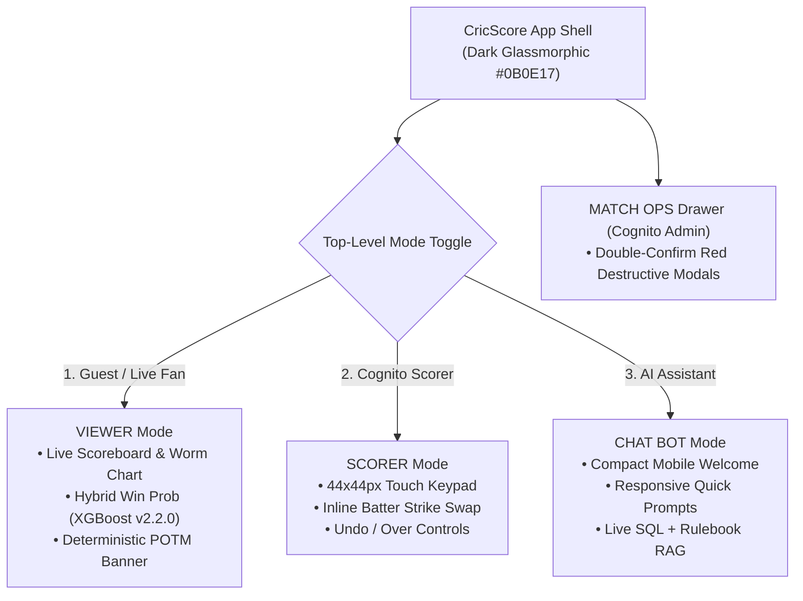

# 🎨 CricScore UI/UX Refinement Checklist & Design System

This guide defines the mobile-first UI/UX standards, accessibility guardrails, and component refinement checklist for the CricScore frontend (`apps/frontend`, verified by `151` Frontend Vitest tests out of **`376` unit tests** and **`15` Playwright E2E tests** across a **`~$1/month`** AWS + Aiven architecture).

---

## 🧭 UI Architecture & Operational Modes



---

## 🎨 Core Design Tokens

| Token Category         | Specification                                        |
| :--------------------- | :--------------------------------------------------- |
| **Primary Background** | `#0B0E17` (Deep Navy Glassmorphic)                   |
| **Accent Highlights**  | Cyan (`#06B6D4`) & Purple (`#A855F7`)                |
| **Touch Target Size**  | Minimum `44x44px` (`min-h-11 min-w-11`)              |
| **Secondary Contrast** | `65%–70%` opacity (`text-slate-300`, ≥ `4.5:1` WCAG) |
| **Iconography**        | Vector SVG icons (`Lucide-React` / inline SVG)       |

### Token Design Rationale

- **1. Primary Background (`#0B0E17`):**
  - Reduces eye strain during live matches and maximizes neon accent contrast on mobile screens.
- **2. Accent Highlights (`#06B6D4` Cyan & `#A855F7` Purple):**
  - Distinguishes the active striker and current bowler while highlighting live win-probability gauges (`XGBoost v2.2.0` served from `xgboost-cpu ~309 MB` with ECR `countNumber = 1`).
- **3. Touch Target Size (`44x44px` minimum):**
  - Prevents mis-taps during rapid ball-by-ball outdoor scoring on mobile phones.
- **4. Secondary Contrast (`65%–70%` opacity, ≥ `4.5:1` WCAG):**
  - Ensures muted labels remain legible under direct outdoor sunlight.
- **5. Vector Iconography (`Lucide-React` / inline SVG):**
  - Guarantees consistent cross-platform rendering instead of OS-dependent system emojis.

---

## ✅ Component Refinement Checklist

- **1. Mobile Touch & Layout (`MatchView.tsx`):**
  - **Requirement:** Keep the Batter Strike Swap trigger aligned inline within the batter card row.
  - **Implementation Pattern:** Use a right-aligned `44x44px` icon button inside the batter flex row with zero overlapping floating badges.
- **2. Header Bar Density (`App.tsx`):**
  - **Requirement:** Prevent horizontal crowding on narrow portrait screens (`320px–390px`).
  - **Implementation Pattern:** Collapse secondary controls into the slide-out drawer (`≡`) and stack mode pills cleanly on compact viewports.
- **3. Long Team & Player Names (`LiveScoreboard.tsx`, `Scoreboard.tsx`):**
  - **Requirement:** Never clip team or player names with unreadable single-line ellipses on scorecards.
  - **Implementation Pattern:** Use `break-words`, multi-line stacking (`flex-col`), and responsive font scaling (`clamp()`).
- **4. Responsive Data Views (`AdminPanel.tsx`, `Scoreboard.tsx`):**
  - **Requirement:** Avoid rigid horizontal table cutoffs in System Access and Scorecards on mobile viewports.
  - **Implementation Pattern:** Render mobile-first stacked cards on `< 640px` and wrap wide statistical tables in `overflow-x-auto`.
- **5. Match Ops Safety (`AdminPanel.tsx`):**
  - **Requirement:** Visually guard destructive admin actions (`delete_guest_data`, `delete_incomplete_matches`, `delete_test_matches`).
  - **Implementation Pattern:** Style buttons with high-danger red borders (`border-red-500/60`) and require an explicit double-confirmation modal.
- **6. ChatBot Mobile Viewport (`ChatComponent.tsx`):**
  - **Requirement:** Keep the initial ChatBot view compact on short mobile screens so the input bar is never pushed below the fold.
  - **Implementation Pattern:** Render a compact welcome header and wrapping quick-question chips (`PR #307`, `PR #327`).
- **7. Post-Match Summary (`LiveScoreboard.tsx`, `summaryHandler.js`):**
  - **Requirement:** Display the deterministic Player of the Match award alongside AI commentary.
  - **Implementation Pattern:** Render the award directly from `computePlayerOfTheMatch` (`summaryHandler.js`) so the POTM badge is 100% deterministic.

---

## ⚡ Runnable UI Verification Commands

```bash
# 1. Start the local Vite development server to inspect responsive viewports
npm run dev --prefix apps/frontend

# 2. Run the 151 Frontend unit & component tests (part of the 376 unit + 15 E2E test suite)
npm test --prefix apps/frontend

# 3. Run TypeScript type-checking and ESLint + Prettier check
npm run lint --prefix apps/frontend
```

---

## 📋 Copy-Paste Prompt for Future UI Polish Iterations

```text
Analyze and refine [Component / Screen Name] in apps/frontend for CricScore:
1. Theme: Dark-mode glassmorphic (#0B0E17 background, cyan/purple accents, crisp slate text).
2. Touch Targets: Minimum 44x44px touch area with zero overlapping floating elements.
3. Text Wrapping: Wrap or auto-scale long team/player names instead of truncating with ellipses.
4. Responsive Containers: Use stacked cards on mobile portrait (<640px) or overflow-x-auto for wide stat tables.
5. Admin Guardrails: Use explicit red danger outlines and confirmation modals for destructive Match Ops actions.
6. Sunlight Readability: Maintain >= 4.5:1 WCAG contrast (65-70% minimum opacity on secondary labels) and verify all 151 frontend Vitest tests pass.
```
