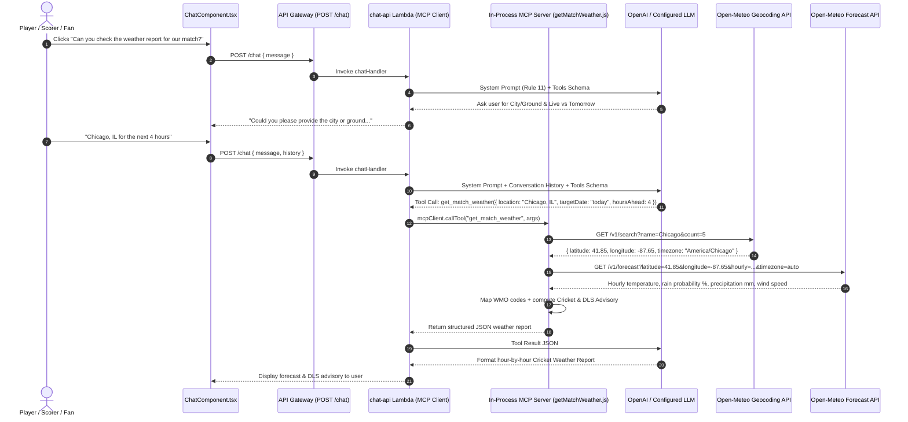

# 🌦️ Cricket Match Weather Report Agent & Open-Meteo Setup Guide

CricScore includes a **Cricket Match Weather Report Specialist Agent** integrated into the AI Chat Assistant via the **Model Context Protocol (MCP)**. Players, captains, umpires, and scorers can query **live hour-by-hour match weather** or **tomorrow's / upcoming match forecasts** for any city or ground worldwide with **zero API keys required**, keeping CricScore's cloud footprint at **~$1/month** across `dev` and `prod`.

---

## 🎯 1. Open-Meteo Integration Specifications

| Capability                   | Open-Meteo Endpoint / Feature                                      | CricScore Implementation Detail                                                                                                                                                                            |
| :--------------------------- | :----------------------------------------------------------------- | :--------------------------------------------------------------------------------------------------------------------------------------------------------------------------------------------------------- |
| **Licensing & Cost**         | `100% Free` for non-commercial / open-source use (no API key)      | Zero secrets or environment variables required in `.env.local`, Terraform, or GitHub Actions.                                                                                                              |
| **Global Geocoding**         | `GET https://geocoding-api.open-meteo.com/v1/search`               | Resolves `"Chicago, IL"`, `"Schaumburg"`, `"Dallas, TX"`, or `"London"` to `latitude`, `longitude`, and local IANA `timezone`.                                                                             |
| **City Token Fallback**      | `geocodeLocation()` in `getMatchWeather.js`                        | If `"City, State"` returns no direct hit, automatically retries with the primary city token and matches the state/country.                                                                                 |
| **Hourly Weather Telemetry** | `GET https://api.open-meteo.com/v1/forecast` (NOAA GFS/HRRR/ECMWF) | Fetches hourly `temperature_2m` (`°F` & `°C`), `apparent_temperature`, `precipitation_probability` (`%`), `precipitation` (`mm`), `relative_humidity_2m`, and `wind_speed_10m` / `wind_gusts_10m` (`mph`). |

---

## 💬 2. User Flows in the AI Chat Assistant

In the **AI Chat Assistant** (`ChatComponent.tsx`), users can click prompt chip **`6. "Can you check the weather report for our match?"`** or ask in natural language (`Rule 11` in `chatHandler.js` and `weather_node` in `apps/ai-service/cricscore_ai/graph.py`):

| Flow       | User Prompt Example                                                      | Tool Call Arguments                                                                     | Returned Forecast Window & Output                                                                                     |
| :--------- | :----------------------------------------------------------------------- | :-------------------------------------------------------------------------------------- | :-------------------------------------------------------------------------------------------------------------------- |
| **Flow A** | _"Can you check the weather report for our match?"_ (no city provided)   | ❌ **None** (asks user for location first; never guesses a city)                        | _"Could you please provide me with the city or ground where the match is taking place? Additionally, let me know..."_ |
| **Flow B** | _"What is the weather forecast for the next 4 hours in Schaumburg, IL?"_ | `get_match_weather({ location: "Schaumburg, IL", targetDate: "today", hoursAhead: 4 })` | Current conditions at the ground + next `4` hours hour-by-hour table + **Cricket & DLS Advisory**.                    |
| **Flow C** | _"How is the weather for tomorrow's match in Chicago?"_                  | `get_match_weather({ location: "Chicago", targetDate: "tomorrow" })`                    | Match-day daytime window (`08:00–21:00` local time) + peak rain/wind summary + **Cricket & DLS Advisory**.            |

### Tool Input Schema (`get_match_weather`)

| Parameter    | Type                | Default   | Allowed Values & Behavior                                                                                                 |
| :----------- | :------------------ | :-------- | :------------------------------------------------------------------------------------------------------------------------ |
| `location`   | `string` (required) | —         | City, town, or venue name (e.g., `"Chicago, IL"`, `"Schaumburg"`, `"Dallas"`).                                            |
| `targetDate` | `string` (optional) | `"today"` | `"today"` (live match next `N` hours), `"tomorrow"` (daytime window `08:00–21:00`), or `"YYYY-MM-DD"` (up to 7 days out). |
| `hoursAhead` | `number` (optional) | `6`       | Clamped to `1–24` hours ahead when `targetDate` is `"today"`.                                                             |

---

## 🏗️ 3. Architecture & Sequence Flow



---

## 🏏 4. Cricket & DLS Advisory Threshold Matrix

Inside `buildCricketAdvisory()` (`apps/backend/lambdas/chat-api/mcp/tools/getMatchWeather.js`), hourly metrics are translated into actionable cricket and Duckworth-Lewis-Stern (DLS) guidance:

| Condition Threshold                                   | Generated Cricket & DLS Advisory                                                                                                    |
| :---------------------------------------------------- | :---------------------------------------------------------------------------------------------------------------------------------- |
| **`maxRainProb >= 60%` OR `totalPrecipMm >= 2.0 mm`** | **High risk of rain interruption**: Recommends keeping **DLS par score projections** ready in case of overs reduction.              |
| **`maxRainProb >= 30%` OR `totalPrecipMm > 0 mm`**    | **Passing showers possible**: Notes that cloud cover and humidity may assist swing bowlers and advises monitoring for brief delays. |
| **`maxWindMph >= 20 mph`** (Dry)                      | **Breezy conditions**: Advises captains and bowlers to factor crosswinds into bowling ends and boundary defense.                    |
| **`maxRainProb < 30%` & Dry & `< 20 mph` wind**       | **Ideal cricket weather**: Full uninterrupted match likely without DLS rain delays.                                                 |

---

## 🧪 5. Key Files & Verification Commands

| Subsystem                          | File Path                                                                                                                                   | Responsibility                                                           |
| :--------------------------------- | :------------------------------------------------------------------------------------------------------------------------------------------ | :----------------------------------------------------------------------- |
| **Node.js MCP Weather Tool**       | [`apps/backend/lambdas/chat-api/mcp/tools/getMatchWeather.js`](../apps/backend/lambdas/chat-api/mcp/tools/getMatchWeather.js)               | Open-Meteo geocoding, hourly forecast slicing, WMO mapping, DLS advisory |
| **MCP Server Registry**            | [`apps/backend/lambdas/chat-api/mcp/server.js`](../apps/backend/lambdas/chat-api/mcp/server.js)                                             | Registers `get_match_weather` schema on the in-memory MCP server         |
| **Supervisor Routing (`Rule 11`)** | [`apps/backend/lambdas/chat-api/handlers/chatHandler.js`](../apps/backend/lambdas/chat-api/handlers/chatHandler.js)                         | Enforces location-clarification prompt before calling weather tool       |
| **Python LangGraph Specialist**    | [`apps/ai-service/cricscore_ai/tools.py`](../apps/ai-service/cricscore_ai/tools.py), [`graph.py`](../apps/ai-service/cricscore_ai/graph.py) | `get_match_weather` tool and `weather_node` specialist                   |
| **Frontend Chat UI**               | [`apps/frontend/src/components/ChatComponent.tsx`](../apps/frontend/src/components/ChatComponent.tsx)                                       | Surfaces prompt chip `#6` for one-click match weather checks             |

```bash
# 1. Run Backend MCP weather tool unit tests
npm --prefix apps/backend test -- --run

# 2. Run Python LangGraph multi-agent weather tests
./apps/ai-service/.venv/bin/pytest apps/ai-service -q

# 3. Run Frontend ChatComponent tests
npm --prefix apps/frontend test -- --run src/test/ChatComponent.test.tsx
```

---

## 🔗 Related Documentation

- [**AI Architecture (Agentic RAG & MCP)**](./ai_architecture.md)
- [**GitHub Issue Specialist Agent Guide**](./github_issue_agent.md)
- [**MLOps & DLS Par Score Guide**](./mlops_tutorial.md)
- [**Architecture & AI/MLOps FAQ**](./architecture_faq.md)
