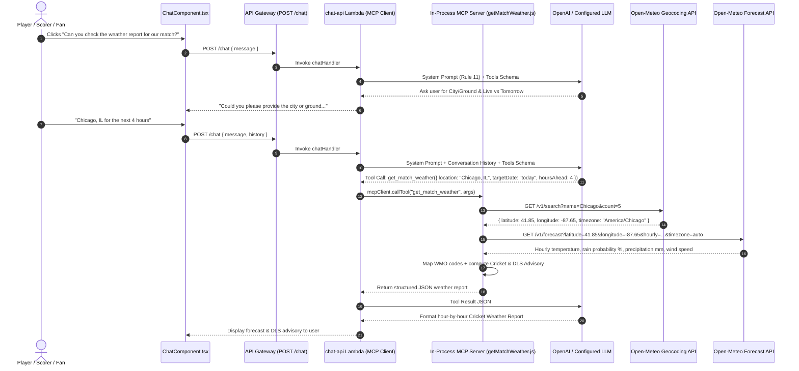

# 🌦️ Cricket Match Weather Report Agent & Open-Meteo Setup Guide

CricScore includes a **Cricket Match Weather Report Specialist Agent** integrated into the AI Chat Assistant via the **Model Context Protocol (MCP)**. Players, captains, umpires, and scorers can ask for **live hour-by-hour match weather** (for the next few hours while playing) or **tomorrow's / upcoming match forecasts** for any city or ground worldwide—completely **free of cost ($0/month)** with **zero API keys required**.

---

## 🎯 1. Overview & Zero-Cost Architecture

Weather is a critical factor in cricket—affecting toss decisions, swing/dew conditions, and **Duckworth-Lewis-Stern (DLS)** rain-interruption planning.

To keep CricScore's cloud operating cost at **$0**, the Weather Report Agent is powered by **[Open-Meteo](https://open-meteo.com/)**:

- **100% Free & Open-Source**: Requires no API key, no credit card, and no paid subscription.
- **Built-in Global Geocoding**: Resolves city names (`"Chicago, IL"`, `"Schaumburg"`, `"Dallas, TX"`, `"London"`) directly to latitude, longitude, and local timezone via `https://geocoding-api.open-meteo.com/v1/search`.
- **High-Resolution Hourly Forecasts**: Combines NOAA GFS, HRRR, and ECMWF weather models via `https://api.open-meteo.com/v1/forecast` to provide hourly temperature (`°F` & `°C`), "Feels Like" temperature, rain probability (`%`), precipitation (`mm`), humidity (`%`), and wind speed/gusts (`mph`).

---

## 💬 2. User Flows in the AI Chat Assistant

In the **AI Chat Assistant** (`ChatComponent.tsx`), users can click the default suggested question:

> **`6. "Can you check the weather report for our match?"`**

or ask directly in natural language.

### Flow A: Generic Weather Prompt (Asks for Location First)

If a user asks about match weather without specifying a location (e.g., clicking _"Can you check the weather report for our match?"_ or asking _"What is the weather for the next 3 hours?"_):

1. The agent (`Rule 11: WEATHER REPORT AGENT` in `chatHandler.js` and `weather_node` in `apps/ai-service/cricscore_ai/graph.py`) **does not** guess a location.
2. It replies:
   > _"Could you please provide me with the city or ground where the match is taking place? Additionally, let me know if you want the forecast for the next few hours (for a live match) or for tomorrow's match."_

### Flow B: Live Match Weather ("Next Few Hours")

When playing a live match (e.g., _"What is the weather forecast for the next 4 hours in Schaumburg, IL?"_):

- Calls `get_match_weather({ location: "Schaumburg, IL", targetDate: "today", hoursAhead: 4 })`.
- Returns current conditions at the ground plus the **next 4 hours** of hour-by-hour temperature, rain probability, wind speed, and a **Cricket & DLS Advisory**.

### Flow C: Tomorrow's / Upcoming Match Weather

When planning for an upcoming match (e.g., _"How is the weather for tomorrow's match in Chicago at 2 PM?"_):

- Calls `get_match_weather({ location: "Chicago", targetDate: "tomorrow" })` (or `"YYYY-MM-DD"`).
- Filters the match-day daytime window (`08:00–21:00` local time) so captains and players can inspect conditions around toss time and throughout both innings.

---

## 🏗️ 3. Architecture & Sequence Flow



---

## 🏏 4. Cricket & DLS Advisory Logic

Inside `buildCricketAdvisory()` (`apps/backend/lambdas/chat-api/mcp/tools/getMatchWeather.js`), hourly metrics are translated into actionable cricket guidance:

| Condition Threshold                                   | Generated Cricket & DLS Advisory                                                                                                    |
| :---------------------------------------------------- | :---------------------------------------------------------------------------------------------------------------------------------- |
| **`maxRainProb >= 60%` OR `totalPrecipMm >= 2.0 mm`** | **High risk of rain interruption**: Recommends keeping **DLS par score projections** ready in case of overs reduction.              |
| **`maxRainProb >= 30%` OR `totalPrecipMm > 0 mm`**    | **Passing showers possible**: Notes that cloud cover and humidity may assist swing bowlers and advises monitoring for brief delays. |
| **`maxWindMph >= 20 mph`** (Dry)                      | **Breezy conditions**: Advises captains and bowlers to factor crosswinds into bowling ends and boundary defense.                    |
| **`maxRainProb < 30%` & Dry & `< 20 mph` wind**       | **Ideal cricket weather**: Full uninterrupted match likely without DLS rain delays.                                                 |

---

## ⚙️ 5. Setup & Configuration

Because Open-Meteo requires **no API key**, the Weather Report Agent works out-of-the-box in both local development and AWS Lambda (`dev` and `prod`) with **zero environment variables or secrets to configure**.

### Tool Input Schema (`get_match_weather`)

| Parameter    | Type                | Default   | Description                                                                                                                                                                            |
| :----------- | :------------------ | :-------- | :------------------------------------------------------------------------------------------------------------------------------------------------------------------------------------- |
| `location`   | `string` (required) | —         | City, town, or venue name (e.g., `"Chicago, IL"`, `"Schaumburg"`, `"Dallas"`). If `"City, State"` is passed, `geocodeLocation()` automatically falls back to the city token if needed. |
| `targetDate` | `string` (optional) | `"today"` | `"today"` (live match next few hours), `"tomorrow"` (tomorrow's match-day window `08:00–21:00`), or `"YYYY-MM-DD"`.                                                                    |
| `hoursAhead` | `number` (optional) | `6`       | Number of hours ahead (`1–24`) to include when `targetDate` is `"today"`.                                                                                                              |

---

## 🧪 6. Key Files & Automated Tests

- **Node.js MCP Tool (`chat-api`)**:
  - Tool Implementation: [`apps/backend/lambdas/chat-api/mcp/tools/getMatchWeather.js`](../apps/backend/lambdas/chat-api/mcp/tools/getMatchWeather.js)
  - MCP Server Registration: [`apps/backend/lambdas/chat-api/mcp/server.js`](../apps/backend/lambdas/chat-api/mcp/server.js)
  - System Prompt Routing (`Rule 11`): [`apps/backend/lambdas/chat-api/handlers/chatHandler.js`](../apps/backend/lambdas/chat-api/handlers/chatHandler.js)
  - Unit Tests: [`apps/backend/lambdas/chat-api/mcp/tools/getMatchWeather.test.js`](../apps/backend/lambdas/chat-api/mcp/tools/getMatchWeather.test.js)
- **Python LangGraph Multi-Agent Service (`apps/ai-service`)**:
  - Intent & Tool: [`apps/ai-service/cricscore_ai/router.py`](../apps/ai-service/cricscore_ai/router.py), [`apps/ai-service/cricscore_ai/tools.py`](../apps/ai-service/cricscore_ai/tools.py), [`apps/ai-service/cricscore_ai/graph.py`](../apps/ai-service/cricscore_ai/graph.py), [`apps/ai-service/cricscore_ai/mcp_server.py`](../apps/ai-service/cricscore_ai/mcp_server.py)
- **Frontend UI (`apps/frontend`)**:
  - Suggested Prompt Chip: [`apps/frontend/src/components/ChatComponent.tsx`](../apps/frontend/src/components/ChatComponent.tsx)

### Run Tests Locally

```bash
# Backend MCP weather tool tests
npm --prefix apps/backend test -- --run

# Python LangGraph multi-agent tests
./apps/ai-service/.venv/bin/pytest apps/ai-service -q

# Frontend ChatComponent tests
npm --prefix apps/frontend test -- --run src/test/ChatComponent.test.tsx
```

---

## 🔗 Related Documentation

- [**AI Architecture (Agentic RAG & MCP)**](./ai_architecture.md)
- [**GitHub Issue Specialist Agent Guide**](./github_issue_agent.md)
- [**MLOps & DLS Par Score Guide**](./mlops_tutorial.md)
- [**Testing Strategy**](./testing.md)
