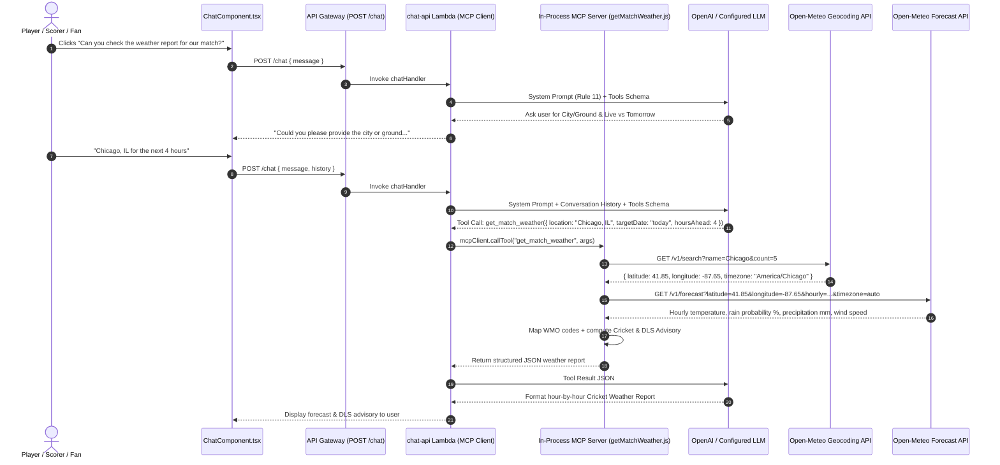

# 🌦️ Cricket Match Weather Report Agent & Open-Meteo Setup Guide

CricScore includes a **Cricket Match Weather Report Specialist Agent** integrated into the AI Chat Assistant via the **Model Context Protocol (MCP)**. Players, captains, umpires, and scorers can query **live hour-by-hour match weather** or **tomorrow's / upcoming match forecasts** for any city or ground worldwide with **zero API keys required**, keeping CricScore's cloud footprint at **~$1/month** across `dev` and `prod`.

---

## 🎯 1. Open-Meteo Integration Specifications

- **1. Licensing & Zero-Cost Footprint:**
  - **Endpoint / Policy:** `100% Free` public API for non-commercial / open-source use (no API key required).
  - **Implementation:** Requires zero secrets or environment variables in `.env.local`, Terraform, or GitHub Actions.
- **2. Global Geocoding (`GET https://geocoding-api.open-meteo.com/v1/search`):**
  - **Implementation:** Resolves `"Chicago, IL"`, `"Schaumburg"`, `"Dallas, TX"`, or `"London"` to exact `latitude`, `longitude`, and local IANA `timezone`.
- **3. City Token Fallback (`geocodeLocation()` in `getMatchWeather.js`):**
  - **Implementation:** If `"City, State"` returns no direct hit, automatically retries with the primary city token and filters candidates by matching `admin1` (state) or `country`.
- **4. Hourly Weather Telemetry (`GET https://api.open-meteo.com/v1/forecast`):**
  - **Implementation:** Powered by NOAA GFS/HRRR and ECMWF; fetches hourly `temperature_2m` (`°F` & `°C`), `apparent_temperature`, `relative_humidity_2m`, `precipitation_probability` (`%`), `precipitation` (`mm`), and `wind_speed_10m` (`mph`).

---

## 💬 2. User Flows in the AI Chat Assistant

In the **AI Chat Assistant** (`ChatComponent.tsx`), users can click prompt chip **`6. "Can you check the weather report for our match?"`** or ask in natural language (`Rule 11` in `chatHandler.js` and `weather_node` in `apps/ai-service/cricscore_ai/graph.py`):

- **Flow A — Generic Intent (No City Provided):**
  - **User Prompt:** _"Can you check the weather report for our match?"_
  - **Tool Call:** ❌ **None** (never guesses a city or ground).
  - **Agent Response:** Prompts the user for the city/ground and whether the match is live today (`next N hours`) or scheduled for tomorrow.
- **Flow B — Live Match Window (`today` + `hoursAhead`):**
  - **User Prompt:** _"What is the weather forecast for the next 4 hours in Schaumburg, IL?"_
  - **Tool Call:** `get_match_weather({ location: "Schaumburg, IL", targetDate: "today", hoursAhead: 4 })`.
  - **Agent Response:** Current conditions at the ground, next `4` hours hour-by-hour forecast, and a **Cricket & DLS Advisory**.
- **Flow C — Upcoming / Tomorrow Match Window (`tomorrow`):**
  - **User Prompt:** _"How is the weather for tomorrow's match in Chicago?"_
  - **Tool Call:** `get_match_weather({ location: "Chicago", targetDate: "tomorrow" })`.
  - **Agent Response:** Match-day daytime window (`08:00–21:00` local time), peak rain/wind summary, and a **Cricket & DLS Advisory**.

### Tool Input Schema (`get_match_weather`)

| Parameter    | Type     | Default   | Allowed Values                                           |
| :----------- | :------- | :-------- | :------------------------------------------------------- |
| `location`   | `string` | Required  | City, town, or venue (e.g., `"Chicago, IL"`, `"Dallas"`) |
| `targetDate` | `string` | `"today"` | `"today"`, `"tomorrow"`, or `"YYYY-MM-DD"` (7 days out)  |
| `hoursAhead` | `number` | `6`       | `1–24` hours ahead when `targetDate` is `"today"`        |

---

## 🏗️ 3. Architecture & Sequence Flow



---

## 🏏 4. Cricket & DLS Advisory Threshold Matrix

Inside `buildCricketAdvisory()` (`apps/backend/lambdas/chat-api/mcp/tools/getMatchWeather.js`), hourly metrics are translated into actionable cricket and Duckworth-Lewis-Stern (DLS) guidance:

- **1. High Rain Risk (`maxRainProb >= 60%` OR `totalPrecipMm >= 2.0 mm`):**
  - **Advisory:** Flags **High risk of rain interruption** and recommends keeping **DLS par score projections** ready in case of overs reduction.
- **2. Moderate Shower Risk (`maxRainProb >= 30%` OR `totalPrecipMm > 0 mm`):**
  - **Advisory:** Flags **Passing showers possible**, notes that cloud cover and humidity may assist swing bowlers, and advises monitoring for brief delays.
- **3. Breezy Conditions (`maxWindMph >= 20 mph` & Dry):**
  - **Advisory:** Flags **Breezy conditions** and advises captains and bowlers to factor crosswinds into bowling ends and boundary defense.
- **4. Clear Conditions (`maxRainProb < 30%` & Dry & `< 20 mph` Wind):**
  - **Advisory:** Confirms **Ideal cricket weather** where a full uninterrupted match is likely without DLS rain delays.

---

## 🧪 5. Key Files & Verification Commands

- **1. Node.js MCP Weather Tool ([`getMatchWeather.js`](../apps/backend/lambdas/chat-api/mcp/tools/getMatchWeather.js)):**
  - Open-Meteo geocoding, city-token fallback, hourly forecast slicing, WMO code mapping, and DLS advisory generation.
- **2. MCP Server Registry ([`server.js`](../apps/backend/lambdas/chat-api/mcp/server.js)):**
  - Registers the `get_match_weather` tool schema on the in-memory MCP server.
- **3. Supervisor Routing — `Rule 11` ([`chatHandler.js`](../apps/backend/lambdas/chat-api/handlers/chatHandler.js)):**
  - Enforces the location-clarification prompt before calling the weather tool.
- **4. Python LangGraph Specialist ([`tools.py`](../apps/ai-service/cricscore_ai/tools.py), [`graph.py`](../apps/ai-service/cricscore_ai/graph.py)):**
  - Implements the `get_match_weather` tool and runs the `weather_node` specialist agent.
- **5. Frontend Chat UI ([`ChatComponent.tsx`](../apps/frontend/src/components/ChatComponent.tsx)):**
  - Surfaces prompt chip `#6` for one-click match weather checks.

```bash
# 1. Run Backend MCP weather tool unit tests (part of 376 unit tests and 15 E2E tests)
npm --prefix apps/backend test -- --run

# 2. Run Python LangGraph multi-agent weather tests
./apps/ai-service/.venv/bin/pytest apps/ai-service -q

# 3. Run Frontend ChatComponent tests
npm --prefix apps/frontend test -- --run src/test/ChatComponent.test.tsx
```

---

## 🔗 Related Documentation

- [**AI Architecture (Agentic RAG & MCP)**](./ai_architecture.md) — End-to-end multi-agent MCP supervisor, `pgvector` RAG, and deterministic POTM engine.
- [**GitHub Issue Specialist Agent Guide**](./github_issue_agent.md) — Conversational 2-step bug/feature issue filing with server-side rate limiting.
- [**MLOps & DLS Par Score Guide**](./mlops_tutorial.md) — How rain interruptions adjust target scores using the Duckworth-Lewis-Stern (DLS) resource table.
- [**Architecture & AI/MLOps FAQ**](./architecture_faq.md) — Deep-dive Q&A on specialist agent orchestration and hybrid win-probability math.
