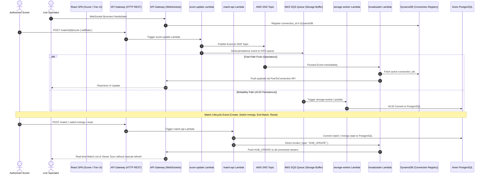

# ⚡ Real-Time WebSockets & Event Fan-Out Tutorial (SNS + SQS)

Hands-on architectural guide to CricScore's **Real-Time Event-Driven Engine**, combining an **AWS SNS + WebSocket Fast-Path** with an **AWS SQS FIFO + PostgreSQL Persistence Path**.

---

## 🎯 Architecture & Data Flow



---

## 🚀 Dual-Path Event Architecture

| Path                      | Pipeline Hop Sequence                                                                                                              | Primary Responsibility                                                                                                             | Latency & Delivery Characteristics                                                             |
| :------------------------ | :--------------------------------------------------------------------------------------------------------------------------------- | :--------------------------------------------------------------------------------------------------------------------------------- | :--------------------------------------------------------------------------------------------- |
| **1. Fast-Path Fan-Out**  | • `Scorer UI` ➔ `POST /match/{id}/score` ➔ `score-update`<br/>• `SNS Topic` ➔ `broadcaster` ➔ `DynamoDB Scan` ➔ `WebSocket`        | • Streams live ball-by-ball updates (`LIVE_SCORE_UPDATE`) to all connected spectators<br/>• Bypasses database I/O on the push path | • Sub-second fan-out<br/>• Parallel `PostToConnectionCommand` calls                            |
| **2. Persistence Path**   | • `Scorer UI` ➔ `POST /match/{id}/score` ➔ `score-update`<br/>• `SQS FIFO (storage_buffer.fifo)` ➔ `storage-worker` ➔ `PostgreSQL` | • Commits deliveries (`balls` table) and cumulative totals (`innings` table)<br/>• Enforces strict ball order (`MessageGroupId`)   | • Ordered FIFO processing (`batch_size = 1`)<br/>• Content-based deduplication & 24h retention |
| **3. Lifecycle Hub Sync** | • `Scorer UI` ➔ `match-api` ➔ `Aiven PostgreSQL`<br/>• Direct Invoke `broadcaster` (`{ type: "HUB_UPDATE" }`) ➔ `Spectators`       | • Broadcasts match creation, toss/innings switches, completion, and resets<br/>• Synchronizes all active viewers immediately       | • Instant UI list & scorecard state transition<br/>• No manual browser refresh required        |

---

## 🔌 WebSocket Connection Lifecycle (DynamoDB Tracking)

| Event / Trigger         | Route / Handler                                  | DynamoDB Operation (`<project>-ws-connections`)                                 | Payload / Error Handling                                                |
| :---------------------- | :----------------------------------------------- | :------------------------------------------------------------------------------ | :---------------------------------------------------------------------- |
| **Client Connects**     | `$connect` ➔ `onconnect` Lambda                  | `PutItem`: stores `{ connection_id, timestamp }`                                | • Returns `200 Connected`<br/>• Establishes `wss://ws.<domain>` session |
| **Client Disconnects**  | `$disconnect` ➔ `ondisconnect` Lambda            | `DeleteItem`: deletes `{ connection_id }`                                       | • Triggered automatically when a spectator closes the browser tab       |
| **Abrupt Network Drop** | `broadcaster` Lambda (`PostToConnectionCommand`) | `DeleteItem`: deletes stale `{ connection_id }` on `GoneException` (`HTTP 410`) | • Self-heals the DynamoDB connection registry during every broadcast    |

---

## 💻 Core Lambda Implementation

### 1. Publishing to SNS & SQS FIFO (`apps/backend/lambdas/score-update/index.js`)

```javascript
import { SNSClient, PublishCommand } from "@aws-sdk/client-sns";
import { SQSClient, SendMessageCommand } from "@aws-sdk/client-sqs";

const sns = new SNSClient({});
const sqs = new SQSClient({});

// 1. Fast-Path: Publish to SNS Topic for immediate WebSocket broadcast
await sns.send(
  new PublishCommand({
    TopicArn: process.env.MATCH_EVENTS_TOPIC,
    Message: JSON.stringify(eventPayload),
    MessageAttributes: {
      eventType: { DataType: "String", StringValue: "BALL_SCORED" },
    },
  }),
);

// 2. Reliability Path: Enqueue in SQS FIFO for ordered PostgreSQL persistence
await sqs.send(
  new SendMessageCommand({
    QueueUrl: process.env.STORAGE_BUFFER_QUEUE,
    MessageBody: JSON.stringify(eventPayload),
    MessageGroupId: String(matchId), // Strict FIFO ordering per match
  }),
);
```

### 2. Parallel WebSocket Fan-Out & Stale Pruning (`apps/backend/lambdas/broadcaster/index.js`)

```javascript
import {
  ApiGatewayManagementApiClient,
  PostToConnectionCommand,
} from "@aws-sdk/client-apigatewaymanagementapi";
import { DynamoDBClient } from "@aws-sdk/client-dynamodb";
import {
  DynamoDBDocumentClient,
  ScanCommand,
  DeleteCommand,
} from "@aws-sdk/lib-dynamodb";

const ddb = DynamoDBDocumentClient.from(new DynamoDBClient({}));
const apiGw = new ApiGatewayManagementApiClient({
  endpoint: process.env.WEBSOCKET_URL.replace("wss://", "https://"),
});

export const handler = async (event) => {
  // Supports both SNS topic records and direct HUB_UPDATE invocations from match-api
  const message = event.Records
    ? event.Records[0].Sns.Message
    : JSON.stringify(event);

  const { Items = [] } = await ddb.send(
    new ScanCommand({ TableName: process.env.TABLE_NAME }),
  );

  await Promise.all(
    Items.map(async ({ connection_id }) => {
      try {
        await apiGw.send(
          new PostToConnectionCommand({
            ConnectionId: connection_id,
            Data: message,
          }),
        );
      } catch (err) {
        if (err.statusCode === 410 || err.name === "GoneException") {
          await ddb.send(
            new DeleteCommand({
              TableName: process.env.TABLE_NAME,
              Key: { connection_id },
            }),
          );
        }
      }
    }),
  );

  return { statusCode: 200, body: "Broadcast complete." };
};
```

---

## 🛡️ State Reconciliation & Reliability Guarantees

| Mechanism                 | Problem Solved                                                                                                      | Implementation Detail                                                                                                                                                            |
| :------------------------ | :------------------------------------------------------------------------------------------------------------------ | :------------------------------------------------------------------------------------------------------------------------------------------------------------------------------- |
| **Authoritative Totals**  | • Prevents score drift or double-counting if SQS FIFO batching lags slightly behind the Fast-Path WebSocket push    | • Scorer UI sends `explicitTotalRuns`, `explicitTotalWickets`, `overs`, and `balls` on every delivery and undo<br/>• Both `storage-worker` and `LiveScoreboard` reconcile totals |
| **Batter Attribution**    | • On odd-run deliveries (`1`, `3`) or end-of-over strike changes, post-delivery `strikerName` is the _next_ striker | • `LiveScoreboard` attributes runs and balls faced strictly to `ballData.batterName`<br/>• Updates active crease positions (`strikerName` / `nonStrikerName`) afterward          |
| **Recency Guard**         | • Prevents a slightly lagging REST poll read from briefly reverting a live boundary or 2nd-innings score            | • `LiveScoreboard` records `lastWsScoreUpdateAtRef` on every WebSocket frame<br/>• Applies monotonic reconciliation (`Math.max(old.totalRuns, inn.totalRuns, playerRunsSum)`)    |
| **Multi-Innings Routing** | • Handles rapid 2nd-innings scoring before the client receives the database primary key for the new inning row      | • `storage-worker` resolves the canonical inning row via `WHERE match_id = $1 AND inning_number = $2`                                                                            |
| **Atomic Real-Time Undo** | • Ensures undoing a ball updates both PostgreSQL and all connected spectators in lockstep                           | • `score-update` broadcasts `undo: true` with restored cumulative totals<br/>• `storage-worker` deletes the latest `balls` record and updates `innings` atomically               |

---

## 🧪 Testing WebSockets Interactively (`wscat`)

```bash
# 1. Install wscat globally (or run via npx)
npm install -g wscat

# 2. Get the deployed WebSocket URL from Terraform outputs
WS_URL=$(terraform -chdir=infra/terraform output -raw websocket_url)

# 3. Open an interactive WebSocket spectator session
wscat -c "$WS_URL"

# 4. Inspect active connection IDs in DynamoDB
aws dynamodb scan --table-name cricscoredev-ws-connections --region us-east-1
```

---

© 2026 CricScore Real-Time Engineering. 🏎️🏁🚀
