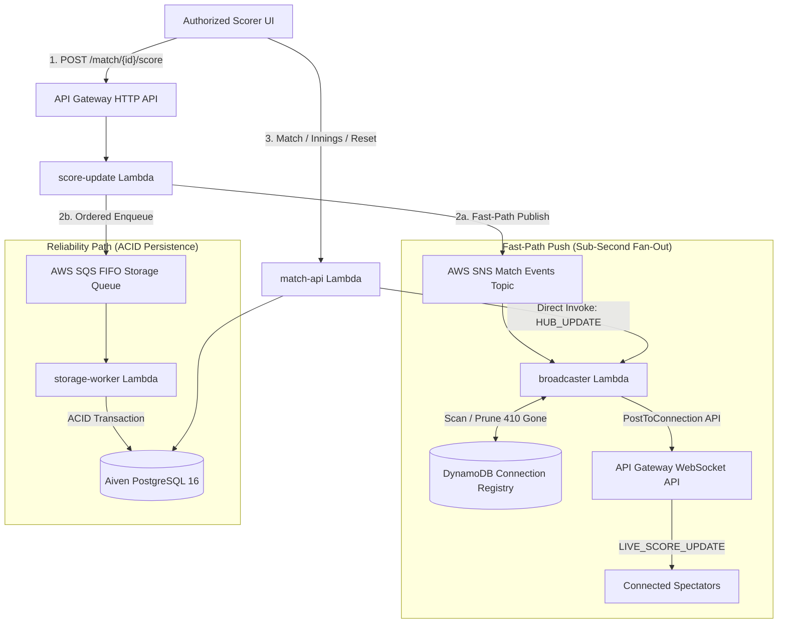

# ⚡ Real-Time WebSockets & Event Fan-Out Tutorial (SNS + SQS)

Hands-on architectural guide to CricScore's **Real-Time Event-Driven Engine**, combining an **AWS SNS + WebSocket Fast-Path** with an **AWS SQS FIFO + PostgreSQL Persistence Path** (`~$1/month` combined AWS run rate across `dev` + `prod`).

---

## 🎯 Architecture & Data Flow



---

## 🚀 Dual-Path Event Architecture

1. **Fast-Path Fan-Out (`Scorer UI` ➔ `POST /match/{id}/score` ➔ `score-update` ➔ `SNS` ➔ `broadcaster` ➔ `WebSocket`):**
   - Streams live ball-by-ball updates (`LIVE_SCORE_UPDATE`) to all connected spectators in sub-second latency.
   - Bypasses relational database I/O on the push path and fans out via parallel `PostToConnectionCommand` calls.
2. **Persistence Path (`Scorer UI` ➔ `POST /match/{id}/score` ➔ `score-update` ➔ `SQS FIFO` ➔ `storage-worker` ➔ `PostgreSQL`):**
   - Enqueues events in `storage_buffer.fifo` with content-based deduplication, 24-hour retention, and `batch_size = 1`.
   - Enforces strict per-match ball ordering (`MessageGroupId = String(matchId)`) before committing to the `balls` and `innings` tables.
3. **Lifecycle Hub Sync (`Scorer UI` ➔ `match-api` ➔ `PostgreSQL` ➔ Direct Invoke `broadcaster`):**
   - Broadcasts match creation, toss/innings switches, match completion, and resets via `{ type: "HUB_UPDATE" }`.
   - Synchronizes all active viewers immediately without requiring a manual browser refresh.

---

## 🔌 WebSocket Connection Lifecycle (DynamoDB Tracking)

| Event                    | Route / Handler                    | DynamoDB Operation                         |
| :----------------------- | :--------------------------------- | :----------------------------------------- |
| **Client Connects**      | `$connect` ➔ `onconnect`           | `PutItem` (`{ connection_id, timestamp }`) |
| **Client Disconnects**   | `$disconnect` ➔ `ondisconnect`     | `DeleteItem` (`{ connection_id }`)         |
| **Stale Socket (`410`)** | `broadcaster` (`PostToConnection`) | `DeleteItem` on `GoneException`            |

- **Self-Healing Registry (`<project>-ws-connections`):**
  - When a spectator connects over `wss://ws.<domain>`, `onconnect` records their `connection_id` and returns `200 Connected`.
  - If a client drops abruptly without a clean `$disconnect`, `broadcaster` catches `GoneException` (`HTTP 410`) during the next broadcast and automatically prunes the stale `connection_id` from DynamoDB.

---

## 💻 Core Lambda Implementation

### 1. Publishing to SNS & SQS FIFO (`apps/backend/lambdas/score-update/index.js`)

```javascript
import { SNSClient, PublishCommand } from "@aws-sdk/client-sns";
import { SQSClient, SendMessageCommand } from "@aws-sdk/client-sqs";

const sns = new SNSClient({});
const sqs = new SQSClient({});

// 1. Fast-Path: Publish to SNS Topic for immediate WebSocket broadcast
await sns.send(
  new PublishCommand({
    TopicArn: process.env.MATCH_EVENTS_TOPIC,
    Message: JSON.stringify(eventPayload),
    MessageAttributes: {
      eventType: { DataType: "String", StringValue: "BALL_SCORED" },
    },
  }),
);

// 2. Reliability Path: Enqueue in SQS FIFO for ordered PostgreSQL persistence
await sqs.send(
  new SendMessageCommand({
    QueueUrl: process.env.STORAGE_BUFFER_QUEUE,
    MessageBody: JSON.stringify(eventPayload),
    MessageGroupId: String(matchId), // Strict FIFO ordering per match
  }),
);
```

### 2. Parallel WebSocket Fan-Out & Stale Pruning (`apps/backend/lambdas/broadcaster/index.js`)

```javascript
import {
  ApiGatewayManagementApiClient,
  PostToConnectionCommand,
} from "@aws-sdk/client-apigatewaymanagementapi";
import { DynamoDBClient } from "@aws-sdk/client-dynamodb";
import {
  DynamoDBDocumentClient,
  ScanCommand,
  DeleteCommand,
} from "@aws-sdk/lib-dynamodb";

const ddb = DynamoDBDocumentClient.from(new DynamoDBClient({}));
const apiGw = new ApiGatewayManagementApiClient({
  endpoint: process.env.WEBSOCKET_URL.replace("wss://", "https://"),
});

export const handler = async (event) => {
  // Supports both SNS topic records and direct HUB_UPDATE invocations from match-api
  const message = event.Records
    ? event.Records[0].Sns.Message
    : JSON.stringify(event);

  const { Items = [] } = await ddb.send(
    new ScanCommand({ TableName: process.env.TABLE_NAME }),
  );

  await Promise.all(
    Items.map(async ({ connection_id }) => {
      try {
        await apiGw.send(
          new PostToConnectionCommand({
            ConnectionId: connection_id,
            Data: message,
          }),
        );
      } catch (err) {
        if (err.statusCode === 410 || err.name === "GoneException") {
          await ddb.send(
            new DeleteCommand({
              TableName: process.env.TABLE_NAME,
              Key: { connection_id },
            }),
          );
        }
      }
    }),
  );

  return { statusCode: 200, body: "Broadcast complete." };
};
```

---

## 🛡️ State Reconciliation & Reliability Guarantees

- **Authoritative Totals (`explicitTotalRuns`, `explicitTotalWickets`, `overs`, `balls`):**
  - Sent by the Scorer UI on every delivery and undo so both `storage-worker` and `LiveScoreboard` reconcile authoritative totals even if SQS FIFO batching lags slightly behind the Fast-Path WebSocket push.
- **Batter Attribution (`ballData.batterName`):**
  - On odd-run deliveries (`1`, `3`) or end-of-over strike changes, post-delivery `strikerName` reflects the _next_ striker. `LiveScoreboard` attributes runs and balls faced strictly to `ballData.batterName` before updating active crease positions (`strikerName` / `nonStrikerName`).
- **Monotonic Recency Guard (`lastWsScoreUpdateAtRef`):**
  - Prevents a slightly lagging REST poll read from briefly reverting a live boundary or 2nd-innings score by applying monotonic reconciliation (`Math.max(old.totalRuns, inn.totalRuns, playerRunsSum)`).
- **Multi-Innings Routing (`WHERE match_id = $1 AND inning_number = $2`):**
  - Resolves the canonical inning row in `storage-worker` during rapid 2nd-innings scoring before the client receives the database primary key for the new inning row.
- **Atomic Real-Time Undo (`undo: true`):**
  - `score-update` broadcasts `undo: true` with restored cumulative totals while `storage-worker` deletes the latest `balls` record and updates `innings` atomically in PostgreSQL.

---

## 🧪 Testing WebSockets Interactively (`wscat`)

```bash
# 1. Install wscat globally (or run via npx)
npm install -g wscat

# 2. Get the deployed WebSocket URL from Terraform outputs
WS_URL=$(terraform -chdir=infra/terraform output -raw websocket_url)

# 3. Open an interactive WebSocket spectator session
wscat -c "$WS_URL"

# 4. Inspect active connection IDs in DynamoDB
aws dynamodb scan --table-name cricscoredev-ws-connections --region us-east-1
```

---

© 2026 CricScore Real-Time Engineering. 🏎️🏁🚀
